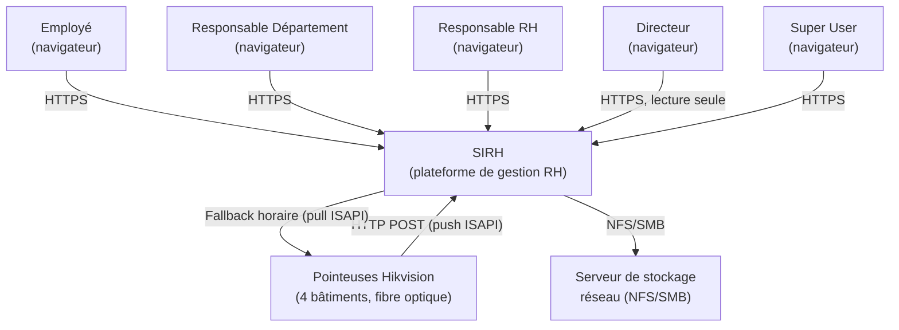
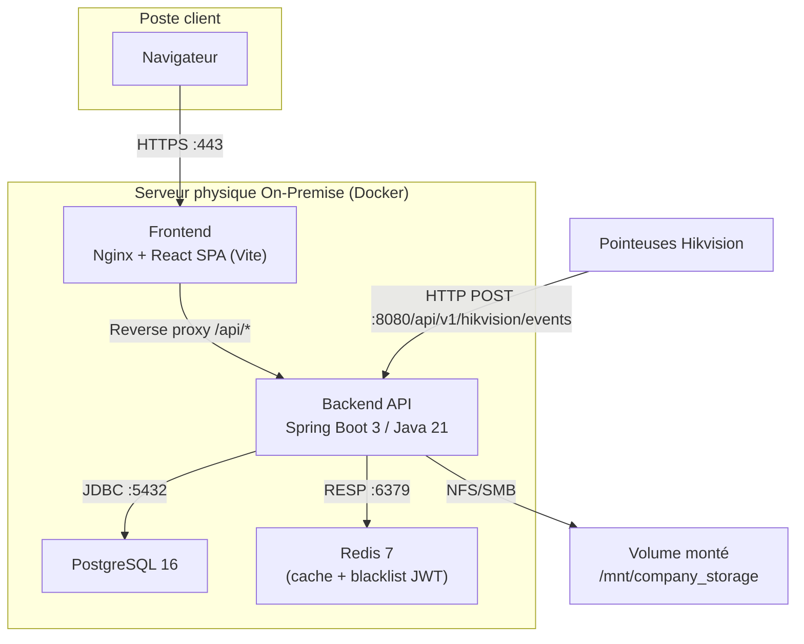
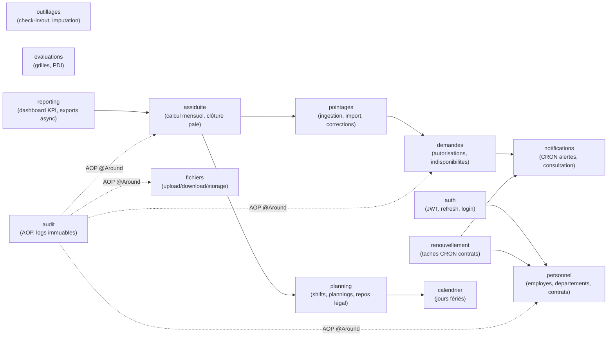
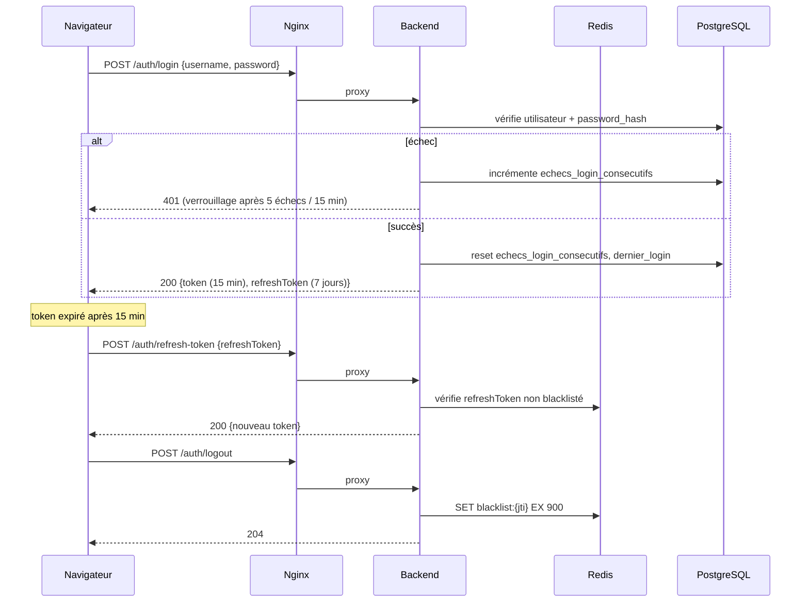

# Architecture Technique — SIRH

**Statut** : Phase 1 (Exploration). Source de vérité pour le schéma et les endpoints : `docs/specs/cahier-technique.md` (v2). Ce document formalise l'architecture qui en découle et tranche les points d'infrastructure encore ouverts à l'issue de l'audit (`docs/specs/audit-rapport.md`, constats 11 et 12).

---

## 1. Vue C4 — Niveau 1 : Contexte système

**5 rôles** consomment le même système, avec des permissions strictement différenciées côté backend (§7 de ce document). Aucun système tiers externe (paie, SIRH externe) n'est intégré dans ce périmètre — les champs `matricule_paie` servent uniquement de clé de correspondance pour un export ultérieur, pas d'API bidirectionnelle.

---

## 2. Vue C4 — Niveau 2 : Conteneurs

**Rôle de chaque conteneur** :
- `frontend-ui` : sert le build statique React et fait office de reverse proxy TLS vers le backend (une seule origine exposée en `:443`, évite tout souci CORS en production).
- `backend-api` : seul conteneur avec accès direct à Postgres/Redis/volume réseau.
- `postgres-db` : source de vérité, schéma versionné par Flyway (§6).
- `redis-broker` : rôle **volontairement restreint** — cache applicatif + révocation de tokens (§7), **pas** de file de jobs (voir justification §7).

---

## 3. Vue C4 — Niveau 3 : Composants Backend (packages Spring)

Chaque package correspond à un module fonctionnel du CDF (§2.3) et embarque son propre `entity/repository/service/controller/dto`. `audit` n'est pas un module métier mais une **coupe transversale** (aspect Spring AOP) qui intercepte les actions sensibles listées en §9.

---

## 4. Modèle de données consolidé (ERD)

Reflète intégralement le schéma corrigé de `cahier-technique.md` §3 (23 tables).

```mermaid
erDiagram
    DEPARTEMENTS ||--o{ EMPLOYES : "rattache"
    EMPLOYES ||--o| DEPARTEMENTS : "manage (manager_id)"
    EMPLOYES ||--o{ CONTRATS : "historique"
    EMPLOYES ||--|| UTILISATEURS : "compte"
    EMPLOYES ||--o{ EVENEMENTS_360 : "timeline"
    EMPLOYES ||--o{ POINTAGES_BRUTS : "pointe"
    EMPLOYES ||--o{ PLANNINGS : "planifié"
    EMPLOYES ||--o{ AUTORISATIONS : "concerné par"
    EMPLOYES ||--o{ INDISPONIBILITES : "concerné par"
    EMPLOYES ||--o{ HISTORIQUE_SOLDES : "solde"
    EMPLOYES ||--o{ OUTILLAGE_MOUVEMENTS : "reçoit/restitue"
    EMPLOYES ||--o{ TACHES_RENOUVELLEMENT : "concerné par"
    EMPLOYES ||--o{ EVALUATIONS : "évalué"

    POINTEUSES ||--o{ POINTAGES_BRUTS : "émet"
    SHIFTS ||--o{ PLANNINGS : "modèle de"
    AUTORISATIONS ||--o{ POINTAGES_BRUTS : "justifie"
    CONTRATS ||--o{ TACHES_RENOUVELLEMENT : "échéance de"
    OUTILLAGES ||--o{ OUTILLAGE_MOUVEMENTS : "historique"
    UTILISATEURS ||--o{ FICHIERS : "téléverse"
    UTILISATEURS ||--o{ ASYNC_JOBS : "déclenche"
    UTILISATEURS ||--o{ AUDIT_LOGS : "trace"
    UTILISATEURS ||--o{ NOTIFICATIONS : "reçoit"
    EVALUATIONS ||--o{ EVALUATION_COMPETENCES : "note"
    EVALUATIONS ||--o{ PLANS_DEVELOPPEMENT : "génère"

    DEPARTEMENTS {
        bigint id PK
        varchar nom
        bigint manager_id FK
    }
    EMPLOYES {
        uuid id PK
        varchar matricule_interne
        varchar matricule_cnss
        varchar matricule_paie
        bigint departement_id FK
        varchar type_contrat
        boolean actif
    }
    CONTRATS {
        bigint id PK
        uuid employe_id FK
        varchar type
        varchar statut
        varchar motif_fin
    }
    UTILISATEURS {
        bigint id PK
        bigint employe_id FK
        varchar role "5 valeurs"
        boolean compte_actif
        int echecs_login_consecutifs
    }
    SHIFTS {
        bigint id PK
        varchar type_rotation
        time heure_debut
        time heure_fin
    }
    PLANNINGS {
        bigint id PK
        uuid employe_id FK
        bigint shift_id FK
        varchar statut
    }
    POINTAGES_BRUTS {
        bigint id PK
        uuid employe_id FK
        bigint pointeuse_id FK
        varchar statut
        bigint autorisation_id FK
    }
    AUTORISATIONS {
        bigint id PK
        uuid employe_id FK
        varchar type
        varchar statut
        varchar cree_par_role
        varchar avis_manager_statut
    }
    INDISPONIBILITES {
        bigint id PK
        uuid employe_id FK
        varchar type_indisponibilite
        varchar statut
    }
    HISTORIQUE_SOLDES {
        bigint id PK
        uuid employe_id FK
        numeric delta_jours
        varchar motif
    }
    OUTILLAGES {
        bigint id PK
        varchar code_barres
        varchar etat
    }
    OUTILLAGE_MOUVEMENTS {
        bigint id PK
        bigint outillage_id FK
        varchar type_mouvement
        numeric montant_imputation
    }
    FICHIERS {
        bigint id PK
        varchar categorie
        varchar entite_type
    }
    ASYNC_JOBS {
        bigint id PK
        varchar type
        varchar statut
        jsonb parametres
    }
    AUDIT_LOGS {
        bigint id PK
        bigint utilisateur_id FK
        varchar action
        jsonb anciennes_valeurs
        jsonb nouvelles_valeurs
    }
    NOTIFICATIONS {
        bigint id PK
        bigint destinataire_id FK
        varchar type
        boolean lue
    }
    JOURS_FERIES {
        bigint id PK
        date date
        varchar type
    }
    TACHES_RENOUVELLEMENT {
        bigint id PK
        uuid employe_id FK
        bigint contrat_id FK
        varchar statut
    }
    EVALUATIONS {
        bigint id PK
        uuid employe_id FK
        uuid manager_id FK
        int annee
        varchar statut
    }
    EVALUATION_COMPETENCES {
        bigint id PK
        bigint evaluation_id FK
        numeric note
        numeric seuil_exigence
    }
    PLANS_DEVELOPPEMENT {
        bigint id PK
        bigint evaluation_id FK
        varchar statut
    }
```

---

## 5. Flux d'authentification (JWT + refresh)

**Décisions** :
- Access token JWT : 15 minutes de durée de vie, claims détaillés en `cahier-technique.md` §2.3 (`role`, `employeId`, `departementId`).
- Refresh token : 7 jours, stocké côté client (le CDC-T ne prévoit pas de cookie httpOnly — à réévaluer si un audit sécurité l'exige, hors périmètre V1).
- Révocation au logout : le `jti` (JWT ID) de l'access token est ajouté à une blacklist Redis avec un TTL égal au temps restant avant expiration naturelle — **c'est le seul usage de Redis autre que le cache** (tranche le constat 11).
- Verrouillage de compte (constat 22) : `utilisateurs.echecs_login_consecutifs` + `verrouille_jusqu_a`, incrémenté/vérifié à chaque tentative, réinitialisé au succès.

---

## 6. Stratégie de migration de schéma — Flyway (constat 12)

- Outil : **Flyway**, exécuté automatiquement au démarrage du conteneur `backend-api` (`spring.flyway.enabled=true`).
- Emplacement : `backend/src/main/resources/db/migration/`.
- Convention : `V<n>__<description_snake_case>.sql`, jamais de modification d'un script déjà appliqué en environnement partagé (toute correction = nouveau `Vn+1`).
- `V1__init_schema.sql` = intégralité du schéma corrigé de `cahier-technique.md` §3 (23 tables), c'est le premier commit backend.
- `.env.example` fourni à la racine avec `DB_PASSWORD`, `JWT_SECRET`, `JWT_REFRESH_SECRET` — jamais commité en clair (`.env` dans `.gitignore`).

---

## 7. Stratégie des jobs asynchrones & rôle de Redis (constat 11 tranché)

**Décision** : pas de file de jobs dédiée (ni Redis pub/sub, ni RabbitMQ) pour cette version. Justification : déploiement mono-instance on-premise, volumétrie modeste (import ≤ 1500 lignes, ~25 employés dans les exemples du CDC-T) — une file de messages ajouterait de la complexité opérationnelle sans bénéfice mesurable.

**Mécanisme retenu** :
- `@Async` (Spring `ThreadPoolTaskExecutor` dédié, pool borné) pour l'exécution des imports Excel et de la génération de rapports.
- `@Scheduled` (cron Spring natif) pour : fallback horaire Hikvision, alertes hebdo/mensuelles (Module 11), génération des tâches de renouvellement (Module 12), purge/archivage à 12 mois (Module 7), verrouillage automatique des tâches de renouvellement expirées, incrémentation mensuelle du solde de congés (Module 8, Lot 5 — `IncrementationSoldeScheduler`, 1er du mois, taux relu depuis `parametres_globaux` à chaque exécution, cf. `cahier-technique.md` §3.24).
- Table `async_jobs` comme **unique source de vérité de suivi** (statut, progression, résultat) — c'est elle que le frontend interroge via polling (`GET /async-jobs/{id}`), pas Redis.

**Rôle final de Redis**, restreint à deux usages :
1. Cache applicatif (`@Cacheable`) pour `GET /dashboard/kpi`, invalidé par TTL court (30-60s) — évite de recalculer les agrégats à chaque rafraîchissement du dashboard.
2. Blacklist de tokens JWT révoqués (§5).

---

## 8. Stratégie de stockage des fichiers

- Volume réseau unique `/mnt/company_storage/` monté dans `backend-api` (`docker-compose.yml`), sous-dossiers `/contracts/`, `/reports/`, `/raw_imports/`, `/archives/` conservés tels quels du CDC-T v1.
- Chaque upload (`POST /fichiers/upload`) écrit sur le volume et enregistre `chemin_relatif` en base (table `fichiers`) — jamais de chemin absolu stocké, pour permettre un remontage du volume à un autre point sans migration de données.
- Pas de S3/objet-storage introduit : cohérent avec la contrainte on-premise du CDF (§1, "environnement On-Premise").
- Archivage à 12 mois (Module 7) : job `@Scheduled` mensuel qui déplace les fichiers de `/reports/` vers `/archives/` (même volume, cf. clarification `cahier-technique.md` §1.2) et met à jour `fichiers.chemin_relatif`.

---

## 9. Stratégie d'audit (piste de contrôle immuable)

- Un aspect Spring AOP (`@Around`) intercepte les méthodes de service annotées `@Audited(action = "...")`, appliqué a minima sur : création/modification/suppression d'utilisateur, correction manuelle de pointage, validation/refus de demande (autorisations/indisponibilités, Lot 5), modification d'un paramètre global (Lot 5), clôture de paie, suppression de fichier, déverrouillage exceptionnel d'un mois clôturé, mouvements d'outillage avec imputation.
- Écriture systématique dans `audit_logs` (`utilisateur_id`, `action`, `table_cible`, `anciennes_valeurs`/`nouvelles_valeurs` en JSONB, `adresse_ip` récupérée depuis la requête HTTP).
- **Immuabilité** : aucun repository Spring Data n'expose de méthode `update`/`delete` sur l'entité `AuditLog` — seule l'insertion est possible au niveau applicatif (pas de contrainte DB supplémentaire nécessaire, le compte applicatif Postgres pourrait en complément se voir retirer le droit `UPDATE`/`DELETE` sur cette table en Phase 2).
- Accès en lecture : `SUPERUSER` exclusivement (`cahier-technique.md` §2.2).

---

## 10. Sécurité transversale

| Sujet | Décision |
|---|---|
| Liste blanche IP Hikvision (constat 13) | Filtre Spring Security exécuté avant l'authentification sur `/api/v1/hikvision/events`, comparant l'IP source à `pointeuses.adresse_ip` (actives uniquement). |
| Verrouillage de compte (constat 22) | 5 échecs consécutifs → verrouillage 15 minutes (`utilisateurs.verrouille_jusqu_a`). |
| CORS | Non pertinent en production (Nginx sert frontend + proxy backend sous une même origine) ; activé en dev (`localhost:5173` → `localhost:8080`). |
| TLS | Terminaison au niveau Nginx (`:443`), certificat à provisionner en Phase 2 (auto-signé en dev, interne en prod). |
| Mots de passe | BCrypt (`password_hash`), politique min. 8 caractères déjà actée dans `cahier-technique.md`. |
| Donnée sensible `employes.matricule_cnss` (constat 21) | Numéro de sécurité sociale : masquage partiel par défaut dans les réponses API (ex. `***-**-1234`), affichage complet réservé au rôle RH/SuperUser sur action explicite, exclusion systématique des exports/rapports non nécessaires (Module 7). À intégrer aux DTOs backend dès leur écriture en Phase 3 — pas de changement de schéma requis, seulement de sérialisation. |

---

## 11. Points restés ouverts après cette phase

Aucun — tous les constats MOYEN de l'audit ayant un impact architectural (11, 12, 13) sont tranchés ci-dessus. Restent volontairement non traités ici (hors périmètre architecture) :
- Le seuil de doublon de pointage (constat 19, ambiguïté rédactionnelle du CDF, à trancher au moment de coder le service de détection en Phase 3).
- Le triple matricule (constat 21) et le durcissement `.env`/secrets management avancé (Vault, etc.) — non nécessaires pour une V1 on-premise mono-serveur.

**Prochaine étape (Phase 2)** : découpage en lots verticaux par module, backlog détaillé BE/FE, création des `CLAUDE.md` et finalisation du `docker-compose.yml`/Dockerfiles.
