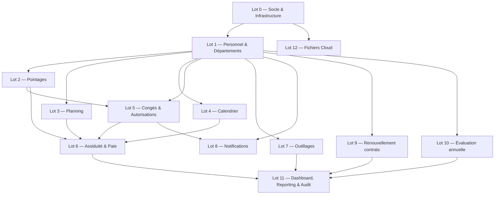

# Backlog — Découpage en Lots (Phase 2)

**Statut** : Phase 2 (Planification). Source de vérité : `docs/specs/cahier-technique.md` (v2) et `docs/ARCHITECTURE.md`. Chaque lot est un incrément **vertical** (backend + frontend livrés ensemble), livrable et démontrable de bout en bout, conformément à l'approche actée en Phase 3 de la stratégie initiale.

**Convention** : chaque lot indique ses dépendances (lots devant être terminés avant de commencer), son backlog Backend, son backlog Frontend, et sa Definition of Done (DoD) — reprise à l'identique pour tous les lots en fin de document pour ne pas la répéter 12 fois.

---

## Ordre de dépendances (vue d'ensemble)

**Lecture** : Lot 0 et Lot 1 sont un préalable strict à tout le reste. Au-delà, les lots 2 à 10 sont largement parallélisables entre eux (peu de dépendances croisées, sauf Lot 6 qui agrège Pointages+Planning+Calendrier+Congés, et Lot 8 qui a besoin du workflow de Lot 5). Lot 11 est le dernier car il consomme les données de presque tous les autres modules. **Lot 12** n'appartient pas au découpage initial des 13 modules du CDF — c'est un pivot ultérieur (2026-08-18) du module `fichiers` posé au Lot 0, sans dépendance vers les lots 1-11, lui-même suivi d'une extraction du stockage objet en repo séparé (2026-08-19, cf. `docs/LOTS/LOT_12_FICHIERS_CLOUD.md`).

---

## Lot 0 — Socle & Infrastructure

**Objectif** : rien de fonctionnel visible, mais bloquant pour tout le reste. C'est le premier commit du projet.
**Dépendances** : aucune.

**Backend**
- Scaffolding Spring Boot 3 / Java 21 (structure de packages par module, cf. `ARCHITECTURE.md` §3).
- `V1__init_schema.sql` Flyway = intégralité du schéma corrigé (`cahier-technique.md` §3, 23 tables, UUID sur `employes`).
- `V2__seed_dev.sql` Flyway = jeu de données minimal de dev (1 département, 1 employé, 1 compte `SUPERUSER`) pour permettre un premier login testable de bout en bout avant l'existence de tout écran de gestion des comptes.
- Volume de stockage Docker (`./storage:/app/storage`, variable `STORAGE_PATH`) — sert désormais uniquement au Module 7 (rapports/archivage) et aux imports Excel bruts ; le module `fichiers` est passé au stockage objet (Floci/S3) au [Lot 12 — Fichiers Cloud](LOTS/LOT_12_FICHIERS_CLOUD.md), cf. `ARCHITECTURE.md` §8.
- Authentification : `POST /auth/login`, `POST /auth/refresh-token`, `POST /auth/logout`, `GET /auth/me`, `PUT /auth/change-password` — JWT + refresh (`ARCHITECTURE.md` §5), verrouillage de compte après 5 échecs.
- 5 rôles Spring Security (`ROLE_EMPLOYE`, `ROLE_MANAGER`, `ROLE_RH`, `ROLE_DIRECTEUR`, `ROLE_SUPERUSER`) et matrice de permissions de base.
- Module `fichiers` complet (upload/download/liste/suppression) — transversal, requis par plusieurs lots ultérieurs (justificatifs congés, contrats). **🔧 Pivoté vers un stockage objet S3-compatible (URLs pré-signées) au [Lot 12 — Fichiers Cloud](LOTS/LOT_12_FICHIERS_CLOUD.md)**, cf. `ARCHITECTURE.md` §8.
- Aspect d'audit AOP (`@Audited`) + table `audit_logs` — le mécanisme est posé ici, les annotations sont ajoutées lot par lot.
- Configuration Redis (cache + blacklist JWT uniquement, `ARCHITECTURE.md` §7).

**Frontend**
- Scaffolding Vite + React + TypeScript strict, arborescence par domaine (miroir des packages backend).
- Bibliothèques socle : TanStack Query, React Router, Zustand (store session), Axios + intercepteur refresh JWT, shadcn/ui + Tailwind (thème sombre par défaut, cf. CDF §2.1), `openapi-typescript` branché sur l'OpenAPI backend (Springdoc).
- Layout applicatif : Top Bar + Side Bar dynamique par rôle (CDF §2.2), page de login, gestion de session (redirection si token expiré).

**Definition of Done spécifique** : `docker-compose up` démarre les 4 conteneurs sains (healthcheck OK), le compte `SUPERUSER` de seed peut se connecter et voir un layout vide mais fonctionnel avec sa sidebar.

---

## Lot 1 — Personnel & Départements *(Module 4 du CDF)*

**Dépendances** : Lot 0.

**Backend** : CRUD `employes` (matricule_interne/cnss/paie, UUID), `departements`, historique `contrats` ; Vue 360° (`evenements_360` + filtres catégorie/date) ; masquage `matricule_cnss` dans les DTOs de sérialisation (`ARCHITECTURE.md` §10).

**Frontend** : écran "Le Personnel" (liste paginée, recherche, filtres département/statut), fiche employé (onglets Infos / Contrats / Timeline 360°), formulaire de création/édition (React Hook Form + Zod), écran "Départements" ; écran de gestion des comptes utilisateurs (RH/SuperUser, CRUD basique sur `utilisateurs` avec sélection d'un employé existant) — déplacé depuis le Lot 0 car dépendant de la liste des employés.

---

## Lot 2 — Pointages *(Module 1)*

**Dépendances** : Lot 1.

**Backend** : webhook Hikvision (`/hikvision/events`, filtre liste blanche IP sur `pointeuses`) ; fallback `@Scheduled` horaire ISAPI ; import Excel asynchrone (≤1500 lignes, rollback total au 1er échec, table `async_jobs` type `IMPORT_POINTAGES`) ; détection de doublon (5 min, même pointeuse, `statut = IGNORE_DOUBLON`) ; correction manuelle avec audit obligatoire.

**Frontend** : écran "Machines" (liste pointeuses, statut en ligne), grille hebdomadaire des pointages, modale de correction manuelle (motif obligatoire), écran d'import Excel avec suivi de progression (polling `GET /async-jobs/{id}`), affichage des anomalies.

---

## Lot 3 — Planning *(Module 2)*

**Dépendances** : Lot 1.

**Backend** : CRUD `shifts` (catalogue de créneaux) ; `plannings` avec affectation + contrôle automatique du repos légal de 11h (409 si violation) ; blocage sur chevauchement d'indisponibilité ; rapport delta théorique/réel.

**Frontend** : écran "Planning" (RH/SuperUser : création/édition, vue calendrier par département) ; vue lecture seule pour Manager (son équipe) et Employé (`/mon-planning`, lui-même) ; alertes visuelles de violation légale.

---

## Lot 4 — Calendrier *(Module 6)*

**Dépendances** : Lot 1.

**Backend** : CRUD `jours_feries` (unitaire + import batch) ; recalcul automatique de `historique_soldes` (motif `RECREDIT_FERIE`) en cas de chevauchement congé payé / jour férié mobile.

**Frontend** : écran "Calendrier" — vue annuelle, import de référentiel, formulaire d'ajout de fermeture collective.

---

## Lot 5 — Congés & Autorisations *(Modules 8 et 13)*

**Dépendances** : Lot 1, Lot 2 (justification d'anomalies de pointage).

**Backend** : `POST/PUT autorisations` et `indisponibilites` (saisie Manager avec avis intégré, ou RH en urgence) ; validation/refus RH ; déduction automatique de solde en jours ouvrés (`historique_soldes`, interfacée avec `jours_feries` du Lot 4) ; justification automatique des anomalies `pointages_bruts` (`autorisation_id`) ; règles de délai 72h (outrepassable par RH) et quota mensuel 4h ; mise à jour du planning (créneau `CONGE`/`ABSENCE`) à la validation ; table générique `parametres_globaux` (décision d'architecture : aucune règle métier à valeur variable codée en dur) portant le taux d'incrémentation mensuelle des congés, appliqué par une tâche `@Scheduled`.

**Frontend** : écran "Congés & Autorisations" (RH : liste à valider, historique) ; écran "Demandes" côté Manager (saisie pour son équipe, avec champ avis) ; consultation solde de congés.

---

## Lot 6 — Assiduité & Paie *(Module 3)*

**Dépendances** : Lot 2, Lot 3, Lot 4, Lot 5 (agrège pointages + planning + jours fériés + autorisations justifiées).

**Backend** : moteur de calcul mensuel (segmentation heures normales/nuit/majorées, primes, pénalités) ; clôture de paie irréversible avec contrôles préalables (anomalies justifiées ≥98%, pas de demande `EN_ATTENTE`) ; verrouillage lecture seule + workflow de déverrouillage exceptionnel.

**Frontend** : écran de synthèse mensuelle par département, bouton `[Clôturer la Paie]` avec confirmation, bandeau "mois clôturé" en lecture seule, formulaire de demande de déverrouillage exceptionnel.

---

## Lot 7 — Outillages *(Module 5)*

**Dépendances** : Lot 1.

**Backend** : `check-out`/`check-in` avec historique `outillage_mouvements`, barème d'imputation financière (0-6/6-12/>12 mois), génération de fiche d'anomalie en cas de perte.

**Frontend** : écran "Gestion du Matériel" (Manager, scope son équipe) — rattachement, restitution avec sélection d'état, affichage du montant d'imputation calculé.

---

## Lot 8 — Notifications *(Module 11)*

**Dépendances** : Lot 1, Lot 5 (déclencheurs sur les demandes).

**Backend** : tâches `@Scheduled` (alerte hebdo 3 oublis de badgeage, alerte mensuelle sous-activité avec filtre suspension légale de contrat) ; table `notifications` + `GET`/`PUT .../lue`.

**Frontend** : cloche de notification (Top Bar, badge de compteur non-lues), panneau déroulant, marquage lu.

---

## Lot 9 — Renouvellement de contrats *(Module 12)*

**Dépendances** : Lot 1.

**Backend** : tâche `@Scheduled` quotidienne (génération M+5/M+11, bascule `URGENT_EXPIRE`) ; endpoints `taches-renouvellement`.

**Frontend** : écran "Tâches" (liste RH, filtrable par statut), action Validé/Non renouvelé avec confirmation.

---

## Lot 10 — Évaluation Annuelle *(Module 9)*

**Dépendances** : Lot 1.

**Backend** : `evaluations`/`evaluation_competences`/`plans_developpement`, blocage de soumission si compétence obligatoire non notée, génération auto de PDI.

**Frontend** : grille de notation (Manager), écran de validation RH, affichage du PDI généré.

---

## Lot 11 — Dashboard, Reporting & Audit *(Modules 10, 7, et logs)*

**Dépendances** : Lot 6 (assiduité), Lot 7 (outillages), Lot 9 (renouvellement), Lot 10 (évaluations — 🔧 ajouté pendant la conception : le Dashboard agrège aussi l'état des évaluations, gap qui n'apparaissait pas dans la liste initiale des dépendances) — agrège leurs données.

**Backend** : `GET /dashboard/kpi` (cache Redis, ouvert à `DIRECTEUR`) ; `GET /dashboard/charts` 🆕 (non listé au cahier technique initial — courbes/histogrammes/anneau du Tableau de Bord) ; génération de rapports asynchrones (`async_jobs` type `REPORT`) ; archivage à 12 mois (`@Scheduled` mensuel) ; `GET /audit-logs` (`SUPERUSER` exclusivement).

**Frontend** : Tableau de Bord (widgets par rôle, état "chargement en arrière-plan" si >5s) ; écran "Synthèse" (sélection rapport + export) ; écran "Logs Système"/"Logs Utilisateurs" (Espace Super User).

---

## Lot 12 — Fichiers Cloud

**Dépendances** : Lot 0 (module `fichiers` posé initialement sur stockage local).

Hors périmètre des 13 modules du CDF initial — pivot du module `fichiers` du Lot 0 vers un stockage objet S3-compatible (arbitrage utilisateur explicite du 2026-08-18, cf. `cahier-technique.md` §1.2/§3.15/§4.2 et `ARCHITECTURE.md` §8), **puis extraction de ce stockage objet en service séparé** `s3-file-system` (repo dédié, arbitrage utilisateur du 2026-08-19) : le SIRH ne garde que la métadonnée métier et consomme le nouveau service via un client Feign.

**Backend SIRH** : `com.sirh.client.FileStorageClient` (Spring Cloud OpenFeign, BOM `spring-cloud-dependencies:2023.0.5`) consomme le contrat REST de `s3-file-system` ; plus de `StoragePort`/`S3StorageAdapter`/AWS SDK direct côté SIRH. Deux buckets logiques toujours résolus depuis `FichierCategorie` (`sirh-documents-rh` versionné, `sirh-uploads`) mais refournis à chaque appel Feign (service cible sans état). Flux d'upload/download 100% en URLs pré-signées, contrat HTTP SIRH inchangé (`POST /fichiers/demande-upload`, `POST /fichiers/{reference}/confirmer`, `GET /fichiers/{reference}/download-url`) — **change toujours le contrat de `POST /fichiers/upload` et `GET /fichiers/{reference}/download` d'origine (Lot 0), non rétrocompatible**.

**Nouveau repo `s3-file-system`** : service technique indépendant (aucune notion métier RH), architecture hexagonale `StoragePort`/`S3StorageAdapter` reprise du Lot 12 d'origine, sans base de données (tout dérivé de Floci/S3), authentification inter-services par clé d'API. Son propre `docker-compose.yml`, ses propres tests d'intégration contre un vrai conteneur Floci.

**Frontend** : 🔴 non traité dans ce lot — le contrat d'upload/download change de forme (multipart → 2 requêtes JSON + PUT/GET direct sur URL pré-signée), tout code frontend consommant `/fichiers/upload` ou `/fichiers/{reference}/download` doit être adapté en conséquence.

---

## Definition of Done — commune à tous les lots

- [ ] Migration Flyway associée committée (si évolution de schéma).
- [ ] Tests backend : unitaires sur la logique métier à risque du lot (règles de calcul, contrôles), intégration Testcontainers sur repository/controller.
- [ ] Tests frontend : composants critiques du lot (formulaires, tableaux) en Vitest + Testing Library.
- [ ] Types TypeScript régénérés depuis l'OpenAPI backend (`openapi-typescript`) si le contrat a changé.
- [ ] Rôles/permissions vérifiés manuellement pour chaque profil concerné par le lot (pas seulement le happy path RH).
- [ ] `CLAUDE.md` backend/frontend mis à jour si de nouvelles conventions apparaissent pendant le lot.
- [ ] Revue (`/code-review`) avant merge, PR même en solo.
