# Lot 0 — Socle & Infrastructure

**Statut** : terminé, mergé (backend `ce7a546`, frontend `d3bdcf1`).
**Dépendances** : aucune (premier lot).
**Documentation rétroactive** — rédigée après le Lot 1, à partir de l'historique Git et des vérifications effectuées à l'époque.

## Objectif

Rien de fonctionnel visible pour l'utilisateur final, mais bloquant pour tout le reste : scaffolding des deux dépôts, authentification JWT complète, module `fichiers` transversal, socle d'audit AOP, infrastructure Docker Compose.

## Étapes de réalisation

1. **Scaffolding** (`chore: scaffold ...`, commit séparé) — structure Maven/Spring Boot 3 côté backend, Vite/React/TypeScript côté frontend, schéma SQL complet (23 tables) posé en une seule migration Flyway `V1__init_schema.sql`.
2. **Authentification JWT** — `JwtService` (access + refresh token, clé HMAC-SHA256 dérivée par SHA-256 du secret pour accepter un secret de longueur arbitraire), `JwtAuthenticationFilter` (revalidation de `compte_actif`/verrouillage à chaque requête, jamais de confiance aveugle dans le token), `TokenBlacklistService` (Redis, clé `blacklist:{jti}`), verrouillage de compte après 5 échecs consécutifs (15 min).
3. **Module `fichiers`** — upload/download/liste/suppression, stockage sur volume Docker (`STORAGE_PATH`), suppression restreinte à `RH`/`SUPERUSER` et journalisée (`@Audited`).
4. **Socle d'audit AOP** — annotation `@Audited`, `AuditAspect` (`@AfterReturning`, échec d'écriture audit non bloquant pour l'action métier), table `audit_logs`.
5. **Frontend** — TanStack Query, Zustand (store de session persistant), Axios avec intercepteur de refresh automatique (401 → refresh → retry, une seule fois), design system shadcn-style + Tailwind (thème sombre par défaut, CDF §2.1), page de connexion, routing protégé, layout applicatif (Top Bar + Side Bar dynamique par rôle).
6. **Données de seed** (`V2__seed_dev.sql`) — 1 département, 1 employé, 1 compte `SUPERUSER` (`admin`/`ChangeMe123!`) pour un premier login testable de bout en bout.
7. **Bugs réels corrigés en cours de route** (scaffold initial, pas des régressions) :
   - `pom.xml` : Maven ne résout pas une propriété `<properties>` utilisée dans `<parent><version>` — version codée en dur.
   - Spring Boot 3.x a renommé `spring.redis.*` → `spring.data.redis.*` ; l'ancien préfixe retombe silencieusement sur `localhost` au lieu d'échouer.
   - `LazyInitializationException` sur `Utilisateur.employe` lu hors session Hibernate dans le filtre JWT → corrigé par `@EntityGraph(attributePaths = "employe")` sur `findByUsername`.
   - `nginx.conf` : le proxy `/api/` ne retirait pas le préfixe avant de transmettre au backend (endpoints bruts, ex. `/auth/login`) — `proxy_pass` corrigé + proxy Vite dev-server équivalent ajouté.
   - `react-router-dom` monté en 6.30.4 (dernier correctif 6.x) pour fermer deux CVE modérées ; un correctif complet nécessite une migration v7 (breaking), volontairement différée.
8. **Validation end-to-end** manuelle contre la stack `docker-compose` réelle (voir Procédure de validation).

## Choix techniques & Dépendances

| Choix | Raison |
|---|---|
| Spring Boot 3.3.1 / Java 21 | Imposé par le cahier technique. |
| `io.jsonwebtoken` (jjwt) pour les JWT | Librairie standard, API `Jwts.builder()` claire, pas de dépendance à un serveur d'auth externe (hors périmètre du projet). |
| Redis = cache + blacklist JWT uniquement | Décision explicite ARCHITECTURE.md §7 — pas de file de jobs (le traitement async passe par la table `async_jobs` + `@Scheduled`, pas par une queue Redis). |
| Lombok + MapStruct posés au `pom.xml` | MapStruct anticipé pour le mapping entité/DTO mais **pas encore utilisé** en Lot 0 (mapping manuel via méthodes statiques `from()` sur les DTOs) — écart à surveiller : soit un lot proche l'exploite, soit la dépendance doit être retirée. |
| Testcontainers + JUnit 5 + Failsafe pour les tests d'intégration | Convention du projet (`CLAUDE.md`). **Limitation connue** : `mvn verify` échoue sur cette machine Windows (Docker Desktop retourne du JSON malformé sur `docker info` via le pipe nommé) — sans lien avec le code testé. Fonctionne en CI Linux. |
| TanStack Query + Zustand (frontend) | Query pour l'état serveur, Zustand+`persist` pour la session (survit au rechargement de page) — pas de Redux, périmètre trop petit pour le justifier. |
| Axios + intercepteur de refresh dédié | Instance `refreshClient` séparée sans intercepteur pour éviter une boucle infinie si le refresh lui-même échoue en 401. |
| shadcn-style (Tailwind, sans Radix) | Composants `Button`/`Card`/`Input`/`Label` écrits à la main plutôt que la dépendance `shadcn/ui` complète — seuls les primitifs réellement utilisés, pas de `asChild`/Slot Radix. |

## Fichiers impactés & Cartographie API

```mermaid
flowchart LR
    subgraph FE["Frontend"]
        LoginPage["pages/LoginPage.tsx"]
        AppLayout["layout/AppLayout.tsx"]
        ProtectedRoute["router/ProtectedRoute.tsx"]
        SessionStore["store/session-store.ts"]
        ApiClient["lib/api-client.ts"]
        AuthService["services/auth-service.ts"]
    end

    subgraph BE_Auth["Backend — auth"]
        AuthController["auth/controller/AuthController.java"]
        AuthServiceBE["auth/service/AuthService.java"]
        JwtService["auth/security/JwtService.java"]
        JwtFilter["auth/security/JwtAuthenticationFilter.java"]
        TokenBlacklist["auth/security/TokenBlacklistService.java"]
        SecurityConfig["auth/security/SecurityConfig.java"]
        UtilisateurEntity["auth/entity/Utilisateur.java"]
    end

    subgraph BE_Fichiers["Backend — fichiers"]
        FichierController["fichiers/controller/FichierController.java"]
        FichierService["fichiers/service/FichierService.java"]
        FichierEntity["fichiers/entity/Fichier.java"]
    end

    subgraph BE_Audit["Backend — audit"]
        AuditAspect["audit/aspect/AuditAspect.java"]
        AuditLog["audit/entity/AuditLog.java"]
    end

    subgraph Infra["Infra"]
        Redis[(Redis)]
        Postgres[(PostgreSQL)]
    end

    LoginPage --> AuthService
    AuthService -->|"POST /auth/login"| ApiClient
    ApiClient -->|"POST /auth/refresh-token (401 auto-retry)"| AuthController
    ApiClient -->|"POST /auth/logout"| AuthController
    ApiClient -->|"GET /auth/me"| AuthController
    AppLayout --> SessionStore
    ProtectedRoute --> SessionStore

    AuthController --> AuthServiceBE
    AuthServiceBE --> JwtService
    AuthServiceBE --> TokenBlacklist
    AuthServiceBE --> UtilisateurEntity
    JwtFilter --> JwtService
    JwtFilter --> TokenBlacklist
    SecurityConfig --> JwtFilter
    TokenBlacklist --> Redis

    ApiClient -->|"POST/GET/DELETE /fichiers/*"| FichierController
    FichierController --> FichierService
    FichierService -.->|"@Audited (delete)"| AuditAspect
    AuditAspect --> AuditLog
    AuditLog --> Postgres
    UtilisateurEntity --> Postgres
    FichierEntity --> Postgres
```

### Endpoints exposés (Lot 0)

| Méthode | Endpoint | Rôles | Contrôleur |
|---|---|---|---|
| POST | `/auth/login` | Public | `AuthController` |
| POST | `/auth/refresh-token` | Public | `AuthController` |
| POST | `/auth/logout` | Authentifié | `AuthController` |
| GET | `/auth/me` | Authentifié | `AuthController` |
| PUT | `/auth/change-password` | Authentifié | `AuthController` |
| POST | `/fichiers/upload` | Authentifié | `FichierController` |
| GET | `/fichiers/{id}/download` | Authentifié | `FichierController` |
| GET | `/fichiers/entite/{type}/{id}` | Authentifié | `FichierController` |
| DELETE | `/fichiers/{id}` | RH, SUPERUSER | `FichierController` |

## Procédure de validation

- **Backend** : `mvn compile` local systématique après chaque changement. `mvn verify` (Testcontainers) non exécutable sur cette machine (cf. limitation documentée) — remplacé par un smoke test manuel contre la stack `docker compose up` réelle : login, `/auth/me`, refresh, logout + révocation immédiate (vérifiée en rejouant `/auth/me` avec le même token → `401`), verrouillage après 5 échecs, upload/download/suppression de fichier avec contrôle de rôle.
- **Frontend** : `npm run build` (tsc + vite) et `npm run test` (Vitest : `LoginPage.test.tsx`, `ProtectedRoute.test.tsx`) verts. Vérifié manuellement dans le navigateur dans les deux topologies (proxy Vite dev-server et conteneur nginx de production).
- **Definition of Done** (BACKLOG.md) : `docker-compose up` démarre les 4 conteneurs sains (healthcheck OK), le compte `SUPERUSER` de seed se connecte et voit un layout vide mais fonctionnel avec sa sidebar — validé.
