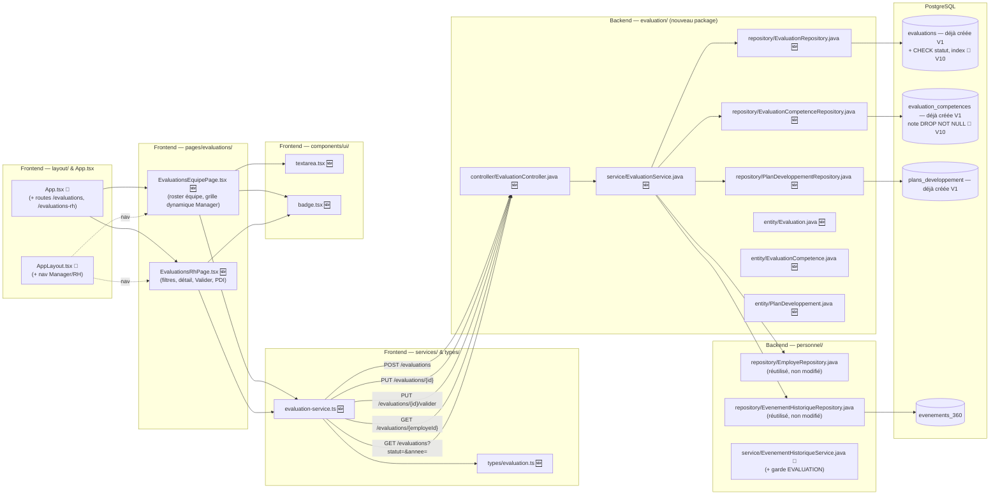

# Lot 10 — Évaluation Annuelle *(Module 9 du CDF)*

**Statut** : implémenté, tests unitaires/intégration/frontend verts, validé visuellement de bout en bout dans un vrai navigateur (Chrome via Claude in Chrome, cf. §16) — prêt pour commit.
**Dépendances** : [Lot 1 — Personnel & Départements](LOT_1_PERSONNEL.md) (`employes`/`departements`, `evenements_360` déjà générique et `EvenementCategorie.EVALUATION` déjà anticipée dans ce lot).
**Suite** : aucune dépendance identifiée pour l'instant (le Lot 11 — Dashboard n'agrège pas les évaluations d'après `BACKLOG.md`).

## Objectif

Dématérialiser la grille de notation annuelle (Manager saisit, RH valide) et générer automatiquement un Plan de Développement Individuel (PDI) pour toute compétence notée sous son seuil d'exigence, avec blocage de la soumission si une compétence reste sans note.

## Arbitrages de design validés avant implémentation

1. **`evaluation_competences.note` devient nullable** (`V10`, `ALTER COLUMN ... DROP NOT NULL`) : le schéma consolidé (`V1`) le déclarait `NOT NULL`, ce qui rendait impossible de représenter une grille "en cours de saisie, pas encore complète" — pourtant explicitement requise par le cas exceptionnel du CDF ("Validation incomplète de la grille"). Résolu en assouplissant le schéma (le cahier technique fait foi sur le schéma, mais jamais au prix de réduire le périmètre fonctionnel) plutôt qu'en inventant un état de "brouillon" hors base.
2. **Sémantique POST vs PUT** : `POST /evaluations` crée la grille sans jamais bloquer (même avec des compétences non notées — c'est un brouillon). `PUT /evaluations/{id}` **persiste toujours** la mise à jour envoyée, puis vérifie la complétude de l'ensemble des lignes de la grille : s'il en manque, la requête entière renvoie 400 avec `competencesManquantes` (la saisie n'est donc jamais perdue même en cas de blocage). C'est la lecture la plus fidèle du texte du cahier technique ("complète/corrige la grille avant soumission ; rejet 400 si...") compatible avec un schéma sans colonne "obligatoire" ni référentiel de compétences.
3. **"Son équipe" pour MANAGER résolu par département**, pas par une hiérarchie manager→employé dédiée — il n'en existe pas dans le schéma (confirmé par exploration du reste du codebase : `AutorisationService`/`IndisponibiliteService` utilisent déjà ce même principe). `evaluations.manager_id` enregistre qui a créé la grille ; l'autorisation de création/lecture reste basée sur `employe.departementId == principal.departementId`.
4. **`GET /evaluations?statut=&annee=` ajouté** (non listé au §4.10 initial) : sans lui, le RH n'a aucun moyen de découvrir les grilles à valider sans connaître déjà l'`employeId`. Même raisonnement que `GET /taches-renouvellement?statut=` au Lot 9 — documenté dans `cahier-technique.md` §4.10.
5. **`plans_developpement.statut` reste une chaîne libre** (pas d'enum Java, pas de contrainte `CHECK`) : aucun endpoint de ce lot ne fait transiter ce statut (le CDF ne décrit aucun workflow de suivi du PDI au-delà de sa génération) — fermer un domaine de valeurs non utilisé aurait été spéculatif.
6. **`actions` du PDI généré par un gabarit déterministe**, pas de contenu métier généré dynamiquement : `Plan de développement à définir pour la compétence "X" (note N/seuil)` — le CDF ne spécifie aucun contenu, un texte informatif minimal suffit à satisfaire "génération automatique d'un PDI" sans halluciner un plan d'action.

## Étapes de réalisation

1. **Analyse de l'existant** — confirmation que `evaluations`/`evaluation_competences`/`plans_developpement` existent déjà intégralement dans `V1__init_schema.sql` (même situation que `taches_renouvellement` au Lot 9), que `EvenementCategorie.EVALUATION` était déjà présente dans `com.sirh.personnel` (anticipée pour ce lot), et qu'aucune hiérarchie manager→employé n'existe en base (exploration de `AutorisationService`, `IndisponibiliteController`, `Departement.managerId`).
2. **Gap migration confirmé** — `V10__lot10_evaluation_annuelle.sql` : `ALTER COLUMN note DROP NOT NULL`, `CHECK (statut IN ('EN_COURS','VALIDEE_RH'))` sur `evaluations`, index `(statut, annee)` pour l'écran RH.
3. **Nouveau package `com.sirh.evaluation`** — entités `Evaluation`/`EvaluationCompetence`/`PlanDeveloppement` (FK à plat, pas de relations JPA, cohérent avec `TacheRenouvellement`/`Contrat`), repositories en derived-queries, DTO records manuels avec factory `from(...)` (MapStruct présent dans `pom.xml` mais inutilisé dans tout le projet — convention confirmée, non réinventée ici), exceptions `EvaluationNotFoundException` (404), `EvaluationStatutInvalideException` (409), `EvaluationIncompleteException` (400, porte la liste `competencesManquantes`).
4. **`EvaluationService`** — `creer` (POST, jamais bloquant, vérifie l'unicité `(employe_id, annee)` et le département du Manager), `mettreAJour` (PUT, remplace intégralement les lignes de compétences par délete+réinsertion — plus simple qu'un diff ligne à ligne, rien ne référence `evaluation_competences.id`, puis lève `EvaluationIncompleteException` si une note manque), `valider` (`@Audited(action = "VALIDER_EVALUATION")`, filet de sécurité anti-incomplétude, génère un `PlanDeveloppement` par compétence sous son seuil, pousse un `EvenementHistorique` catégorie `EVALUATION`), `search`/`parEmploye` (restriction département appliquée en mémoire après un lookup batché des employés, même style que `RenouvellementService#enrichir`).
5. **Garde-fou `EvenementHistoriqueService`** — `EVALUATION` ajoutée à la liste des catégories refusées en saisie manuelle (même règle que `CONTRAT`, réservée à la génération automatique).
6. **`EvaluationController`** — `POST`/`PUT /{id}` `hasAuthority('ROLE_MANAGER')`, `PUT /{id}/valider` `hasAnyAuthority('ROLE_RH','ROLE_SUPERUSER')`, `GET /{employeId}` et `GET ?statut=&annee=` ouverts aux trois rôles avec restriction département appliquée pour MANAGER dans le service.
7. **`GlobalExceptionHandler`** — trois handlers ajoutés (404/409/400), le handler `EvaluationIncompleteException` enrichit la réponse standard avec `competencesManquantes` pour que le frontend puisse cibler les champs en erreur.
8. **Tests unitaires** (`EvaluationServiceTest`, Mockito, 13 cas) — refus hors département (création et lecture), doublon annuel, grille partielle acceptée à la création, refus de modification par un autre Manager, refus sur grille déjà validée, blocage 400 avec persistance malgré le rejet, grille complète acceptée, blocage à la validation RH (filet de sécurité), double validation refusée (409), génération du PDI uniquement sous le seuil, aucun PDI si tout est au niveau.
9. **Tests d'intégration** (`EvaluationControllerIT`, Testcontainers, 8 cas) — 403 hors département, brouillon incomplet accepté (201), PUT incomplet → 400 avec la liste exacte, PUT complet → 200, cycle Manager→RH complet avec PDI généré, double validation → 409, lecture hors département → 403, liste RH par statut.
10. **Régénération des types frontend** — backend démarré en local (`mvn spring-boot:run`, port `8080`), `npm run generate:api-types` : `EvaluationDto`/`EvaluationCreateRequest`/`EvaluationUpdateRequest`/`EvaluationCompetenceDto`/`PlanDeveloppementDto` confirmés dans `src/types/api.d.ts`.
11. **Composants UI ajoutés** — `Textarea`/`Badge` (`components/ui/`), absents jusqu'ici, suivant strictement le style `cva`/`cn` de `button.tsx`. Palette de badges en classes Tailwind directes (`emerald`/`amber`/`destructive`/`muted`) — le thème sombre du Lot 0 ne définit que les tokens shadcn de base, pas de token "success"/"warning" dédié à créer pour un seul composant.
12. **Écran Manager** (`EvaluationsEquipePage.tsx`) — roster de l'équipe (réutilise `GET /employes?departementId=`) avec badge d'état par employé (`Non commencée`/`Brouillon`/`Prête`/`Validée`, dérivés de `GET /evaluations?annee=`), grille dynamique `react-hook-form` + `useFieldArray` (ajout/suppression de compétences, animation `fade-in`/`slide-in` déjà utilisée par `Dialog.tsx`), transition immédiate création→édition après le premier `POST` réussi (évite un double clic qui retenterait un `POST` et échouerait en 409), bannière ambre informative (compétences restantes, hors tentative de soumission) vs bannière rouge de blocage (après un 400 réel), aide de champ "Note requise" et anneau `destructive` subtil sur la ligne concernée plutôt qu'un rouge vif.
13. **Écran RH** (`EvaluationsRhPage.tsx`) — trois filtres (`Prêtes à valider`/`Brouillons Manager`/`Validées`), détail en modale (grille en lecture seule avec badge note/seuil coloré, PDI affiché après validation), bouton `Valider` désactivé tant que la grille reste incomplète.
14. **Routing** — `/evaluations` (nav MANAGER) et `/evaluations-rh` (nav RH/SUPERUSER) dans `App.tsx`/`AppLayout.tsx`.
15. **Bug détecté et corrigé pendant la validation navigateur réelle** — `fields[i].competence` (`useFieldArray`) ne reflète que la valeur par défaut au montage, pas la valeur tapée (champs non contrôlés via `register`) : le surlignage rouge ne matchait jamais la compétence réellement en cause après une soumission bloquée. Corrigé avec `useWatch({ control, name: 'competences' })` pour lire la valeur live à chaque rendu.
16. **Validation de bout en bout dans un vrai navigateur** (Chrome via Claude in Chrome, backend réel port `8080` + `vite dev` port `5173` via proxy réel) — deux comptes de test insérés directement en base de dev (`docker exec sirh-postgres psql`, un Manager et un RH, même département), scénario complet : connexion Manager → sélection d'un employé → création d'une grille à 2 compétences (une notée sous le seuil, une non notée) → bannière ambre informative → tentative de soumission bloquée (bannière rouge + ligne surlignée + "Note requise", confirmant le bug useWatch corrigé) → complétion de la note → soumission réussie (badge "Prête") → connexion RH → écran de validation liste la grille → détail avec badges colorés par compétence → validation → PDI généré affiché inline → reconnexion Manager → grille en lecture seule avec badge "Validée par le RH" et PDI visible. **Tous les écrans conformes, aucune erreur console.**

## Choix techniques & Dépendances

| Choix | Raison |
|---|---|
| `V10` assouplit `note` (`DROP NOT NULL`) plutôt que d'ajouter une table de brouillon séparée | Coût minimal (une ligne de migration) pour représenter fidèlement le cas exceptionnel du CDF, sans dupliquer le modèle de données. |
| `PUT` persiste toujours puis rejette si incomplet (pas de rollback de la saisie) | Le Manager ne doit jamais perdre son travail à cause d'un champ oublié — seule la transition "prête pour le RH" est bloquée. |
| "Son équipe" résolu par département, pas par une nouvelle relation manager→employé | Aucune table de hiérarchie n'existe dans le schéma ; introduire une nouvelle relation aurait dépassé le périmètre du lot pour un besoin déjà couvert par la convention département existante. |
| `GET /evaluations?statut=&annee=` ajouté et documenté a posteriori | Sans lui, l'écran de validation RH explicitement demandé par le CDF (Workflow Nominal, étape 2) serait impossible à construire — ne jamais réduire le périmètre fonctionnel pour éviter un endpoint supplémentaire. |
| DTO records manuels, pas MapStruct | Convention déjà actée dans tout le projet (dépendance présente, jamais utilisée) — pas de première introduction isolée dans ce lot. |
| Remplacement intégral (delete+réinsertion) des `evaluation_competences` à chaque `PUT` | Rien ne référence leur `id` individuellement (le PDI référence `evaluation_id`, pas la ligne de compétence) — plus simple et plus sûr qu'un diff ligne à ligne pour supporter ajout/suppression de compétences. |
| PDI : gabarit de texte déterministe, pas de génération de contenu métier | Le CDF ne spécifie aucun contenu pour les actions du PDI ; un texte informatif minimal remplit "génération automatique" sans invention hors périmètre. |
| Frontend : `useWatch` pour la valeur live des compétences, pas `fields[i]` | `useFieldArray` ne fournit que le snapshot par défaut au montage sur des champs non contrôlés — bug réel trouvé et corrigé pendant la validation navigateur (cf. étape 15). |
| Frontend : badges en classes Tailwind directes (`emerald`/`amber`), pas de nouveaux tokens CSS | Le thème sombre du Lot 0 ne définit que les tokens shadcn de base ; ajouter des tokens `success`/`warning` pour un seul composant aurait été prématuré (déjà le choix retenu au Lot 9 pour `TachesRenouvellementPage`). |
| Frontend : transition immédiate création→édition après le premier `POST` (état local `evaluationActuelle`) | Sans cela, un second clic sur "Créer la grille" retenterait un `POST` et échouerait en 409 (doublon annuel) avant que la query parente ne se rafraîchisse. |

## Fichiers impactés & Cartographie API

### Endpoints exposés (Lot 10)

| Méthode | Endpoint | Rôles | Contrôleur |
|---|---|---|---|
| POST | `/evaluations` | `ROLE_MANAGER` | `EvaluationController` |
| PUT | `/evaluations/{id}` | `ROLE_MANAGER` | `EvaluationController` |
| PUT | `/evaluations/{id}/valider` | `ROLE_RH`, `ROLE_SUPERUSER` | `EvaluationController` |
| GET | `/evaluations/{employeId}` | `ROLE_MANAGER` (son département), `ROLE_RH`, `ROLE_SUPERUSER` | `EvaluationController` |
| GET | `/evaluations?statut=&annee=` 🔧 | `ROLE_MANAGER` (son département), `ROLE_RH`, `ROLE_SUPERUSER` | `EvaluationController` |

Aucun accès Employé — non prévu par le CDF pour ce module.

## Procédure de validation

- **Compilation** : `mvn compile`/`mvn test-compile`, verts.
- **Tests unitaires** (`EvaluationServiceTest`, Mockito, 13 cas, `mvn test -Dtest=EvaluationServiceTest`, tous verts) : restriction département (création/lecture), doublon annuel, brouillon partiel accepté, refus de modification hors propriétaire, refus sur grille déjà validée, blocage 400 avec persistance de la saisie, grille complète acceptée, blocage à la validation (filet de sécurité), double validation refusée, génération du PDI sous le seuil, aucun PDI si tout est au niveau.
- **Tests d'intégration** (`EvaluationControllerIT`, Testcontainers, 8 cas, `mvn test -Dtest=EvaluationControllerIT`, tous verts) : 403 hors département, brouillon incomplet → 201, PUT incomplet → 400 + liste exacte, PUT complet → 200, cycle Manager→RH avec PDI généré, double validation → 409, lecture hors département → 403, liste RH par statut.
- **Compilation/typecheck frontend** : `tsc --noEmit` vert.
- **Tests frontend** (`vitest run`) : `EvaluationsEquipePage.test.tsx` (2 cas : création de grille, blocage 400 avec bannière) + `EvaluationsRhPage.test.tsx` (2 cas : validation avec PDI, filtre vide) — 16 cas au total sur l'ensemble du frontend, aucune régression sur les tests préexistants (Lot 9 inclus).
- **Validation navigateur réelle** (Chrome via Claude in Chrome, backend réel port `8080` + `vite dev` port `5173`) : cycle complet Manager (création brouillon → blocage 400 visible avec surlignage → complétion → soumission réussie) → RH (liste filtrée → détail avec badges → validation → PDI affiché) → Manager (vue lecture seule post-validation avec PDI). Bug `useFieldArray`/`useWatch` détecté et corrigé durant cette validation (cf. étape 15 des Étapes de réalisation). **Tous les écrans conformes, aucune erreur console.**

## ⚠️ Synchronisation multi-repo

Ce lot modifie `docs/specs/cahier-technique.md` (§3.22, §4.10) — la modification a été appliquée à l'identique dans les deux dépôts (`sirh-project-backend` et `sirh-project-frontend`) dans le cadre de ce lot, cf. règle de synchronisation de `CLAUDE.md`.
