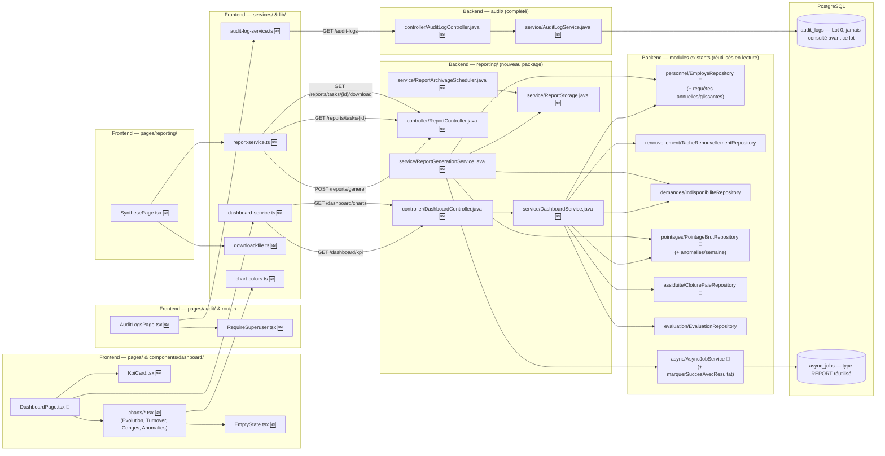

# Lot 11 — Dashboard, Reporting & Audit *(Modules 10, 7, et logs du CDF)*

**Statut** : implémenté, testé (15 tests backend — 11 tests d'intégration Testcontainers + 4 tests unitaires ; 9 tests frontend Vitest), validé visuellement de bout en bout dans un vrai navigateur (Chrome via Claude in Chrome) — validé et committé (backend + frontend).
**Dépendances** : [Lot 6 — Assiduité & Paie](LOT_6_ASSIDUITE_PAIE.md), Lot 7 — Outillages, [Lot 9 — Renouvellement de contrats](LOT_9_RENOUVELLEMENT_CONTRATS.md), **Lot 10 — Évaluation annuelle** (dépendance ajoutée pendant la conception, cf. correction `BACKLOG.md` ci-dessous — le Dashboard agrège aussi l'état des évaluations).
**Suite** : aucune dépendance identifiée pour l'instant — dernier lot du projet, il consomme les données de presque tous les autres modules.

**Commits** (`sirh-project-backend`) :
- `7869335` `feat(reporting): endpoints d'agregation dashboard KPI et charts`
- `234bcaa` `feat(audit): endpoint de consultation des logs SUPERUSER exclusivement`
- `292a433` `docs(dashboard): corrige la dependance Lot 10 et documente GET /dashboard/charts`
- `9598ed8` `feat(reporting): generation et telechargement de rapports PDF/Excel`
- `9513d03` `feat(reporting): archivage mensuel des rapports a 12 mois`
- `2dbfcc6` `docs(reporting): documente le catalogue de rapports et GET /reports/tasks/{id}/download`

**Commits** (`sirh-project-frontend`) :
- `538acf2` `feat(dashboard): tableau de bord premium avec KPI et graphiques Recharts`
- `d546bf2` `feat(audit): ecran Logs Systeme SUPERUSER avec garde de route`
- `3cace22` `docs(dashboard): corrige la dependance Lot 10 et documente GET /dashboard/charts`
- `c5e8b17` `docs(reporting): documente le catalogue de rapports et GET /reports/tasks/{id}/download`
- `2d2cbab` `feat(reporting): ecran Synthese pour la generation de rapports`

## Objectif

Donner à RH/SUPERUSER/MANAGER/DIRECTEUR une hypervision quasi temps réel de l'application (Module 10), permettre l'export de rapports RH au format PDF/Excel avec archivage automatique (Module 7), et exposer aux SUPERUSER l'historique immuable des actions système (audit_logs, jusque-là posé mais jamais consultable depuis le Lot 0).

## Arbitrages de design validés avant implémentation

1. **`GET /dashboard/charts` ajouté** (non listé au cahier technique initial, qui ne nommait que `/dashboard/kpi`) : le Module 10 du CDF exige des visualisations (courbes/histogrammes/anneau), impossibles à construire sur un simple objet de KPI scalaires — même raisonnement que les gaps comblés lots après lots (`GET /plannings/delta` au Lot 3, `GET /evaluations?statut=` au Lot 10). Documenté a posteriori dans `cahier-technique.md` §4.8.
2. **Agrégation par composition de repositories existants, jamais par nouvelle relation JPA** : `DashboardService` et `ReportGenerationService` ne font que composer des requêtes de comptage/regroupement sur les repositories déjà exposés par chaque module (Employe, TacheRenouvellement, Indisponibilite, PointageBrut, CloturePaie, Evaluation). Le scope département (MANAGER) est appliqué en mémoire par filtrage d'un ensemble d'`employeId` — ces entités n'ont qu'un `employeId` à plat, pas de relation JPA vers `departements` (même convention que `EvaluationService#search`/`RenouvellementService#enrichir`).
3. **Dépendance Lot 10 corrigée** : `docs/LOTS/LOT_10_EVALUATION_ANNUELLE.md` affirmait que le Dashboard n'agrégerait pas les évaluations, simple reflet de l'absence de la flèche `L10 --> L11` dans `BACKLOG.md` (jamais une décision motivée). Le CDF ne l'exclut pas et le coût d'ajout est négligeable (`countByStatut`) — inclus, `BACKLOG.md` et `LOT_10` corrigés en conséquence plutôt que de réduire le périmètre pour éviter un gap documentaire.
4. **Premier usage de Spring Cache du projet** : `CacheConfig` (`RedisCacheManager`, TTL 45s) pour `/dashboard/kpi` et `/dashboard/charts`, conforme à `ARCHITECTURE.md` §7 ("cache applicatif, TTL 30-60s, évite de recalculer les agrégats à chaque rafraîchissement").
5. **`GET /audit-logs` premier contrôleur SUPERUSER-exclusif du projet** : jusqu'ici tout endpoint RH restait accessible à SUPERUSER (superset) ; les logs sont la seule exception actée (`audit-rapport.md`, constat 2). Filtrage via `JpaSpecificationExecutor` (même pattern que `demandes`/`pointages`), noms d'utilisateurs résolus par lookup batché (pas de relation JPA sur `audit_logs`, immuable par design).
6. **Génération de rapports toujours soumise à un pool dédié, jamais un vrai "wait" bloquant indéfini** : le CDF (Module 7) décrit "<5s = direct, >5s = async" sans préciser le mécanisme. Implémenté via `CompletableFuture.supplyAsync(...).get(delai, TimeUnit.MILLISECONDS)` — si le délai est dépassé, la tâche continue en arrière-plan sur le même `Future` et complète le job `async_jobs` de façon découplée (`thenAccept`/`exceptionally`), sans jamais perdre le calcul déjà lancé. Le délai est configurable (`reporting.delai-synchrone-ms`, défaut 5000) uniquement pour permettre de tester le chemin asynchrone sans dépendre d'un calcul réellement lent en environnement de test/dev.
7. **Catalogue de rapports limité à `TURNOVER_ANNUEL`/`ABSENTEISME_ANNUEL`** : les deux seuls exemples cités par le CDF Module 7 — un catalogue plus large aurait été spéculatif (YAGNI).
8. **`resultatUrl` d'`async_jobs` porte le nom de fichier physique, pas une URL** : le lien de téléchargement effectif est toujours `GET /reports/tasks/{id}/download` (gap comblé, non listé au cahier technique), qui résout ce nom de fichier indépendamment de son dossier courant (`storage/reports/` ou `storage/archives/` après la purge mensuelle) — évite de devoir réécrire les lignes `async_jobs` historiques quand l'archivage déplace un fichier.
9. **Archivage = opération fichier pure, jamais de mutation `async_jobs`** : `ReportArchivageScheduler` déplace les fichiers de plus de 12 mois vers `storage/archives/` (cahier-technique.md §1.2 : point de montage unique, pas de second serveur isolé) avec retry 3x, mais ne touche jamais aux lignes actives de la base — une panne du montage réseau n'impacte donc jamais la disponibilité applicative.
10. **Frontend : distinction sync/async sur `Content-Type`, pas sur le code HTTP seul** : `POST /reports/generer` renvoie soit un fichier binaire (200) soit un `AsyncJobDto` JSON (202) — `report-service.ts` force `responseType: 'blob'` (nécessaire pour recevoir le PDF/Excel correctement) puis discrimine après coup via l'en-tête `Content-Type` de la réponse.

## Étapes de réalisation

### Phase 1 — Dashboard & Audit
1. Exploration des entités des Lots 1/2/5/6/9/10 (`Employe`, `Contrat`, `TacheRenouvellement`, `Indisponibilite`, `PointageBrut`, `CloturePaie`, `Evaluation`) pour identifier les requêtes d'agrégation possibles sans nouvelle relation JPA.
2. Confirmation de la convention réelle du projet (pas de préfixe `/api`, module `reporting` déjà nommé dans `ARCHITECTURE.md` §3) avant de coder — écart avec la proposition initiale de l'utilisateur (`/api/dashboard/...`), corrigé avant implémentation.
3. `com.sirh.reporting` (nouveau package) : `DashboardController`/`DashboardService`, requêtes natives PostgreSQL (`generate_series`) pour les séries temporelles (évolution effectifs, départs) sur 12 mois glissants.
4. `com.sirh.audit` complété : `AuditLogController`/`AuditLogService`/`AuditLogSpecifications`, `AuditLogRepository` passé à `JpaSpecificationExecutor`.
5. `CacheConfig` (Redis, TTL 45s) — premier `@EnableCaching` du projet.
6. Tests d'intégration Testcontainers (scoping département Manager vérifié sur données réelles, pas mockées — les requêtes `generate_series` ne se valident pas avec des mocks).
7. Frontend : `DashboardPage.tsx`, composants `KpiCard`/`EmptyState`/graphiques Recharts (`charts/`), palette validée avec le skill dataviz contre la surface réelle des `Card` du thème sombre. `AuditLogsPage.tsx` + garde `RequireSuperuser`.
8. **Revue de design** (retour utilisateur après première validation visuelle) : valeurs KPI en `text-4xl font-bold`, bordure gauche sémantique par couleur d'icône, `AreaChart` (au lieu de `LineChart`) avec dégradé et `strokeWidth={3}`, grilles à `strokeOpacity={0.15}`, composant `EmptyState` dédié pour les widgets sans données.
9. Validation navigateur réelle (comptes MANAGER/EMPLOYE temporaires créés puis nettoyés) : scoping département (16 → 6 effectifs), garde SUPERUSER bloquant un accès direct par URL, redirection EMPLOYE vers `/mon-planning`, filtre `/audit-logs?action=`.

### Phase 2 — Reports & Archivage
10. Ajout d'OpenPDF (`com.github.librepdf:openpdf`, LGPL/MPL) au `pom.xml` — aucune lib PDF n'existait, POI déjà présent pour Excel (réutilisé du Lot 2).
11. `ReportGenerationService` : requêtes annuelles dédiées (`evolutionEffectifsAnnee`/`departsAnnee`, bornées à une année civile plutôt qu'à une fenêtre glissante), génération PDF (OpenPDF `PdfPTable`) et Excel (POI `XSSFWorkbook`) factorisée derrière un rendu tableau générique.
12. `ReportStorage` (composant partagé génération/archivage) et `ReportArchivageScheduler` (`@Scheduled` mensuel, retry 3x).
13. `ReportController` : `POST /reports/generer`, `GET /reports/tasks/{taskId}`, `GET /reports/tasks/{taskId}/download` (gap comblé).
14. Tests : `ReportControllerIT` (chemin synchrone, délai par défaut), `ReportControllerAsyncIT` (délai forcé à 1ms via `@DynamicPropertySource`, cycle complet 202 → polling → SUCCESS → téléchargement), `ReportArchivageSchedulerTest` (Mockito, retry/échec/succès).
15. Validation réelle via `curl` contre le backend local : vrai PDF (1 page, `file` confirme `PDF document, version 1.5`) et vrai `.xlsx` (`file` confirme `Microsoft Excel 2007+`) générés et inspectés.
16. Frontend : `SynthesePage.tsx` (cartes de sélection, formats PDF/Excel, polling avec message "génération en arrière-plan"), `report-service.ts` (discrimination sync/async sur `Content-Type`), `download-file.ts` (déclenchement natif du téléchargement, aucune dépendance ajoutée).
17. Validation navigateur réelle des deux chemins : synchrone (PDF Turnover et Excel Absentéisme, téléchargement direct confirmé) et asynchrone forcé (`reporting.delai-synchrone-ms=1` sur le backend de dev le temps du test) — message "arrière-plan" affiché, job suivi en base (`async_jobs`), téléchargement automatique déclenché à la complétion. Artefacts de test nettoyés (lignes `async_jobs`, fichiers `storage/reports/`) après validation.

## Choix techniques & Dépendances

| Choix | Raison |
|---|---|
| Pas de nouvelle table/relation JPA pour l'agrégation | Toutes les données existent déjà dans les modules des Lots 1-10 ; une nouvelle relation aurait créé un couplage fort que l'utilisateur a explicitement demandé d'éviter. |
| `generate_series` PostgreSQL pour les séries temporelles | Comble les mois/semaines sans variation (absents d'un `GROUP BY` classique) en une seule requête, plutôt qu'une boucle applicative mois par mois. |
| OpenPDF plutôt qu'iText/commercial | Licence LGPL/MPL, pas de dépendance commerciale, API `com.lowagie.text` suffisante pour un tableau + titre. |
| `CompletableFuture` + délai configurable plutôt qu'un timeout de requête HTTP | Le calcul déjà lancé ne doit jamais être perdu si le délai synchrone est dépassé — un timeout HTTP brut aurait annulé le calcul au lieu de le laisser continuer en arrière-plan. |
| `resultatUrl` = nom de fichier, pas un chemin absolu | Le fichier peut être déplacé par l'archivage mensuel sans jamais avoir à réécrire la ligne `async_jobs` historique. |
| Recharts (frontend, déjà confirmé Phase 1) | Composants déclaratifs React, cohérent avec React 18 + TS strict, pas de gestion manuelle du canvas contrairement à Chart.js. |
| `report-service.ts` : `responseType: 'blob'` + discrimination sur `Content-Type` | axios ne peut pas savoir à l'avance si `POST /reports/generer` renverra un binaire ou un JSON — c'est le contrat même du endpoint (CDF : sync ou async selon la durée du calcul). |

## Fichiers impactés & Cartographie API

### Endpoints exposés (Lot 11)

| Méthode | Endpoint | Rôles | Contrôleur |
|---|---|---|---|
| GET | `/dashboard/kpi` | `ROLE_MANAGER` (son département), `ROLE_RH`, `ROLE_SUPERUSER`, `ROLE_DIRECTEUR` (lecture seule globale) | `DashboardController` |
| GET | `/dashboard/charts` 🆕 | idem | `DashboardController` |
| GET | `/audit-logs` | `ROLE_SUPERUSER` exclusivement | `AuditLogController` |
| POST | `/reports/generer` | `ROLE_RH`, `ROLE_SUPERUSER` | `ReportController` |
| GET | `/reports/tasks/{taskId}` | `ROLE_RH`, `ROLE_SUPERUSER` | `ReportController` |
| GET | `/reports/tasks/{taskId}/download` 🆕 | `ROLE_RH`, `ROLE_SUPERUSER` | `ReportController` |

Aucun accès Employé — non prévu par le CDF pour ce module (redirection frontend vers `/mon-planning`).

## Procédure de validation

- **Compilation** : `mvn compile`/`mvn test-compile`, verts.
- **Tests d'intégration** (Testcontainers, `mvn verify -Dit.test=<Classe>` — le mémo projet signale la suite complète flaky sur Windows, tests exécutés classe par classe) :
  - `DashboardControllerIT` (4 cas) : 403 EMPLOYE, DIRECTEUR voit l'agrégat global, MANAGER restreint à son département (16 → 6 effectifs sur données réelles), `/dashboard/charts` renvoie bien 12 points mensuels + 8 points hebdomadaires.
  - `AuditLogControllerIT` (2 cas) : 403 RH, SUPERUSER voit les logs et le filtre `?action=` fonctionne.
  - `ReportControllerIT` (4 cas) : 403 MANAGER, génération PDF Turnover et Excel Absentéisme synchrones (fichier renvoyé directement), 404 sur tâche inexistante.
  - `ReportControllerAsyncIT` (1 cas, délai forcé à 1ms) : 202 Accepted, polling jusqu'à `SUCCESS`, téléchargement du fichier réel.
- **Tests unitaires** (Mockito) : `ReportArchivageSchedulerTest` (4 cas) — archivage de chaque fichier éligible, retry 3x puis abandon sans exception, réussite après un échec transitoire, montage réseau inaccessible à la liste sans lever d'exception.
- **Tests frontend** (Vitest, 9 cas nouveaux sur 25 au total, aucune régression) : `DashboardPage.test.tsx` (3), `RequireSuperuser.test.tsx` (2), `AuditLogsPage.test.tsx` (1), `SynthesePage.test.tsx` (3).
- **Validation navigateur réelle** (Chrome via Claude in Chrome, backend réel port `8080` + `vite dev` port `5173`) :
  - Dashboard : vue SUPERUSER globale (16 employés, graphiques rendus avec dégradé/grilles subtiles), vue MANAGER scopée département (6 employés), garde SUPERUSER bloquant un Manager en accès direct à `/logs-systeme`, redirection EMPLOYE vers `/mon-planning`.
  - Logs Système : table peuplée avec les vrais logs `@Audited` des lots précédents (`VALIDER_EVALUATION`, `TRAITER_TACHE_RENOUVELLEMENT`), détail JSON dépliable, filtre par action fonctionnel.
  - Synthèse : génération PDF Turnover (chemin synchrone, téléchargement direct confirmé), génération Excel Absentéisme (chemin synchrone), chemin asynchrone forcé (`reporting.delai-synchrone-ms=1` temporaire) — message "génération en arrière-plan" affiché, job suivi via `GET /reports/tasks/{id}`, téléchargement automatique à la complétion confirmé en base (`async_jobs.statut = SUCCESS`) et sur le disque.
  - **Zéro erreur console** sur l'ensemble des scénarios.
- **Validation `curl` directe** (avant intégration frontend) : PDF réel (`file` : `PDF document, version 1.5, 1 page(s)`), Excel réel (`file` : `Microsoft Excel 2007+`).

## ⚠️ Synchronisation multi-repo

Ce lot modifie `docs/BACKLOG.md` (dépendance `L10 --> L11`), `docs/LOTS/LOT_10_EVALUATION_ANNUELLE.md` (correction) et `docs/specs/cahier-technique.md` (§4.8 : `GET /dashboard/charts`, catalogue de rapports, `GET /reports/tasks/{id}/download`) — appliqué à l'identique dans les deux dépôts (`sirh-project-backend` et `sirh-project-frontend`), conformément à la règle de synchronisation de `CLAUDE.md`.
