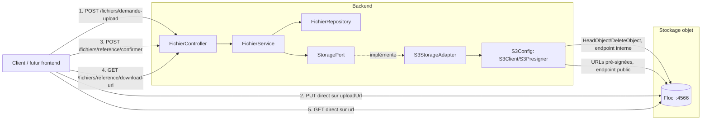

# Lot 12 — Fichiers Cloud

**Statut** : implémenté et testé côté backend (1 test d'intégration Testcontainers end-to-end + suite existante non-régressée) — **non committé**, en attente de validation utilisateur. Frontend non traité (hors périmètre demandé).
**Dépendances** : [Lot 0 — Socle & Infrastructure](LOT_0_INFRASTRUCTURE.md) (module `fichiers` posé initialement sur stockage disque local).
**Suite** : aucune identifiée — module transversal déjà consommé par les Lots 1/5/9 (justificatifs, contrats) via son contrat d'API, inchangé dans sa forme fonctionnelle (seul le mécanisme de stockage change).

Hors périmètre des 13 modules du CDF initial — ce lot n'existait pas dans `BACKLOG.md` avant le 2026-08-18.

## Objectif

Faire passer le module `fichiers` (posé au Lot 0 sur un volume disque local) à un stockage objet S3-compatible, pour couvrir deux usages : documents RH sensibles (contrats, bulletins de paie...) et uploads génériques (avatars, pièces jointes), avec un flux d'upload/download 100% en URLs pré-signées — aucun binaire ne transite plus par le backend.

## Choix techniques & Dépendances

1. **Contradiction documentaire signalée avant implémentation** : `cahier-technique.md` §1.2 et `ARCHITECTURE.md` §8 documentaient explicitement *"pas de S3/objet-storage, cohérent avec la contrainte on-premise"* — une décision motivée par une contrainte métier réelle (déploiement on-premise), pas un détail arbitraire. L'utilisateur a tranché explicitement pour un pivot vers S3/Floci malgré cette contrainte documentée ; les deux documents de référence ont été corrigés en conséquence plutôt que de coder en silence contre une contradiction non résolue (cf. règle de conflit `CLAUDE.md`).
2. **Architecture hexagonale minimale, pas de nouveau package** : un port `StoragePort` et un seul adapter concret `S3StorageAdapter` vivent dans `com.sirh.service` (package plat existant, comme `FichierService`/`ReportStorage`) plutôt que dans un nouveau package `port`/`adapter`/`infrastructure` — cohérent avec la convention du repo (packages organisés par couche technique).
3. **AWS SDK v2** (`software.amazon.awssdk:bom` + module `s3`) : le module Maven `s3-presigner` **n'existe pas** en tant qu'artefact séparé (vérifié directement sur Maven Central pendant l'implémentation, malgré des exemples en ligne suggérant le contraire) — les classes `S3Presigner`/`presigner.model.*` sont packagées à l'intérieur du jar `s3` lui-même.
4. **Floci** (`floci/floci:latest`, https://github.com/floci-io/floci, image Docker Hub vérifiée à 1,6M+ pulls) comme émulateur AWS local — choisi par l'utilisateur pour sa légèreté (~13 MiB idle, ~24ms de démarrage) face à LocalStack Community. **Aucun module Testcontainers Java dédié n'est publié** (`io.floci`/`org.floci`/`com.floci` : `numFound: 0` sur Maven Central) — `GenericContainer("floci/floci:latest")` est utilisé à la place, même approche que `REDIS` dans `AbstractIntegrationTest` qui n'a lui non plus jamais eu de module dédié.
5. **Deux endpoints S3 distincts en configuration** (`storage.s3.endpoint` vs `storage.s3.public-endpoint`) : `S3Client` (appels serveur-à-serveur : `HeadObject`/`DeleteObject`) reste sur l'endpoint interne au réseau Docker (`http://floci:4566`) ; `S3Presigner` signe toujours avec l'endpoint public (`http://localhost:4566` en dev) — sans cette distinction, une URL pré-signée générée avec `floci:4566` serait invalide une fois ouverte depuis le navigateur (qui ne résout pas ce nom d'hôte).
6. **Statut de fichier ajouté** (`EN_ATTENTE`/`DISPONIBLE`/`ECHEC`) : nécessaire car l'upload en 2 temps (URL pré-signée puis dépôt côté client) introduit une fenêtre où la ligne `fichiers` existe en base sans qu'aucun objet n'existe encore côté stockage — `GET /fichiers/{reference}/download-url` refuse (409 `FICHIER_INDISPONIBLE`) tant que la confirmation n'a pas eu lieu.
7. **Table `fichiers` étendue, jamais dupliquée** : `chemin_relatif` renommé `objet_cle` (même sémantique, déjà au format `categorie/uuid.ext`) plutôt que de créer une nouvelle table parallèle — migration Liquibase `renameColumn` + `addColumn` (`bucket`, `statut`), avec backfill des lignes existantes avant de poser la contrainte `NOT NULL` sur `bucket`.
8. **`ReportStorage` (Module 7) volontairement hors périmètre** : non mentionné par l'utilisateur, continue sur le volume disque local `storage.path` — les deux mécanismes de stockage (objet pour `fichiers`, disque local pour les rapports) cohabitent désormais, documenté explicitement dans `ARCHITECTURE.md` §8 pour éviter toute confusion future.
9. **Suppression toujours logique uniquement** (`DELETE /fichiers/{reference}`) : parité avec le comportement historique du module — l'objet stocké n'est pas physiquement effacé du bucket versionné.

## Étapes de réalisation

1. Audit du module `fichiers` existant (`Fichier`/`FichierService`/`FichierController`/`FichierRepository`) et des documents de référence (`cahier-technique.md` §1.2/§3.15, `ARCHITECTURE.md` §8) — découverte de la contradiction avec la demande utilisateur (cf. Choix techniques point 1), signalée et tranchée avant tout code.
2. Plan détaillé validé (arborescence, endpoints, schéma, docker-compose) via le mode Plan.
3. Vérification factuelle de l'image Docker Floci et des coordonnées Maven `testcontainers-floci` annoncées par l'utilisateur — la première existe (`floci/floci`), la seconde n'existe pas (aucun module Testcontainers Java publié).
4. `pom.xml` : BOM `software.amazon.awssdk:bom`, dépendance `s3` (le module `s3-presigner` séparé s'est révélé inexistant en cours de route et a été retiré).
5. `application.yml` : bloc `storage.s3.*` (endpoint interne/public, région, credentials, TTL des URLs pré-signées, noms des deux buckets).
6. `docker-compose.yml` : service `floci` (port 4566, `FLOCI_HOSTNAME=floci`, `FLOCI_STORAGE_MODE=hybrid`) ; service `backend` : nouvelles variables d'environnement `STORAGE_S3_*`, dépendance sur `floci`.
7. `FichierStatut` (nouvel enum) ; `FichierCategorie` étendu (`BULLETIN_PAIE`, `AVATAR`, `PIECE_JOINTE`).
8. `com.sirh.service.StoragePort` (port) et `com.sirh.service.S3StorageAdapter` (adapter, `HeadObject`/`DeleteObject`/URLs pré-signées PUT/GET) ; `com.sirh.config.S3Config` (beans `S3Client`/`S3Presigner`, deux endpoints distincts).
9. Migration Liquibase `004-fichiers-cloud.xml` (`renameColumn chemin_relatif → objet_cle`, `addColumn bucket/statut`, backfill, `NOT NULL`).
10. `Fichier` (entité), `FichierDto`, nouveaux DTOs `FichierDemandeUploadRequest`/`FichierUploadUrlDto`/`FichierDownloadUrlDto`, `FichierService` (réécrit : `demanderUpload`/`confirmerUpload`/`genererUrlTelechargement` remplacent `upload`/`loadAsResource`), `FichierController` (nouveaux endpoints).
11. `ErrorCode.FICHIER_INDISPONIBLE` (409) + message associé.
12. `FichierControllerIT` réécrit : conteneur Floci démarré manuellement (même pattern que Postgres/Redis dans `AbstractIntegrationTest`), buckets créés en `@BeforeAll`, flux complet demande-upload → PUT direct → confirmation → download-url → GET direct testé de bout en bout avec de vrais appels HTTP contre un vrai conteneur Floci (aucun mock du SDK AWS).
13. Validation : `mvn compile`/`spotless:apply`, `mvn verify -Dit.test=FichierControllerIT` (4/4 tests passés), `mvn test` (suite unitaire complète non-régressée), `mvn verify` complet (suite IT complète — `FichierControllerIT` passe ; des échecs préexistants et sans rapport ont été identifiés sur d'autres classes IT, cf. Procédure de validation).
14. Mise à jour de `cahier-technique.md` (§1.2, §3.15, §4.2), `ARCHITECTURE.md` (§8) et `BACKLOG.md` (Lot 0 corrigé, nouveau Lot 12) pour refléter le pivot.

## Fichiers impactés & Cartographie API

**Backend modifié** : `Fichier.java`, `FichierDto.java`, `FichierService.java`, `FichierController.java`, `FichierCategorie.java`, `ErrorCode.java`, `messages.properties`, `application.yml`, `docker-compose.yml`, `pom.xml`.
**Backend nouveau** : `FichierStatut.java`, `StoragePort.java`, `S3StorageAdapter.java`, `S3Config.java`, `FichierDemandeUploadRequest.java`, `FichierUploadUrlDto.java`, `FichierDownloadUrlDto.java`, `db/changelog/changes/004-fichiers-cloud.xml`.
**Tests** : `FichierControllerIT.java` (réécrit intégralement).
**Frontend** : aucun fichier touché — 🔴 à faire dans un lot séparé, cf. `BACKLOG.md` Lot 12.

## Procédure de validation

- `mvn compile` puis `mvn validate -Pspotless-apply` puis recompilation — 0 violation de formatage.
- `mvn verify -Dit.test=FichierControllerIT` : **4/4 tests passés** contre de vrais conteneurs Postgres + Redis + Floci (Testcontainers), aucun mock du SDK AWS — flux demande-upload → PUT présigné → confirmation → download-url → GET présigné → suppression logique, plus le cas 409 (téléchargement avant confirmation).
- `mvn test` (suite unitaire complète, 54 tests hors IT) : **0 échec**.
- `mvn verify` (suite complète, tous les IT) : `FichierControllerIT` **passe** (isolé et dans la suite complète). **Échecs préexistants et sans rapport détectés** sur `AssiduiteControllerIT`, `AutorisationControllerIT`, `CalendrierControllerIT`, `IndisponibiliteControllerIT`, `OutillageControllerIT`, `ParametreGlobalControllerIT` (500 `SYSTEM_ERROR` sur des endpoints métier n'ayant aucun rapport avec le stockage de fichiers) — confirmé **indépendant de ce lot** en relançant `AutorisationControllerIT` isolément (sans `FichierControllerIT` dans la JVM Failsafe) : échec identique. Non corrigé ici (hors périmètre de la demande), signalé pour investigation séparée.
