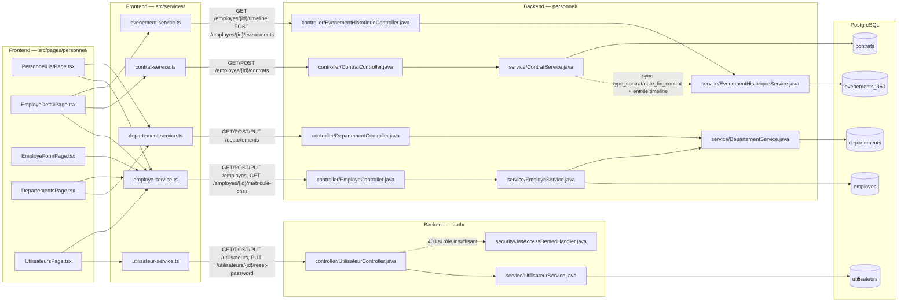

# Lot 1 — Personnel & Départements *(Module 4 du CDF)*

**Statut** : terminé, mergé (backend `fa2e85e`, frontend `4ce81e2`).
**Dépendances** : Lot 0.

## Objectif

CRUD `employes` (matricule_interne/cnss/paie, UUID), `departements`, historique `contrats` ; Vue 360° (`evenements_360` + filtres catégorie/date) ; masquage `matricule_cnss` dans les DTOs de sérialisation ; écran de gestion des comptes utilisateurs (déplacé depuis le Lot 0 car dépendant de la liste des employés).

## Étapes de réalisation

1. **Départements** — entité/repo/service/contrôleur CRUD simple (`nom`, `manager_id`), restreint `RH`/`SUPERUSER`.
2. **Employés** — relation JPA `@ManyToOne` vers `Departement` (remplace le simple `Long departementId` du Lot 0, avec un accesseur `getDepartementId()` conservé pour ne pas casser `SirhUserDetails`/le flux JWT qui ne lisent qu'un identifiant), recherche paginée (nom/prénom/matricule) + filtres (département, actif), masquage de `matricule_cnss` par défaut (`***-**-1234`) avec endpoint dédié `GET /employes/{id}/matricule-cnss` pour l'affichage complet à la demande.
3. **Contrats** — historique par employé ; création d'un contrat **synchronise** `employes.type_contrat`/`date_fin_contrat` depuis le contrat dont `date_debut` est la plus récente (pas une hypothèse d'ordre d'insertion) et génère automatiquement une entrée dans la timeline Vue 360°.
4. **Vue 360°** (`evenements_360`) — lecture filtrable (catégorie, plage de dates), saisie manuelle RH pour `NOTE_RH`/`DISCIPLINE`/`EVALUATION` ; la catégorie `CONTRAT` est réservée à la génération automatique (rejet explicite en saisie manuelle pour éviter une entrée concurrente trompeuse).
5. **Gestion des comptes utilisateurs** — CRUD (création liée à un employé existant, changement de rôle/statut, réinitialisation de mot de passe), `@Audited` sur création/modification/reset (ARCHITECTURE.md §9).
6. **Tests d'intégration** écrits (`PersonnelControllerIT`, `UtilisateurControllerIT`) — non exécutables localement (même limitation Testcontainers que le Lot 0), validation faite en conditions réelles (voir Procédure de validation).
7. **Frontend** — écran "Le Personnel" (liste paginée, recherche, filtres), fiche employé à onglets (Infos / Contrats / Historique 360°), formulaire de création/édition (React Hook Form + Zod), écran Départements, écran de gestion des comptes utilisateurs, sidebar restreinte à `RH`/`SUPERUSER` pour ces trois écrans (CDF §2.2/§2.3 — ni Manager ni Directeur n'y ont accès).

### Bugs trouvés et corrigés en validant sur la stack réelle

Aucun n'était dans le périmètre demandé, mais tous bloquaient un usage normal :

1. **Pré-existant du Lot 0** — aucun `AccessDeniedHandler` n'était configuré : un rôle authentifié mais insuffisant recevait `401` au lieu de `403` (Spring Security retombe sur l'`AuthenticationEntryPoint` faute de handler dédié). Corrigé par `JwtAccessDeniedHandler`, vérifié aussi bien sur les nouveaux endpoints que sur `FichierController` (Lot 0).
2. **Nouveau, découvert en stress-test** — les requêtes à filtres optionnels (`GET /employes`, `GET /employes/{id}/timeline`) échouaient de façon intermittente (`could not determine data type of parameter` / `function lower(bytea) does not exist`) : pgjdbc perd le type d'un paramètre nul une fois que PostgreSQL bascule sur un plan préparé mis en cache (après ~5 exécutions), et le pattern JPQL `(:param IS NULL OR ...)` ne lui donne pas assez de contexte. Remplacé par des `Specification` JPA, qui omettent purement le prédicat quand le filtre est absent plutôt que d'envoyer un paramètre ambigu.
3. **Attrapé avant déploiement** — `EmployeService.update` effaçait `matricule_cnss` dès que le champ était vide dans la requête ; or l'API ne le renvoie **jamais** en clair (masquage), donc un formulaire d'édition ne peut jamais le ré-émettre tel quel. Un champ vide signifie désormais explicitement « ne pas modifier ».
4. **Sécurité, repéré avant écriture** — le mot de passe en clair (`UtilisateurCreateRequest.password`, `ResetPasswordRequest.newPassword`) ne doit jamais figurer dans un argument de méthode `@Audited` : `AuditAspect` sérialise `joinPoint.getArgs()` tel quel dans `audit_logs.nouvelles_valeurs`, une table en lecture `SUPERUSER`. Le hash est calculé par une méthode séparée non auditée (`UtilisateurService.hashPassword`) avant l'appel à la méthode auditée, qui ne reçoit que le hash.
5. **Sécurité, découvert lors d'un audit ModelMapper post-migration** — `UtilisateurService.toDto()` se limitait à `modelMapper.map(utilisateur, UtilisateurDto.class)` ; comme `Utilisateur.employe` (`@OneToOne`) est mappé automatiquement vers l'`EmployeDto` imbriqué, ce mapping recopiait `matricule_cnss` en clair sans jamais repasser par le masquage d'`EmployeService.toDto()`. Toute réponse `GET/POST/PUT /utilisateurs` exposait donc le matricule CNSS en clair dans l'objet `employe` imbriqué. Corrigé en réappliquant explicitement le masquage (`EmployeService.maskCnss`, rendu visibilité package) juste après le mapping ; couvert par un nouveau test `UtilisateurControllerIT.listing_masqueLeMatriculeCnssDeLEmployeImbrique`.
6. **Coquille de nommage** — le champ `Departement.nmanagerId` ne correspondait pas à sa colonne `@Column(name = "manager_id")` (uniquement masqué par ModelMapper/Hibernate qui matchent sur l'annotation, pas le nom Java) ; renommé en `managerId`.
7. **Contrat API rompu** — `EmployeController.revealMatriculeCnss` (`GET /employes/{id}/matricule-cnss`) renvoyait une `Map` brute avec la clé camelCase `matriculeCnss` au lieu de `matricule_cnss` (convention snake_case du reste de l'API, via `@JsonProperty` sur les DTOs) ; le test `PersonnelControllerIT.employe_creation_masqueLeMatriculeCnssParDefaut` échouait sur l'assertion de révélation. Corrigé.

## Choix techniques & Dépendances

| Choix | Raison |
|---|---|
| `Specification` JPA plutôt que `@Query("... :param IS NULL OR ...")` | Cf. bug n°2 ci-dessus — c'est devenu le standard du projet pour tout filtre multi-critères optionnel (voir décision actée avec l'utilisateur : pas de QueryDSL, risque de compatibilité Hibernate 6/Spring Boot 3.3 non justifié par le besoin actuel). |
| React Hook Form + Zod (nouvelles dépendances frontend) | Imposé par `BACKLOG.md` pour le formulaire employé ; pas utilisé pour les formulaires plus courts (Contrat, Département, Compte utilisateur) qui restent en `useState` contrôlé — pas de sur-ingénierie pour 2-3 champs. |
| Pas de nouvelle dépendance backend | MapStruct toujours non exploité (mapping manuel via `from()`, cohérent avec le Lot 0) ; aucun besoin de librairie de recherche tierce (cf. Specifications). |
| Masquage `matricule_cnss` dans le DTO, pas en base | Aucun changement de schéma requis (ARCHITECTURE.md §10) — la sérialisation seule suffit ; affichage complet via un endpoint séparé et explicite plutôt qu'un paramètre de requête sur l'endpoint principal, pour rendre l'action d'exposition visible dans les logs d'accès. |
| Flyway conservé (pas de Liquibase) | Décision actée avec l'utilisateur — projet mono-SGBD (PostgreSQL), pas de besoin de rollback DSL ; la discipline "jamais de modification d'un `Vn` déjà appliqué" suffit. Aucune nouvelle migration nécessaire pour ce lot (tables déjà posées en V1). |

## Fichiers impactés & Cartographie API

### Endpoints exposés (Lot 1)

| Méthode | Endpoint | Rôles | Contrôleur |
|---|---|---|---|
| GET | `/departements` | RH, SUPERUSER | `DepartementController` |
| POST / PUT | `/departements`, `/departements/{id}` | RH, SUPERUSER | `DepartementController` |
| GET | `/employes` (pagination, `search`, `departementId`, `actif`) | RH, SUPERUSER | `EmployeController` |
| POST / PUT | `/employes`, `/employes/{id}` | RH, SUPERUSER | `EmployeController` |
| GET | `/employes/{id}/matricule-cnss` | RH, SUPERUSER | `EmployeController` |
| GET / POST | `/employes/{id}/contrats` | RH, SUPERUSER | `ContratController` |
| GET | `/employes/{id}/timeline` (`categorie`, `dateDebut`, `dateFin`) | RH, SUPERUSER | `EvenementHistoriqueController` |
| POST | `/employes/{id}/evenements` | RH, SUPERUSER | `EvenementHistoriqueController` |
| GET / POST | `/utilisateurs` | RH, SUPERUSER | `UtilisateurController` |
| GET / PUT | `/utilisateurs/{id}` | RH, SUPERUSER | `UtilisateurController` |
| PUT | `/utilisateurs/{id}/reset-password` | RH, SUPERUSER | `UtilisateurController` |

## Procédure de validation

- **Compilation** : `mvn compile` / `mvn test-compile` verts localement après chaque étape.
- **Tests d'intégration** : écrits (`PersonnelControllerIT` — départements, masquage CNSS, recherche filtrée, règle de synchronisation contrat, rejet catégorie `CONTRAT` en saisie manuelle ; `UtilisateurControllerIT` — création/doublon/reset/désactivation, + masquage CNSS de l'`employe` imbriqué pour les correctifs n°5-7 ci-dessus). Exécutés avec succès (`mvn test -Dtest=UtilisateurControllerIT,PersonnelControllerIT`, Docker Desktop disponible) lors de la correction des bugs n°5-7 : 11/11 verts.
- **Validation réelle** : smoke test intensif contre `docker compose up` — reconstruction de l'image backend à chaque correctif, puis pour chaque combinaison de filtres (~15 appels répétés par cas) pour forcer PostgreSQL à basculer sur un plan préparé mis en cache et vérifier la tenue du correctif n°2. Vérifié : masquage/révélation CNSS, recherche + filtres département/actif, création de contrat → synchronisation employé + entrée timeline, rejet de la catégorie `CONTRAT` en saisie manuelle, RBAC (`403` pour un rôle insuffisant, `401` sans token), création de compte + login immédiat, doublon de compte → `409`, reset password → ancien mot de passe refusé/nouveau accepté, contenu de `audit_logs` inspecté pour confirmer l'absence de mot de passe en clair.
- **Frontend** : `npm run build` (tsc + vite) et `npm run test` (Vitest, suite Lot 0 toujours verte) OK. Vérification complète au navigateur (`claude-in-chrome`) : connexion, sidebar RH/SuperUser, liste + recherche + filtres + pagination, fiche employé (3 onglets, révélation CNSS, ajout de contrat, ajout de note avec rejet de la catégorie `CONTRAT`), création d'employé avec validation Zod visible, écran Départements (création/édition + choix du manager), écran Comptes utilisateurs (création, changement de rôle, réinitialisation).
