# Lot 2 — Pointages *(Module 1 du CDF)*

**Statut** : implémenté et validé, en attente de commit/merge.
**Dépendances** : Lot 1 (les pointages référencent `employes.id`).

## Objectif

Webhook Hikvision (mode Push) avec liste blanche IP ; fallback horaire ISAPI ; import Excel asynchrone (≤1500 lignes, rollback total au 1er échec) ; détection des doublons (5 min, même pointeuse) ; correction manuelle avec audit obligatoire (Qui, Quand, Valeur précédente) ; écran Machines, grille hebdomadaire, modale de correction, suivi d'import par polling.

## Étapes de réalisation

1. **Chaînage Git** — merge (fast-forward) de `feature/lot-1-personnel-departements` dans `feature/lot-2-pointages` sur les deux dépôts : le Lot 2 référence `employes.id` (UUID), donc dépend directement des entités/API du Lot 1.
2. **Schéma & entités** — `Pointeuse`, `PointageBrut`, `AsyncJob` (tables déjà posées en `V1__init_schema.sql`, aucune migration de schéma nécessaire) + enums (`TypeEvenement`, `MethodeValidation`, `SourceImport`, `PointageStatut`, `AsyncJobType`, `AsyncJobStatut`) + `V3__seed_pointeuses_dev.sql` (2 pointeuses de test, dont une en loopback `127.0.0.1` pour pouvoir tester le webhook sans matériel).
3. **Webhook Hikvision** (`POST /api/v1/hikvision/events`) + `HikvisionIpAllowlistFilter` — filtre Spring Security exécuté avant l'authentification, compare l'IP source à `pointeuses.adresse_ip`, rejette en 403 si aucune correspondance. Pas de JWT sur ce endpoint (périphérique physique).
4. **Détection des doublons** — centralisée dans `PointageBrutService.enregistrer(...)`, point d'entrée unique pour toute insertion (webhook, import Excel). Fenêtre de 5 min, même `employe_id` + même `pointeuse_id` ; gère aussi l'insertion hors ordre chronologique (si le nouveau pointage est en réalité antérieur à un `OK` déjà en base, c'est ce dernier qui bascule en `IGNORE_DOUBLON`, pas l'inverse).
5. **Détection d'anomalie** "nombre impair de pointages" du jour — recalcul après chaque insertion, marque le dernier pointage `OK` du jour en `ANOMALIE_NON_JUSTIFIEE` si le compte (hors doublons) est impair. Résolution laissée à une action RH explicite (correction), jamais un ré-équilibrage automatique silencieux.
6. **Import Excel asynchrone** — validation du nombre de lignes (≤1500) en amont ; `@Async` sur un `ThreadPoolTaskExecutor` borné (2-4 threads) ; parsing Apache POI avec colonnes nommées (`badgeId`, `dateTime`, `typeEvenement`, `methodeValidation`) ; **rollback total au 1er échec** (une seule transaction pour tout le fichier) ; suivi via `async_jobs` (`GET /async-jobs/{id}`, polling frontend).
7. **Correction manuelle** (`PUT /pointages/{id}/corriger`, RH/SUPERUSER) — écrit directement dans `audit_logs` (anciennes **et** nouvelles valeurs) plutôt que via le mécanisme `@Audited` générique, insuffisant pour cet usage (voir Choix techniques).
8. **Fallback ISAPI horaire** (`@Scheduled`) — sonde chaque pointeuse toutes les heures, met à jour `statut_en_ligne`/`derniere_synchro`. Ne parse pas les événements d'assiduité retournés (voir limitation documentée ci-dessous).
9. **Frontend** — écran Machines (liste + statut en ligne), grille hebdomadaire des pointages (filtres employé/statut, navigation semaine, badges colorés), modale de correction (motif obligatoire), écran d'import avec suivi de progression par polling.
10. **Bug trouvé et corrigé pendant la vérification navigateur** — la liste `GET /pointages` renvoyait `employeNom`/`employePrenom`/`pointeuseNom` toujours `null` (mapping DTO jamais enrichi, seule la version à 1 argument de `PointageBrutDto.from()` était utilisée dans le contrôleur). Corrigé par un batch-fetch des employés/pointeuses concernés dans `PointageController`.
11. **Validation** — smoke test intensif via `docker compose` + `curl`/`docker exec` (Testcontainers toujours indisponible sur cette machine, cf. Lots 0/1), puis vérification complète au navigateur (`claude-in-chrome`).

## Choix techniques & Dépendances

| Choix | Raison |
|---|---|
| Apache POI (`poi-ooxml`, nouvelle dépendance) | Bibliothèque de référence pour le parsing `.xlsx` en Java — aucune alternative sérieuse, pas de raison de réinventer un parseur. |
| `@Async` + `ThreadPoolTaskExecutor` borné, pas de file de jobs dédiée | Décision actée en `ARCHITECTURE.md` §7 (volumétrie modeste, mono-instance) — cohérent avec le rôle de Redis déjà limité à cache + blacklist JWT depuis le Lot 0. |
| Import Excel scindé en 3 beans (`ImportPointagesService` → `PointageImportAsyncLauncher` → `PointageImportWriter`) | Spring AOP (`@Async`, `@Transactional`) n'intercepte que les appels **externes** à un bean, jamais un self-invocation (`this.methode(...)`). Un seul bean aurait fait exécuter l'import de façon synchrone et bloquante sur le thread HTTP (résultat encore pire : le `@Transactional` interne aurait aussi été silencieusement ignoré). Même piège déjà rencontré et documenté au Lot 1 pour le hash de mot de passe. |
| Écriture directe d'`AuditLog` pour la correction manuelle, en dehors de `@Audited` | Le mécanisme générique (`AuditAspect`, `@AfterReturning`) ne sérialise que les arguments de la méthode dans `nouvelles_valeurs` — il ne capture jamais d'état "avant". Insuffisant pour l'exigence explicite du Module 1 ("Qui, Quand, **Valeur précédente**"). Écriture manuelle et complète plutôt qu'un contournement partiel de l'annotation. |
| `POST /api/v1/hikvision/events` — seul endpoint du backend à porter ce préfixe | Le cahier technique le spécifie littéralement et à plusieurs reprises (§1.1, diagramme C4, table sécurité §10) : c'est un contrat device-to-device (pointeuse physique → backend directement sur le port exposé, pas de proxy nginx sur ce chemin), distinct du reste de l'API consommée par le frontend en chemins nus. Ne pas généraliser ce préfixe aux autres endpoints — cohérence avec tout ce qui a déjà été livré (Lots 0/1). |
| `Specification` JPA pour `GET /pointages` | Même pattern acté au Lot 1 pour la recherche multi-critères (cf. décision Flyway/Specifications vs Liquibase/QueryDSL) — pas de nouvelle dépendance. |
| Fallback ISAPI horaire : squelette réel mais sans parsing des événements | Le protocole Hikvision ISAPI réel (authentification digest, réponse XML propriétaire `AccessControllerEvent`) n'a pas pu être vérifié sans matériel physique. Fabriquer un parseur pour un schéma non confirmé aurait donné une fausse confiance plutôt qu'une vraie intégration. Le job sonde réellement la connectivité (requête HTTP + mise à jour `statut_en_ligne`) ; le parsing des événements reste à finaliser lors de l'intégration avec du matériel réel. Le canal principal et pleinement fonctionnel est le webhook Push (§1.1, testé de bout en bout). |

## Fichiers impactés & Cartographie API

```mermaid
flowchart LR
    subgraph Hikvision["Pointeuse physique"]
        Device["Hikvision (mode Push)"]
    end

    subgraph FE["Frontend — src/pages/pointages/"]
        MachinesPage["MachinesPage.tsx"]
        GridPage["PointagesGridPage.tsx"]
        CorrectionModal["CorrectionPointageModal.tsx"]
        ImportPage["ImportPointagesPage.tsx"]
    end

    subgraph FE_SVC["Frontend — src/services/"]
        PointeuseSvc["pointeuse-service.ts"]
        PointageSvc["pointage-service.ts (+ asyncJobService)"]
    end

    subgraph BE_Security["Backend — sécurité"]
        IpFilter["pointages/security/HikvisionIpAllowlistFilter.java"]
    end

    subgraph BE_Pointages["Backend — pointages/"]
        HikvisionController["controller/HikvisionController.java"]
        PointeuseController["controller/PointeuseController.java"]
        PointageController["controller/PointageController.java"]
        PointageBrutService["service/PointageBrutService.java<br/>(doublons + anomalie + correction)"]
        ImportService["service/ImportPointagesService.java"]
        AsyncLauncher["service/PointageImportAsyncLauncher.java (@Async)"]
        ImportWriter["service/PointageImportWriter.java (@Transactional, Apache POI)"]
        SyncScheduler["service/PointeuseSyncScheduler.java (@Scheduled)"]
    end

    subgraph BE_Async["Backend — async/"]
        AsyncJobController["controller/AsyncJobController.java"]
        AsyncJobService["service/AsyncJobService.java"]
    end

    subgraph DB["PostgreSQL"]
        T_pointeuses[(pointeuses)]
        T_pointages[(pointages_bruts)]
        T_asyncjobs[(async_jobs)]
        T_audit[(audit_logs)]
    end

    Device -->|"POST /api/v1/hikvision/events"| IpFilter
    IpFilter -->|"IP whitelistée"| HikvisionController
    IpFilter -.->|"403 sinon"| Device

    MachinesPage --> PointeuseSvc
    GridPage --> PointageSvc
    CorrectionModal --> PointageSvc
    ImportPage --> PointageSvc

    PointeuseSvc -->|"GET /pointeuses"| PointeuseController
    PointageSvc -->|"GET /pointages"| PointageController
    PointageSvc -->|"PUT /pointages/{id}/corriger"| PointageController
    PointageSvc -->|"POST /pointages/import"| PointageController
    PointageSvc -->|"GET /async-jobs, GET /async-jobs/{id} (polling)"| AsyncJobController

    HikvisionController --> PointageBrutService
    PointageController --> PointageBrutService
    PointageController --> ImportService
    ImportService --> AsyncLauncher
    AsyncLauncher --> ImportWriter
    ImportWriter --> PointageBrutService
    AsyncLauncher --> AsyncJobService
    ImportService --> AsyncJobService
    AsyncJobController --> AsyncJobService
    SyncScheduler --> T_pointeuses

    PointageBrutService --> T_pointages
    PointageBrutService -.->|"correction : anciennes+nouvelles valeurs"| T_audit
    AsyncJobService --> T_asyncjobs
    PointeuseController --> T_pointeuses
```

### Endpoints exposés (Lot 2)

| Méthode | Endpoint | Rôles | Contrôleur |
|---|---|---|---|
| POST | `/api/v1/hikvision/events` | Public (liste blanche IP) | `HikvisionController` |
| GET | `/pointeuses` | RH, SUPERUSER | `PointeuseController` |
| GET | `/pointages` (`employeId`, `dateDebut`, `dateFin`, `statut`) | RH, SUPERUSER | `PointageController` |
| POST | `/pointages/import` (multipart) | RH, SUPERUSER | `PointageController` |
| PUT | `/pointages/{id}/corriger` | RH, SUPERUSER | `PointageController` |
| GET | `/async-jobs?type=IMPORT_POINTAGES` | RH, SUPERUSER | `AsyncJobController` |
| GET | `/async-jobs/{id}` | RH, SUPERUSER | `AsyncJobController` |

## Procédure de validation

- **Compilation** : `mvn compile` / `mvn test-compile` verts localement à chaque étape.
- **Tests d'intégration** : écrits (`PointagesControllerIT` — webhook depuis IP autorisée, badge inconnu, doublon dans la fenêtre de 5 min, import valide → `SUCCESS`, import avec ligne invalide → `FAILED` + rollback total vérifié, correction manuelle → `audit_logs` avec anciennes/nouvelles valeurs, RBAC), non exécutables sur cette machine (Testcontainers/Docker Desktop, limitation déjà documentée aux Lots 0/1).
- **Validation réelle (`docker compose` + `curl`/`docker exec`)** :
  - Webhook depuis une IP whitelistée (`docker exec sirh-backend curl ... 127.0.0.1`) → `202`, pointage créé, `statut_en_ligne` de la pointeuse mis à jour.
  - Webhook depuis une IP non whitelistée (hôte Windows) → `403`.
  - Doublon (2 pointages à 2 min d'écart, même employé + même pointeuse) → 1x `OK`/anomalie, 1x `IGNORE_DOUBLON`.
  - Anomalie "nombre impair" : un seul pointage dans la journée → `ANOMALIE_NON_JUSTIFIEE` automatique.
  - Import Excel valide (fichier généré via `openpyxl`, 2 lignes) → job `SUCCESS`, `nombreLignesTraitees = 2`.
  - Import Excel avec une ligne invalide (matricule inexistant, ligne 3) → job `FAILED`, `ligneErreur = 3`, **aucune ligne insérée** (rollback total vérifié par comptage direct en base).
  - Correction manuelle → `200`, `statut` passe à `JUSTIFIE`, `audit_logs.anciennes_valeurs`/`nouvelles_valeurs` tous deux peuplés (vérifié par requête SQL directe).
  - RBAC : rôle `MANAGER` sur `/pointages` → `403` (pas `401`, confirme que le correctif `JwtAccessDeniedHandler` du Lot 1 couvre aussi les nouveaux endpoints).
- **Vérification navigateur complète** (`claude-in-chrome`) : connexion, sidebar RH/SuperUser (Pointages, Machines, Import pointages), écran Machines (statuts en ligne/hors ligne, y compris le passage à "Hors ligne" du fallback ISAPI horaire une fois celui-ci déclenché — confirme que le `@Scheduled` tourne réellement), grille hebdomadaire avec badges de statut colorés, modale de correction (remplissage + soumission + rafraîchissement de la grille), import de fichier réel par upload navigateur (job suivi par polling jusqu'à `SUCCESS`, historique rafraîchi automatiquement).
- **Bug de mapping DTO** trouvé pendant cette vérification navigateur (noms employé/pointeuse absents de la grille) et corrigé avant validation finale (voir Étapes de réalisation, point 10).