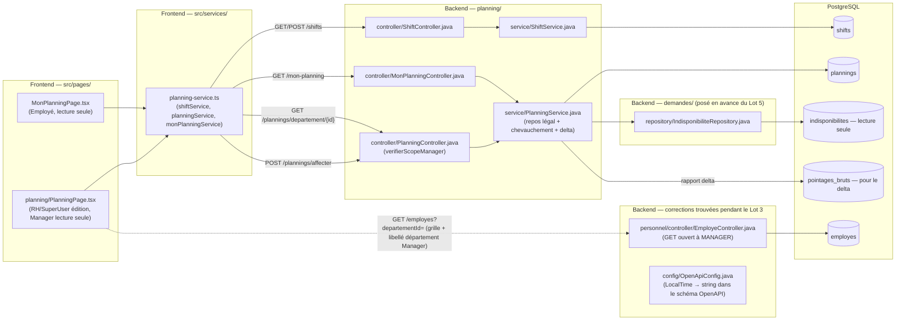

# Lot 3 — Planning *(Module 2 du CDF)*

**Statut** : implémenté et validé, en attente de commit/merge.
**Dépendances** : Lot 1 (référence `employes.id`/`departements.id`), Lot 2 (le rapport delta compare au pointage réel).

## Objectif

CRUD `shifts` (catalogue de créneaux réutilisables) ; affectation planning avec contrôle bloquant du repos légal (11h consécutives, 409) et du chevauchement avec un congé validé ; consultation par département (RH/SuperUser en édition, Manager en lecture seule sur sa propre équipe) ; consultation stricte de son propre planning pour l'Employé (`/mon-planning`) ; rapport delta planning théorique / pointage réel ; écran calendrier hebdomadaire avec alertes visuelles de violation légale.

## Étapes de réalisation

1. **Chaînage Git** — `feature/lot-3-planning` créée à partir de `feature/lot-2-pointages` sur les deux dépôts (inclut donc Lots 1+2 et leur documentation).
2. **Schéma** — `shifts` et `plannings` existaient déjà en base depuis `V1__init_schema.sql` (posées par anticipation lors du Lot 0/1) : aucune nouvelle migration Flyway nécessaire pour ce lot.
3. **Entités & repositories** — `Shift` (`typeRotation` en `String` et non enum Java : les valeurs documentées `FIXE`/`2X8`/`3X8` ne sont pas des identifiants Java valides), `Planning`, repositories avec les requêtes ciblées (fenêtre élargie ±11h pour le contrôle de repos, plage par département).
4. **Lecture `indisponibilites` en avance de phase sur le Lot 5** — la vérification "chevauchement congé validé" a besoin de lire cette table, qui appartient fonctionnellement au Lot 5 (Congés & Autorisations, pas encore construit). Plutôt que dupliquer un mapping partiel, `Indisponibilite` a été créée dans son package définitif (`com.sirh.demandes`) avec **tous** les champs du schéma §3.11 — le Lot 5 pourra construire son CRUD directement dessus sans redéfinir l'entité.
5. **Service métier (`PlanningService`)** — `affecter()` centralise les deux contrôles bloquants :
   - Repos légal : requête sur une fenêtre élargie de 11h de part et d'autre de la nouvelle affectation ; pour chaque affectation voisine, rejet immédiat si chevauchement direct, sinon calcul de l'écart et rejet si `< 11h` avec le message exact du CDF (`[VIOLATION LÉGALE] Repos consécutif insuffisant (Xh au lieu de 11h minimum). Affectation refusée.`).
   - Chevauchement congé : lecture `indisponibilites` filtrée `statut = 'VALIDE'`.
   - Rapport delta : apparie les pointages consécutifs (Entrée/Sortie, hors `IGNORE_DOUBLON`) par jour et les compare à la durée théorique des affectations du planning — même logique d'appariement que le moteur d'assiduité du Module 3.
6. **Contrôleurs** — `ShiftController` (`GET` ouvert à RH/SuperUser/Manager, `POST` RH/SuperUser) ; `PlanningController` (`/plannings/affecter`, `/plannings/departement/{id}`, `/plannings/delta`, avec scoping serveur du Manager à son propre département) ; `MonPlanningController` dédié (`/mon-planning` ne partage pas le préfixe `/plannings`), filtre strictement sur `JWT.employeId`, jamais un paramètre client.
7. **Gap de doc comblé** — `GET /plannings/delta` était requis par `cahier-fonctionnel.md` (Module 2) et `BACKLOG.md` mais absent du catalogue d'endpoints de `cahier-technique.md` §4.4. Conformément à la règle "jamais réduire le périmètre fonctionnel", l'endpoint a été implémenté et **ajouté** à `cahier-technique.md` (les deux dépôts, cf. règle de synchronisation) plutôt que d'être silencieusement laissé de côté.
8. **Bug pré-existant trouvé et corrigé (`EmployeController`)** — en branchant la vue Manager du planning (qui a besoin de lister les employés de son département pour construire les lignes du calendrier), `GET /employes` renvoyait `403` pour `ROLE_MANAGER`. Or `cahier-technique.md` §4.2 documente explicitement que les endpoints Employés/Départements en lecture doivent rester ouverts à `MANAGER` (hérité du v1) au-delà de RH/SuperUser — un oubli du Lot 1, pas une extension de périmètre décidée ici. Corrigé en passant `EmployeController` d'un `@PreAuthorize` de classe à des annotations par méthode (lecture : RH/SuperUser/Manager ; écriture et révélation CNSS : RH/SuperUser uniquement, inchangé).
9. **Bug OpenAPI trouvé et corrigé (`OpenApiConfig`)** — springdoc décrivait `java.time.LocalTime` (champs `heureDebut`/`heureFin` de `Shift`) par réflexion sur ses champs internes (`{hour, minute, second, nano}`) au lieu de la chaîne `"HH:mm:ss"` réellement produite par Jackson à l'exécution — cassait la génération de types TypeScript côté frontend (`openapi-typescript`). `LocalDate` n'a pas ce problème (déjà correctement mappé en `string`). Corrigé avec `SpringDocUtils.getConfig().replaceWithClass(LocalTime.class, String.class)`.
10. **Frontend — types & service** — régénération de `src/types/api.d.ts` (openapi-typescript) après les deux corrections backend ci-dessus, `src/types/planning.ts`, `src/services/planning-service.ts` (`shiftService`, `planningService`, `monPlanningService`).
11. **Frontend — écrans** — un seul composant `PlanningPage.tsx` pour RH/SuperUser (édition complète : nouvelle affectation, gestion des créneaux, sélecteur de département) et Manager (lecture seule, département verrouillé sur le sien) : le rôle ne change que les contrôles affichés, jamais la donnée consultée côté client (la restriction réelle est serveur). Calendrier hebdomadaire construit à la main (table HTML + navigation semaine précédente/suivante), sans dépendance de calendrier — pas de nouvelle librairie pour un besoin qu'une grille suffit à couvrir. `MonPlanningPage.tsx` (stub du Lot 0) implémenté avec la vraie consultation en lecture seule. Alerte visuelle de violation légale : bannière rouge affichant tel quel le message renvoyé par le backend (409), pas de re-formulation côté client.
12. **Sidebar** — ajout du lien "Planning" pour RH/SuperUser, et création d'une entrée dédiée pour `ROLE_MANAGER` (`navItemsForRole` retombait auparavant sur le cas par défaut "Tableau de bord" seul, alors que Lot 1/2 n'avaient jamais eu besoin de différencier ce rôle).
13. **Auto-revue manuelle du diff** (le skill `/code-review` ne peut être déclenché que par l'utilisateur, pas par l'agent) — un bug de nullabilité a été trouvé et corrigé : `PlanningController.verifierScopeManager` déréférençait `principal.getDepartementId()` sans garde ; un Manager dont l'employé n'a pas de département assigné aurait provoqué un 500 au lieu d'un 403 propre. Corrigé avec `Objects.equals(...)` (null-safe), couvert par un nouveau test d'intégration.
14. **`/code-review --fix`** (déclenché par l'utilisateur juste après) — quatre constats, tous vérifiés et corrigés dans `PlanningService` :
    - **Heures perdues sur un pointage de nuit** — `heuresReellesParJour` regroupait les pointages par jour calendaire du *timestamp brut* avant d'apparier Entrée/Sortie ; une paire à cheval sur minuit (ex. Entrée 23h/Sortie 7h le lendemain — exactement le motif Soir/Matin utilisé par les tests du repos légal) tombait dans deux groupes de taille impaire et ne s'appariait donc jamais, perdant ses heures (ou pire, s'appariant à tort avec un pointage sans rapport du jour suivant). Corrigé en appariant sur la liste triée complète de la fenêtre puis en imputant chaque session au jour de son Entrée — vérifié en base : une paire 23h/7h remonte désormais 8h sur le bon jour.
    - **`REPOS` compté comme heures théoriques** — `calculerDelta` sommait la durée de tous les plannings sans filtrer sur le statut, donc une affectation `REPOS` (jour de repos explicite) gonflait à tort les heures théoriques du rapport. Exclu par un filtre `statut != REPOS` — `PROVISOIRE` reste compté volontairement : aucun workflow de validation de planning (`PROVISOIRE` → `VALIDE`) n'existe encore dans ce lot, se limiter à `VALIDE` aurait vidé le rapport de toute donnée exploitable.
    - **`employeId` inexistant → 409 trompeur au lieu de 404** — `affecter()` ne validait pas l'existence de l'employé avant utilisation (contrairement à `shiftId`) ; un identifiant invalide échouait silencieusement sur la contrainte FK à l'insertion, remonté par le handler générique comme un 409 "contrainte d'unicité" — factuellement faux. Corrigé en validant via `employeRepository.findById(...)` en tête de méthode, même pattern que `ContratService.create`.
    - **Duplication de l'enrichissement DTO** — `PlanningController.enrichir()` et le corps de `MonPlanningController.get()` reconstruisaient la même logique (batch-fetch employé/shift, construction du DTO). Extraite en une seule méthode `PlanningService.enrichir(...)`, appelée par les deux contrôleurs.
    - Un candidat écarté après vérification : l'accès élargi de `GET /employes` à `ROLE_MANAGER` (sans restriction de département, contrairement à `PlanningController`) ressemblait à une fuite de périmètre, mais `cahier-technique.md` §4.2 documente explicitement cette règle sans restriction — confirmé non-bug.
    - Les quatre corrections sont couvertes par de nouveaux tests d'intégration (`PlanningControllerIT`).
15. **Validation** — Testcontainers toujours indisponible sur cette machine (npipe Docker Desktop, cf. Lots 0/1/2) : validation via `docker compose build/up` + `curl`/`docker exec psql` pour le backend, puis vérification complète au navigateur (`claude-in-chrome`) pour le frontend, avec trois comptes de rôles différents (RH/SuperUser, Manager, Employé).

## Choix techniques & Dépendances

| Choix | Raison |
|---|---|
| `Shift.typeRotation` en `String`, pas en enum Java | Les valeurs documentées (`FIXE`, `2X8`, `3X8`) ne sont pas des identifiants Java valides (un enum ne peut pas commencer par un chiffre) — même pattern que `Employe.typeContrat`. |
| `Indisponibilite` créée dans `com.sirh.demandes` (Lot 5) plutôt que dans `com.sirh.planning` | La table appartient fonctionnellement au Lot 5 ; y placer l'entité dès maintenant (avec tous les champs du schéma, pas un sous-ensemble) évite un remaniement quand le Lot 5 construira son CRUD, et évite un double mapping JPA de la même table dans deux packages. |
| Pas de librairie de calendrier frontend (react-big-calendar, FullCalendar, etc.) | Le besoin réel — une grille 7 jours × employés avec des blocs colorés — est couvert par une `<table>` HTML de quelques dizaines de lignes, cohérent avec la grille hebdomadaire de pointages du Lot 2 (déjà construite à la main). Ajouter une dépendance pour ça aurait été disproportionné. |
| Un seul composant `PlanningPage.tsx` pour RH/SuperUser et Manager | Les deux rôles consultent exactement la même donnée (plannings d'un département) ; seuls les contrôles d'édition diffèrent. Deux composants auraient dupliqué la requête, la grille et la navigation de semaine pour ne différer que sur l'affichage de 2 blocs de formulaire. |
| Alerte visuelle = message backend affiché tel quel (pas de re-traduction côté client) | Le CDF spécifie le message exact (`[VIOLATION LÉGALE] Repos consécutif insuffisant (Xh au lieu de 11h minimum)...`) ; le générer à nouveau côté frontend aurait dupliqué la logique de calcul d'écart et risqué une désynchronisation du wording. |
| `GET /plannings/delta` synchrone, pas via `async_jobs` | Portée bornée par département/employé + période (comme `GET /assiduite/calcul-mensuel`, déjà synchrone) — pas la volumétrie d'un export global qui justifierait un job asynchrone. |
| `EmployeRepository.findByDepartement_Id` (nouvelle méthode dérivée) | Évite un `findAll()` filtré en mémoire pour peupler la grille par département — requête SQL ciblée dès le départ plutôt qu'un scan complet de la table `employes`. |

## Fichiers impactés & Cartographie API

### Endpoints exposés (Lot 3)

| Méthode | Endpoint | Rôles | Contrôleur |
|---|---|---|---|
| GET | `/shifts` | RH, SUPERUSER, MANAGER | `ShiftController` |
| POST | `/shifts` | RH, SUPERUSER | `ShiftController` |
| POST | `/plannings/affecter` | RH, SUPERUSER | `PlanningController` |
| GET | `/plannings/departement/{id}` | RH, SUPERUSER, MANAGER (restreint à son département) | `PlanningController` |
| GET | `/plannings/delta` (`employeId` XOR `departementId`, `dateDebut`, `dateFin`) | RH, SUPERUSER, MANAGER (restreint à son département) | `PlanningController` |
| GET | `/mon-planning` | EMPLOYE (filtre serveur sur `JWT.employeId`) | `MonPlanningController` |

### Corrections apportées à des endpoints existants

| Endpoint | Avant | Après | Raison |
|---|---|---|---|
| `GET /employes`, `GET /employes/{id}` | RH, SUPERUSER | RH, SUPERUSER, **MANAGER** | Alignement avec `cahier-technique.md` §4.2 (déjà documenté, jamais implémenté) — nécessaire à la vue Planning Manager. |

## Procédure de validation

- **Compilation** : `mvn compile` / `mvn test-compile` (backend) et `tsc -b` (frontend) verts à chaque étape.
- **Tests d'intégration** : `PlanningControllerIT` — violation du repos légal (7h, rejet 409 avec le message exact), affectation acceptée à exactement 11h de repos (limite), chevauchement avec un congé validé (409), `/mon-planning` ne renvoie que le planning du titulaire du JWT, Manager sans département propre refusé proprement (403, pas de 500), plus les 3 régressions issues de `/code-review --fix` : pointage de nuit correctement attribué au jour de l'Entrée dans le rapport delta, `REPOS` exclu des heures théoriques, `employeId` inexistant refusé en 404. Non exécutable sur cette machine (Testcontainers/Docker Desktop, limitation déjà documentée aux Lots 0/1/2).
- **Validation réelle backend (`docker compose` + `curl`)** :
  - Enchaînement Soir (fin 23h00) → Matin (début 06h00) le lendemain → `409`, message `[VIOLATION LÉGALE] Repos consécutif insuffisant (7h au lieu de 11h minimum). Affectation refusée.`
  - Même enchaînement avec 11h pile de repos → `201`.
  - Affectation sur une période couverte par une `indisponibilite` de statut `VALIDE` → `409`.
  - `GET /plannings/departement/{id}` et `GET /plannings/delta` : Manager sur son propre département → `200` ; Manager sur un département étranger → `403` (pas de fuite de données).
  - `GET /mon-planning` : Employé ne voit que ses propres affectations, quel que soit le contenu de la base.
  - Rapport delta (`GET /plannings/delta?employeId=...`) : heures théoriques calculées correctement par jour à partir des `plannings`, heures réelles à 0 en l'absence de pointage (cohérent, aucun pointage inséré pour l'employé de test sur la période) ; après `/code-review --fix`, ré-validé avec une paire Entrée 23h00/Sortie 07h00 le lendemain insérée directement en base — 8h correctement imputées au jour de l'Entrée (0h avant le correctif) et un planning `REPOS` confirmé exclu des heures théoriques.
- **Vérification navigateur complète (`claude-in-chrome`)**, trois rôles :
  - **RH/SuperUser** : écran Planning, sélecteur de département, navigation semaine précédente/suivante, création de créneaux (Matin/Soir), nouvelle affectation avec bannière rouge d'alerte en cas de violation légale (vérifié en conditions réelles, message identique au backend), grille calendrier avec badges colorés par statut.
  - **Manager** : sidebar dédiée ("Planning (mon équipe)"), écran en lecture seule (aucune section "Nouvelle affectation" ni "Créneaux"), département verrouillé sur le sien avec le bon libellé, grille correctement peuplée avec les 4 employés du département.
  - **Employé** : sidebar réduite à "Mon Planning" uniquement, vue hebdomadaire en lecture seule affichant exactement les affectations de l'employé connecté.
  - Aucune erreur console JS pendant les trois parcours (`read_console_messages`).