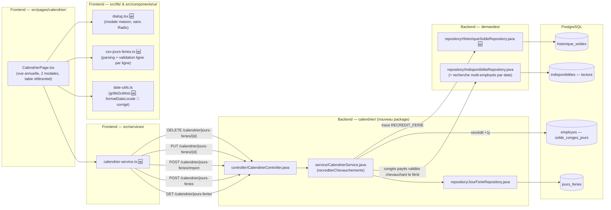

# Lot 4 — Calendrier *(Module 6 du CDF)*

**Statut** : implémenté et validé, en attente de commit/merge.
**Dépendances** : Lot 1 (référence `employes.id`), lecture en avance sur `indisponibilites` (Lot 5, posée pendant le Lot 3).

## Objectif

CRUD `jours_feries` (création unitaire + import batch) avec recrédit automatique de solde (`historique_soldes`, motif `RECREDIT_FERIE`) en cas de chevauchement congé payé validé / jour férié mobile ; écran Calendrier RH/SuperUser (vue annuelle, import de référentiel, ajout unitaire couvrant aussi bien un jour férié qu'une fermeture collective) et consultation Manager.

## Étapes de réalisation

1. **Chaînage Git** — `feature/lot-4-calendrier` créée à partir de `feature/lot-3-planning` sur les deux dépôts (inclut donc l'historique complet des Lots 1 à 3 et leur documentation).
2. **Schéma** — `jours_feries` et `historique_soldes` existaient déjà en base depuis `V1__init_schema.sql` (posées par anticipation lors du Lot 0/1) : aucune nouvelle migration Flyway nécessaire pour ce lot.
3. **Gap de doc identifié et comblé** — `cahier-technique.md` §4.5 se limitait à "✅ INCHANGÉ" sans jamais lister les endpoints (même lacune que `/plannings/delta` au Lot 3). Le contrat REST a été conçu à partir du schéma DB et de `BACKLOG.md` ("CRUD `jours_feries` + import batch"), implémenté, puis **documenté** dans les deux dépôts plutôt que laissé implicite.
4. **Entités & repositories** — `JourFerie` (nouveau package `calendrier`), `TypeJourFerie` (enum `FERIE`/`FERMETURE_COLLECTIVE`), `HistoriqueSolde` (package `demandes`, aux côtés d'`Indisponibilite` déjà posée en avance de phase pendant le Lot 3) ; nouvelle méthode dérivée sur `IndisponibiliteRepository` pour rechercher, tous employés confondus, les congés payés (`typeIndisponibilite = CONGE_PAYE`) `VALIDE` couvrant une date donnée (filtre ajouté pendant `/code-review --fix`, cf. point 14).
5. **Service métier (`CalendrierService`)** — CRUD `jours_feries` ; `recrediterChevauchements()` appelée uniquement à la **création** (unitaire et import), jamais à la modification (pour ne pas recréditer deux fois le même employé sur une simple correction de libellé), uniquement pour `type = FERIE` (jamais `FERMETURE_COLLECTIVE`), et uniquement sur un congé payé validé (jamais un autre motif d'indisponibilité comme `MALADIE`) — cf. cahier-fonctionnel.md Module 6.
6. **Import batch atomique** — méthode `@Transactional` : le premier échec (contrainte d'unicité sur `date`, etc.) fait échouer toute la transaction via le mécanisme standard Spring (aucune logique de rollback manuelle) — même principe que l'import Excel pointages (Lot 2), mais **synchrone**, pas d'`async_jobs` (volumétrie annuelle trop faible pour le justifier).
7. **Contrôleur** — `CalendrierController` (`/calendrier/jours-feries`), lecture RH/SUPERUSER/MANAGER, écriture RH/SUPERUSER, même pattern d'autorisation par méthode que `ShiftController` (Lot 3).
8. **Frontend — types & service** — régénération de `src/types/api.d.ts` (`openapi-typescript`) contre le backend reconstruit (`docker compose up --build backend`), `src/types/calendrier.ts`, `src/services/calendrier-service.ts`.
9. **Bug pré-existant trouvé et corrigé (`lib/date-utils.ts`, `formatDateLocale`)** — implémentée via `date.toISOString().slice(0, 10)`, qui convertit d'abord en UTC ; pour tout fuseau positif (UTC+1 Maroc/France, le fuseau de développement/déploiement cible), cela décale le jour affiché d'une unité (minuit local = 23h la veille en UTC). Ce bug pré-existant affectait déjà silencieusement `PlanningPage`/`MonPlanningPage` (filtrage des affectations par jour) ; découvert en construisant la grille annuelle du Calendrier, qui dépend directement de cette fonction pour aligner les badges sur le bon jour. Corrigé à la racine (reconstruction depuis les composants locaux de `Date`, plus de conversion UTC) plutôt que par un formateur dupliqué local à Calendrier — bénéficie à tous les appelants existants. Note : `PointagesGridPage.tsx` a sa propre copie locale dupliquée de la même fonction bogée, volontairement non touchée ici (hors périmètre de ce lot, à corriger si ce fichier est retouché).
10. **Frontend — composant `Dialog` maison** (`src/components/ui/dialog.tsx`) — le projet n'a aucune dépendance Radix ; toutes les primitives `components/ui` existantes sont déjà "shadcn-style sans Radix" (CVA + Tailwind écrits à la main). Modale minimale (portal + overlay + fermeture Échap/clic-extérieur) en une trentaine de lignes, sans nouvelle dépendance.
11. **Frontend — écran `CalendrierPage.tsx`** — vue annuelle (12 mini-calendriers, grille de 6 semaines par mois via une nouvelle fonction pure `grilleDuMois` dans `date-utils.ts`), légende de badges colorés (violet = Jour férié, ambre = Fermeture collective), table "Référentiel `<année>`" listant tous les jours de l'année avec action de suppression pour RH/SuperUser (confirmation native `window.confirm`). Deux modales : création unitaire (formulaire complet date/libellé/type/portée/région, avec rappel du recrédit automatique affiché uniquement quand `type = FERIE`), import batch (upload d'un fichier CSV, parsing et prévisualisation côté client avant envoi).
12. **Parseur CSV** (`src/lib/csv-jours-feries.ts`) — volontairement simple (split virgule, pas de valeurs entre guillemets), le format cible étant un référentiel annuel d'une quinzaine de lignes (pas un import de masse comme les pointages) ; en-tête optionnel, erreurs de parsing rapportées ligne par ligne sans bloquer les lignes valides suivantes. Couvert par un test unitaire dédié (`csv-jours-feries.test.ts`, 5 cas).
13. **Sidebar** — ajout du lien "Calendrier" pour RH/SuperUser et Manager (lecture seule côté backend pour ce dernier, cohérent avec le contrat d'API §4.5).
14. **Auto-revue manuelle du diff** (le skill `/code-review` ne peut être déclenché que par l'utilisateur, pas par l'agent) — un bug trouvé et corrigé : le bouton "Annuler" de la modale de création ne réinitialisait pas le formulaire (le composant reste monté entre deux ouvertures de la modale — seul le rendu du `Dialog` est conditionnel sur `open`) — une saisie abandonnée réapparaissait à la prochaine ouverture. Corrigé en réinitialisant le formulaire à la fermeture (annulation *et* succès), avec une date par défaut recalculée à chaque réinitialisation (`formulaireVide()`, une fonction) plutôt que figée une fois pour toutes au chargement du module.
15. **`/code-review --fix`** (déclenché par l'utilisateur juste après la vérification navigateur) — deux constats, tous deux vérifiés et corrigés :
    - **Recrédit trop permissif** — `recrediterChevauchements` recréditait sur *n'importe quel* type d'`indisponibilite` `VALIDE` (congé payé, mais aussi maladie, etc.), alors que le CDF (Module 6) et `cahier-technique.md` §4.5 restreignent la règle au congé payé. Corrigé : nouvelle méthode `IndisponibiliteRepository.findByTypeIndisponibiliteAndStatutAndDateDebutLessThanEqualAndDateFinGreaterThanEqual`, filtrée sur `"CONGE_PAYE"` (littéral déjà utilisé ailleurs dans le code — `PlanningService`, fixtures de test). `cahier-technique.md` §4.5 corrigé en conséquence dans les deux dépôts.
    - **`@Valid` ne cascade pas sur un `List<T>` en `@RequestBody`** — limitation connue de Bean Validation/Spring MVC : une ligne d'import avec un champ obligatoire manquant (ex. `libelle` absent) passait la validation DTO sans erreur et n'échouait qu'à l'insertion (contrainte `NOT NULL`), remontant un `409` trompeur ("contrainte d'unicité") au lieu d'un `400` explicite — incohérent avec le `POST` unitaire, qui rejette correctement ce cas en `400`. Corrigé en injectant un `jakarta.validation.Validator` dans `CalendrierController` et en validant chaque ligne manuellement avant mapping, plutôt que de changer le contrat d'API documenté (`POST /calendrier/jours-feries/import` reste un tableau JSON brut, pas un objet enveloppe) — réutilise le handler `IllegalArgumentException → 400` déjà existant, pas de nouveau type d'exception.
    - Les deux corrections sont couvertes par de nouveaux tests d'intégration (`CalendrierControllerIT`) et revérifiées manuellement contre le backend reconstruit (`docker compose up --build backend` + `curl`).
16. **Validation** — Testcontainers toujours indisponible sur cette machine (npipe Docker Desktop, limitation documentée depuis le Lot 0) : validation backend via `docker compose build/up` + `curl`/`docker exec psql`, puis vérification complète au navigateur (`claude-in-chrome`) pour le frontend en rôle SUPERUSER (CRUD, import, badges, rollback sur doublon).

## Choix techniques & Dépendances

| Choix | Raison |
|---|---|
| Import batch synchrone (pas `async_jobs`) | Référentiel annuel de quelques dizaines de lignes maximum — pas la volumétrie d'un import Excel de pointages qui justifie un job asynchrone ; même raisonnement que `/plannings/delta` au Lot 3. |
| Recrédit uniquement à la création, jamais à la modification | Le CDF déclenche la règle quand le férié "est validé" (= créé) ; recréditer aussi au `PUT` aurait risqué un double recrédit sur une simple correction de libellé, sans mécanisme d'idempotence pour l'empêcher. |
| Recrédit limité au type `FERIE`, jamais `FERMETURE_COLLECTIVE` | Le CDF parle explicitement d'un "jour férié mobile" prioritaire sur un congé déjà posé ; une fermeture collective est une décision RH interne, pas un jour chômé légal avec la même priorité. |
| `HistoriqueSolde` dans `com.sirh.demandes` (pas `com.sirh.calendrier`) | Même raisonnement qu'`Indisponibilite` au Lot 3 : la table appartient fonctionnellement au domaine soldes/congés (les Lots 5/6 y écriront aussi, avec d'autres motifs) — la poser dans son package définitif évite un remaniement futur. |
| Pas de librairie de calendrier frontend (react-big-calendar, FullCalendar…) | La vue annuelle est 12 grilles 7×6 avec surlignage conditionnel — couvert par une fonction pure (`grilleDuMois`) + une grid CSS, cohérent avec le choix déjà fait pour la grille hebdomadaire du Planning (Lot 3) et des pointages (Lot 2). |
| `Dialog` maison plutôt que Radix/shadcn officiel | Le projet n'a aucune dépendance Radix ; toutes les primitives `components/ui` existantes sont déjà "shadcn-style sans Radix" (CVA + Tailwind à la main). Ajouter Radix pour une seule modale aurait rompu cette cohérence pour un composant qui tient en une trentaine de lignes. |
| Import CSV parsé côté client (pas d'endpoint multipart dédié) | `POST /calendrier/jours-feries/import` attend un tableau JSON, pas un fichier — cohérent avec un référentiel de quelques lignes (contrairement aux pointages, qui ont un vrai parseur Excel serveur pour 1500 lignes). Parser côté client puis réutiliser l'endpoint JSON existant évite de dupliquer un parseur de fichier côté backend pour ce volume. |
| Correctif `formatDateLocale` appliqué à la fonction partagée, pas dupliqué localement | Bug de fond, pas de façade : le bug affectait déjà silencieusement `PlanningPage`/`MonPlanningPage` ; corriger la fonction partagée bénéficie à tous les appelants au lieu de contourner uniquement pour Calendrier. |

## Fichiers impactés & Cartographie API

### Endpoints exposés (Lot 4)

| Méthode | Endpoint | Rôles | Contrôleur |
|---|---|---|---|
| GET | `/calendrier/jours-feries` (`dateDebut`, `dateFin`) | RH, SUPERUSER, MANAGER | `CalendrierController` |
| POST | `/calendrier/jours-feries` | RH, SUPERUSER | `CalendrierController` |
| POST | `/calendrier/jours-feries/import` | RH, SUPERUSER | `CalendrierController` |
| PUT | `/calendrier/jours-feries/{id}` | RH, SUPERUSER | `CalendrierController` |
| DELETE | `/calendrier/jours-feries/{id}` | RH, SUPERUSER | `CalendrierController` |

## Procédure de validation

- **Compilation** : `mvn compile`/`mvn test-compile` (backend), `tsc -b` + `vite build` (frontend), verts à chaque étape.
- **Tests** : `CalendrierControllerIT` (backend, 7 cas — recrédit sur `FERIE` chevauchant un congé payé validé, absence de recrédit pour `FERMETURE_COLLECTIVE`, absence de recrédit sur un autre type d'indisponibilité validée (`MALADIE`, régression `/code-review --fix`), rollback total de l'import sur doublon, ligne d'import invalide refusée en `400` (régression `/code-review --fix`), `403` pour MANAGER en écriture, liste filtrée par période) — non exécutable sur cette machine (Testcontainers/npipe, limitation documentée depuis le Lot 0). `csv-jours-feries.test.ts` (frontend, 5 cas) — exécuté avec succès (`vitest run`, 9/9 tests verts tous fichiers confondus).
- **Validation réelle backend** (`docker compose up --build backend` + `curl`/`docker exec psql`) :
  - Création `FERIE` chevauchant une `indisponibilite` `CONGE_PAYE` `VALIDE` existante → solde employé `10.00` → `11.00`, ligne `historique_soldes` créée (motif `RECREDIT_FERIE`, delta `+1`, source `JOUR_FERIE`).
  - Création `FERMETURE_COLLECTIVE` sur la même période chevauchant le même congé → solde inchangé (`11.00`), confirmant l'absence de recrédit pour ce type.
  - Import batch (2 lignes, dont une date déjà existante) → `409`, aucune des deux lignes insérée (revérifié par `GET` après coup).
  - Doublon de date en création unitaire → `409`.
  - **Après `/code-review --fix`, backend reconstruit et revérifié** : création `FERIE` chevauchant une `indisponibilite` `MALADIE` `VALIDE` → solde inchangé (`10.00`), confirmant la restriction du recrédit au seul congé payé. Import avec une ligne sans `libelle` → `400` (`"Ligne d'import invalide : must not be blank"`), plus le `409` trompeur d'avant correctif.
- **Vérification navigateur complète** (`claude-in-chrome`), rôle SUPERUSER :
  - Vue annuelle : 12 mini-calendriers, alignement des jours de semaine correct (vérifié : 1er janvier 2026 = Jeudi, cohérent avec le calendrier réel — confirme le correctif de `formatDateLocale`), badges violet/ambre cohérents entre la grille annuelle et la table "Référentiel".
  - Modale de création : formulaire complet, rappel du recrédit affiché uniquement pour `type = FERIE`, fermeture "Annuler" réinitialise désormais le formulaire (bug trouvé en auto-revue, corrigé avant validation finale).
  - Modale d'import : upload d'un vrai fichier CSV, prévisualisation exacte des lignes parsées, import réussi (badges apparus sur la grille), puis import avec doublon → message d'erreur serveur affiché tel quel, aucune ligne insérée (revérifié en base).
  - Suppression : bouton déclenche bien `window.confirm()` ; l'appel API sous-jacent a été vérifié fonctionnellement en direct (backend/API), le dialogue natif n'étant pas pilotable par l'outil d'automatisation navigateur utilisé pour cette session.
  - Aucune erreur console JS pendant le parcours.
  - Toutes les données de test créées pendant cette vérification ont été supprimées de la base de dev après coup.
