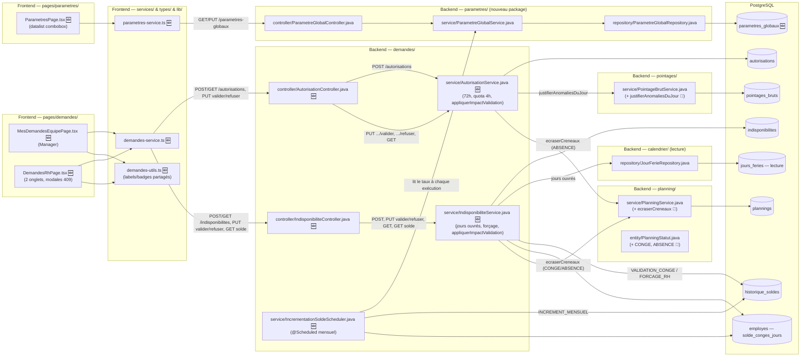

# Lot 5 — Congés & Autorisations *(Modules 8 et 13 du CDF)*

**Statut** : implémenté, validé et committé (backend + frontend). PR backend ouverte (`sirh-project-backend`), branche frontend poussée (`sirh-project-frontend`).
**Dépendances** : Lot 1 (référence `employes.id`), Lot 2 (justification d'anomalies de pointage), Lot 3 (contrôle bloquant de chevauchement congé/planning, package `com.sirh.planning`), Lot 4 (jours fériés, `Indisponibilite`/`HistoriqueSolde` posées en avance de phase).

## Objectif

Workflow de saisie hiérarchique (Manager avec avis → validation RH, ou saisie RH d'urgence) pour les autorisations d'absence courte (Module 13, justification automatique des anomalies de pointage) et les indisponibilités/congés (Module 8, déduction automatique de solde en jours ouvrés) ; règles de délai 72h et de quota mensuel 4h sur les autorisations ; gestion du solde insuffisant/forçage RH sur les congés ; incrémentation mensuelle automatique du solde via un taux paramétrable dynamiquement (aucune valeur métier codée en dur) ; mise à jour du planning comme source de vérité unique à la validation d'une demande.

## Étapes de réalisation

1. **Chaînage Git** — `feature/lot-5-conges-autorisations` créée à partir de `feature/lot-4-calendrier`.
2. **Design first (règle n°1 du DoD)** — lecture de `cahier-fonctionnel.md` (Modules 8/13), `cahier-technique.md` (§3.10-3.12, §4.6, §5) et `BACKLOG.md`, proposition d'architecture complète soumise à l'utilisateur avant tout code. Cinq ajustements actés par l'utilisateur avant le "go" : quota 4h cumulant `EN_ATTENTE_RH`+`VALIDE`, déduction de solde en **jours ouvrés** (pas calendaires — interfaçage explicitement demandé avec `jours_feries` du Lot 4), mise à jour du **planning** à la validation (créneau `CONGE`/`ABSENCE`, pas seulement le contrôle bloquant du Lot 3), gap `PUT /indisponibilites/{id}/refuser` à combler, et table de paramétrage nommée `parametres_globaux` (pas `parametres_rh`, pour rester réutilisable par d'autres lots).
3. **Migration V4 — `parametres_globaux`** — table générique `cle`/`valeur`/`type`, seedée avec `TAUX_INCREMENTATION_CONGES_MENSUEL = 1.5`. Nouveau package `com.sirh.parametres` (entity/repository/service/dto/controller), volontairement hors de `demandes` pour rester réutilisable (ex. seuils M+5/M+11 du Lot 9 à venir).
4. **Migration V5 — shift système** — `plannings.shift_id` est `NOT NULL` mais les créneaux `CONGE`/`ABSENCE` générés automatiquement n'ont pas de créneau horaire réel : un shift "système" (`type_rotation = 'SYSTEME'`) sert de support générique unique, plutôt que de rendre la colonne nullable (éviterait de casser la contrainte existante pour un cas très minoritaire).
5. **`PlanningService.ecraserCreneaux`** — nouvelle méthode partagée (Lot 3 existant) : supprime toute affectation chevauchant strictement la fenêtre puis insère un créneau `CONGE`/`ABSENCE`. Statuts `PlanningStatut.CONGE`/`ABSENCE` ajoutés, exclus des heures théoriques du rapport delta au même titre que `REPOS`. Committé séparément avant tout code de `demandes` puisqu'il s'agit d'une extension du domaine `planning`, pas de `demandes`.
6. **`Autorisation`** — entité/repository/service/dto/controller créés de zéro (contrairement à `Indisponibilite`/`HistoriqueSolde`, posées en avance pendant les Lots 3/4). `PointageBrutService.justifierAnomaliesDuJour` ajoutée côté `pointages` (appariement employé+jour, la FK `pointages_bruts.autorisation_id` reste unidirectionnelle) pour ne pas dupliquer la logique de mutation de pointage hors de son module propriétaire.
7. **`Indisponibilite`/`HistoriqueSolde`** — CRUD/workflow complétés sur les entités déjà posées. Déduction en jours ouvrés : `IndisponibiliteService` injecte `JourFerieRepository` (package `calendrier`) pour exclure week-ends et jours `type = FERIE` (jamais `FERMETURE_COLLECTIVE`, cohérent avec la règle de recrédit du Lot 4) du décompte.
8. **Gaps d'endpoints comblés et documentés** — même pattern que `/plannings/delta` (Lot 3) et `/calendrier/jours-feries` (Lot 4) : `cahier-technique.md` §4.6 ne listait aucun `GET` de listing ni `PUT /indisponibilites/{id}/refuser`. Contrat conçu à partir du besoin des écrans "liste à valider"/"historique" (`BACKLOG.md`), implémenté, puis documenté dans `cahier-technique.md` §4.6/§4.11.
9. **Bug trouvé en vérification manuelle et corrigé** — le workflow d'urgence RH (statut `VALIDE` dès la création) ne déclenchait aucun des effets d'une validation (déduction de solde, justification de pointage, mise à jour du planning), ces effets n'existant que dans `valider()`. Trouvé en testant le scénario RH-direct via `docker compose` + `curl` (Testcontainers indisponible sur cette machine, cf. point 11) : une indisponibilité `CONGE_PAYE` créée directement par le RH restait `VALIDE` sans jamais déduire le solde. Corrigé par extraction d'une méthode partagée `appliquerImpactValidation()` appelée à la fois par `creer()` (chemin RH) et `valider()` — commit dédié, tests d'intégration mis à jour pour refléter le comportement corrigé (deux tests reposaient implicitement sur l'ancien bug : ils appelaient `valider()` après une création RH déjà `VALIDE`, ce qui renvoie désormais `409` puisque la demande n'est plus `EN_ATTENTE_RH`).
10. **Choix délibéré : quota 4h non bloquant à la création RH d'urgence** — contrairement à la déduction de solde, le contrôle de quota mensuel (bloquant, avec choix `DEDUCTION_SALAIRE`/`RECUPERATION` obligatoire) reste réservé à la validation RH explicite en deux temps. Bloquer une autorisation urgente sur un total mensuel sans rapport avec l'absence à traiter irait à l'encontre de l'objectif même du workflow d'urgence (traiter vite un cas réellement urgent) — asymétrie documentée en commentaire de code.
11. **Validation backend** — Testcontainers toujours indisponible sur cette machine (npipe Docker Desktop, limitation documentée depuis le Lot 0 ; une tentative avec `DOCKER_HOST` explicite sur le pipe `dockerDesktopLinuxEngine` échoue avec la même erreur `BadRequestException` malgré `docker info`/`docker compose` fonctionnels en CLI). Validation via `docker compose up --build` + `curl`/`docker exec psql`, couvrant tous les scénarios métier (détail §Procédure de validation). Le job mensuel (`IncrementationSoldeScheduler`) est testé unitairement avec Mockito (pas de dépendance HTTP/DB, donc pas besoin de Testcontainers).
12. **Design first frontend** — proposition d'architecture UI/UX (écrans, parcours, composants, intégration à l'existant) soumise à l'utilisateur avant tout code, à partir d'une exploration du frontend existant (`App.tsx`, `AppLayout.tsx`, `PlanningPage`/`CalendrierPage` des Lots 3/4, primitives `components/ui/*`). Trois points ouverts tranchés par l'utilisateur avant le "go" : liste fermée des types d'indisponibilité (`CONGE_PAYE`, `CONGE_SANS_SOLDE`, `MALADIE`, `MATERNITE`, `AUTRE` — aucune énumération officielle n'existe côté backend pour ce champ), deux onglets dans une seule route `/demandes` plutôt que deux écrans séparés côté RH, route `/parametres` dédiée et séparée du reste (socle générique pour les futurs paramètres).
13. **Régénération des types** — `docker compose up --build` (backend Lot 5) puis `npm run generate:api-types` : `src/types/api.d.ts` récupère les schémas `AutorisationDto`/`IndisponibiliteDto`/`ParametreGlobalDto`/etc. Vérifié que les query params générés (`statut`, `employeId`, `departementId`, `dateDebut`, `dateFin`) correspondent exactement à ceux conçus côté backend.
14. **Types & services** — `src/types/demandes.ts`, `src/types/parametres.ts` (wrappers `components['schemas'][...]`, même pattern que `types/calendrier.ts`/`types/planning.ts`), `src/services/demandes-service.ts`, `src/services/parametres-service.ts` (même pattern `apiClient.get/post/put`). Commit séparé, premier des quatre commits frontend.
15. **Écran Paramètres RH** (`/parametres`, RH/SUPERUSER) — liste générique de tous les paramètres retournés par le backend (pas seulement le taux d'incrémentation codé en dur), combobox native `<input list> + <datalist>` pour les valeurs `DECIMAL` (suggestions 1/1.5/2/2.5/3, saisie libre acceptée) — exactement la demande explicite de l'utilisateur formulée pendant la conception backend, sans nouvelle dépendance.
16. **Écran Manager `/mes-demandes-equipe`** — switch Autorisation/Indisponibilité, employé-picker scopé au département du Manager (`employeService.list({ departementId: user.departementId })`, même pattern que `PlanningPage`), avis obligatoire, deux tableaux d'historique (le scope "son équipe" est appliqué côté serveur, ce composant consomme le résultat tel quel sans re-filtrer).
17. **Écran RH `/demandes`** — deux onglets (Autorisations/Indisponibilités), filtres (statut/département/employé), actions Valider/Refuser. `Valider` tente l'appel direct puis, sur les deux 409 documentés (quota dépassé, solde insuffisant), ouvre une modale de décision (`Dialog` existant) plutôt qu'un message d'erreur sec — correspond exactement à l'UX validée avec l'utilisateur pendant la conception. Panneau de consultation de solde sur l'onglet Indisponibilités.
18. **Petite factorisation** — `src/lib/demandes-utils.ts` (labels/couleurs de statut) partagé entre les écrans Manager et RH plutôt que dupliqué comme `STATUT_STYLES` l'a été entre `PlanningPage`/`MonPlanningPage` aux lots précédents.
19. **Vérification navigateur complète** (`claude-in-chrome`, backend + `vite dev` réels, pas de mocks) sur les trois rôles (Manager, RH/SuperUser) — détail §Procédure de validation. Un bug de l'ancienne limitation `window.confirm()` non pilotable par l'outil d'automatisation (déjà rencontré au Lot 4) a nécessité de dismiss le dialogue natif via la touche Entrée plutôt qu'un clic simulé.

## Choix techniques & Dépendances

| Choix | Raison |
|---|---|
| `parametres_globaux` générique (pas `parametres_rh`) | Décision explicite de l'utilisateur : réutilisable par d'autres lots (seuils, taux) sans nouvelle migration à chaque paramètre. Colonne `type` pour supporter au-delà de `DECIMAL` sans changement de schéma. |
| Taux relu à chaque exécution du job, jamais mis en cache | Un changement de taux par le RH doit s'appliquer dès le prochain passage du cron sans redéploiement — cohérent avec `CLAUDE.md` (Redis borné au dashboard/JWT, jamais réutilisé pour ce genre de configuration). |
| Shift "système" (migration V5) plutôt que `shift_id` nullable | Évite d'affaiblir une contrainte `NOT NULL` existante pour un cas minoritaire (créneaux générés automatiquement, sans créneau horaire réel). |
| Déduction de solde en jours ouvrés, interfacée avec `jours_feries` | Décision explicite de l'utilisateur (refus du calcul en jours calendaires) : le Lot 4 existe déjà, doit être réutilisé plutôt que dupliqué. |
| Recrédit du Lot 4 limité à `CONGE_PAYE`/`FERIE` réutilisé tel quel pour l'exclusion des jours ouvrés | Cohérence : un jour férié qui recrédite un congé payé au Lot 4 ne doit pas non plus être compté comme un jour consommé au Lot 5 — même filtre `type = FERIE` (jamais `FERMETURE_COLLECTIVE`) des deux côtés. |
| Mise à jour planning en complément du contrôle Lot 3, jamais en remplacement | Décision explicite de l'utilisateur : le contrôle bloquant (refus d'affectation sur congé validé) reste utile même avec un planning à jour — deux garde-fous indépendants plutôt qu'un seul point de défaillance. |
| Justification des pointages par appariement employé+jour (pas de nouvelle colonne) | La FK `pointages_bruts.autorisation_id` posée au Lot 2 est unidirectionnelle par conception ; réutiliser l'appariement plutôt que d'ajouter un lien inverse évite un remaniement de schéma pour ce lot. |
| `PointageBrutService.justifierAnomaliesDuJour` dans `pointages`, pas `demandes` | Le module `pointages` reste le seul point de mutation des pointages bruts (cohérent avec son javadoc "point d'entrée unique") ; `demandes` appelle ce service plutôt que d'écrire directement dans `pointages_bruts`. |
| Quota 4h bloquant uniquement à la validation en deux temps, jamais à la création RH d'urgence | Choix délibéré (pas explicitement tranché par l'utilisateur) : bloquer une urgence sur un total mensuel sans rapport avec l'absence à traiter contredirait l'objectif du workflow d'urgence. Documenté en commentaire de code et dans ce lot pour traçabilité — à reconfirmer si le comportement attendu diffère. |
| `AutorisationService`/`IndisponibiliteService` : `appliquerImpactValidation()` partagée entre `creer()` (RH) et `valider()` | Bug trouvé en vérification manuelle (workflow d'urgence sans effets) : une seule méthode d'impact garantit que les deux chemins vers `VALIDE` produisent le même résultat, plutôt que deux implémentations à maintenir en synchronisation. |
| Formulaires en `useState` simple (pas React Hook Form + Zod) pour les 3 écrans frontend | Convention établie aux Lots 3/4 (plus récente que le formulaire pleine page de Lot 1) pour les actions rapides en modale/inline — RHF+Zod réservé aux formulaires pleine page dédiés, absents de ce lot. |
| `<input list> + <datalist>` natif pour le paramètre décimal (pas de composant combobox tiers) | Demande explicite de l'utilisateur pendant la conception backend, satisfaite sans nouvelle dépendance — cohérent avec l'absence totale de Radix dans le projet (`Dialog` maison du Lot 4). |
| Écran `/parametres` générique (boucle sur tous les paramètres retournés, pas seulement le taux de congés) | Anticipe les paramètres des lots futurs (M+5/M+11 du Lot 9, etc.) sans nouveau composant à écrire à chaque ajout côté backend. |
| Deux onglets dans une seule route `/demandes` côté RH | Validé par l'utilisateur : `Autorisation`/`Indisponibilite` sont deux entités backend distinctes mais un seul workflow RH (valider/refuser) — plus ergonomique qu'une sidebar à deux entrées. |
| `src/lib/demandes-utils.ts` partagé (Manager + RH) | Évite de reproduire la duplication `STATUT_STYLES` déjà présente entre `PlanningPage`/`MonPlanningPage` — écrit une fois puisque les deux écrans sont construits dans le même lot. |

## Fichiers impactés & Cartographie API

### Routes frontend exposées (Lot 5)

| Route | Rôle(s) | Écran |
|---|---|---|
| `/demandes` | RH, SUPERUSER | `DemandesRhPage.tsx` |
| `/mes-demandes-equipe` | MANAGER | `MesDemandesEquipePage.tsx` |
| `/parametres` | RH, SUPERUSER | `ParametresPage.tsx` |

### Endpoints exposés (Lot 5)

| Méthode | Endpoint | Rôles | Contrôleur |
|---|---|---|---|
| GET/PUT | `/parametres-globaux`, `/parametres-globaux/{cle}` | RH, SUPERUSER | `ParametreGlobalController` |
| POST | `/autorisations` | MANAGER, RH, SUPERUSER | `AutorisationController` |
| PUT | `/autorisations/{id}/valider`, `/refuser` | RH, SUPERUSER | `AutorisationController` |
| GET | `/autorisations` | MANAGER (son département), RH, SUPERUSER | `AutorisationController` |
| POST | `/indisponibilites` | MANAGER, RH, SUPERUSER | `IndisponibiliteController` |
| PUT | `/indisponibilites/{id}/valider`, `/refuser` | RH, SUPERUSER | `IndisponibiliteController` |
| GET | `/indisponibilites`, `/indisponibilites/solde/{employeId}` | MANAGER (son département), RH, SUPERUSER | `IndisponibiliteController` |

## Procédure de validation

- **Compilation** : `mvn compile`/`mvn test-compile`, verts après chaque commit.
- **Tests unitaires** : `IncrementationSoldeSchedulerTest` (Mockito, 2 cas — taux appliqué à chaque employé actif, relecture du taux à chaque appel sans cache) — exécutés avec succès (`mvn test`, offline, pas de Docker requis).
- **Tests d'intégration** (`ParametreGlobalControllerIT`, `AutorisationControllerIT`, `IndisponibiliteControllerIT`, `PlanningServiceEcraserCreneauxIT`) : écrits et compilés (~25 cas au total couvrant CRUD paramètres, délai 72h, quota 4h, justification de pointage, déduction jours ouvrés, solde insuffisant/forçage, refuser, scope Manager) — **non exécutables sur cette machine** (Testcontainers/npipe Docker Desktop, limitation documentée depuis le Lot 0 ; confirmée à nouveau ce lot avec une tentative de contournement via `DOCKER_HOST` explicite, sans succès).
- **Validation réelle backend** (`docker compose up --build backend` + `curl`/`docker exec psql`), tous les scénarios rejoués manuellement après reconstruction du backend avec le correctif du point 9 :
  - `parametres-globaux` : lecture du taux seedé (`1.5`), modification RH (`1.75`), lecture confirmant la persistance, `403` pour Manager.
  - Autorisation, workflow normal : Manager crée avec avis dans les 72h → `EN_ATTENTE_RH` ; au-delà de 72h → `409 [DÉLAI DÉPASSÉ]` ; RH valide → anomalie de pointage du jour passée en `JUSTIFIE` avec `autorisation_id`, créneau `ABSENCE` généré sur le planning (vérifié en base).
  - Autorisation, workflow d'urgence RH (après correctif) : création directe → `VALIDE`, justification de pointage et créneau planning **déjà présents immédiatement**, sans appel `valider()` séparé.
  - Autorisation : `PUT .../refuser` (Manager crée `EN_ATTENTE_RH`, RH refuse → `REFUSE`), `GET /autorisations?statut=REFUSE` confirme le listing.
  - Indisponibilité, workflow normal + jours ouvrés : congé payé Lundi→Vendredi avec un jour férié (`type=FERIE`) inséré le mercredi → 4 jours ouvrés décomptés (pas 5), solde déduit en conséquence, créneau `CONGE` généré sur le planning.
  - Indisponibilité, solde insuffisant : sans `forcer` → `409 "Solde insuffisant (X jours disponibles)"`, solde inchangé en base ; avec `forcer:true` → déduction en négatif, `historique_soldes.motif = FORCAGE_RH`.
  - Indisponibilité, workflow d'urgence RH (après correctif) : même comportement forçage/blocage directement à la création (pas seulement à la validation), vérifié en base (`solde_conges_jours`, `historique_soldes`, `plannings`).
  - Indisponibilité : `PUT .../refuser` (gap comblé), `GET /indisponibilites?statut=REFUSE`.
  - Régression Lot 4 : `POST /calendrier/jours-feries` toujours `403` pour Manager (aucune régression de permissions introduite par les nouveaux modules).
  - Toutes les données de test créées pendant cette vérification (employés, comptes, autorisations, indisponibilités, pointages, jour férié, planning) ont été supprimées de la base de dev après coup ; le paramètre global a été remis à sa valeur seedée (`1.5`).
- **Compilation frontend** : `tsc --noEmit` vert après chaque commit (`noUnusedLocals`/`noUnusedParameters` activés dans `tsconfig.app.json`).
- **Tests frontend** : `vitest run` — 9/9 tests existants toujours verts (aucune régression). Pas de nouveau test ajouté pour les 3 écrans de ce lot, cohérent avec l'absence de test sur `PlanningPage`/`CalendrierPage` aux lots précédents (composants de page, pas de logique métier isolée à tester unitairement côté frontend).
- **Vérification navigateur complète** (`claude-in-chrome`, backend réel `docker compose up --build` + `vite dev` réel, aucun mock), rejouée sur les rôles SUPERUSER et MANAGER :
  - Connexion SUPERUSER → sidebar affiche bien "Congés & Autorisations" et "Paramètres" (absents pour les autres rôles déjà vérifiés aux lots précédents).
  - `ParametresPage` : valeur seedée affichée (`1.5`), combobox datalist (flèche native visible, suggestions 1/1.5/2/2.5/3), saisie libre `1.75` acceptée et persistée (`Enregistrer` désactivé tant que la valeur ne change pas, réactivé après modification), remis à `1.5` après vérification.
  - Connexion MANAGER (compte de test dédié) → sidebar réduite à Tableau de bord/Planning/Calendrier/Demandes (aucune entrée RH). `MesDemandesEquipePage` : soumission d'une indisponibilité `CONGE_PAYE` et d'une autorisation `ABSENCE_COURTE` toutes deux réussies, apparaissent en `En attente RH` dans l'historique en bas de page (scope département confirmé : une ligne pré-existante d'un autre employé du même département apparaît aussi, cohérent avec le filtrage serveur).
  - Connexion SUPERUSER → `DemandesRhPage`, onglet Autorisations : clic "Valider" sur la demande dont le cumul mensuel dépasse 4h (préparé via 3 autorisations RH-urgence supplémentaires) → **modale "Quota mensuel dépassé"** avec les deux boutons `Récupération`/`Déduction du salaire`, exactement comme conçu ; clic "Récupération" → validation réussie, statut passe à `Validé` dans le listing filtré.
  - Onglet Indisponibilités : clic "Valider" sur l'indisponibilité `CONGE_PAYE` d'un employé au solde insuffisant (1 jour dispo) → **modale "Solde insuffisant"** avec `Basculer en congé sans solde`/`Forcer (solde négatif)` ; clic "Basculer" → validation réussie, vérifié en base (`type_indisponibilite = CONGE_SANS_SOLDE`, `statut = VALIDE`, `solde_conges_jours` inchangé — aucune déduction, cohérent avec la règle métier).
  - Panneau "Consulter un solde" : sélection d'un employé + `Consulter` → affiche correctement `1 jour(s)`.
  - `Refuser` (nouvelle demande `MALADIE` créée via API pour le test) : le `window.confirm()` natif bloque l'outil d'automatisation navigateur (timeout `Input.dispatchMouseEvent`, même limitation documentée au Lot 4) — dialogue confirmé via la touche Entrée plutôt qu'un clic simulé ; vérifié en base : `statut = REFUSE`.
  - Aucune erreur console JS sur l'ensemble du parcours (`read_console_messages`, filtre erreurs).
  - Toutes les données de test créées pendant cette vérification navigateur (employés `VALID-UI-*`, compte manager, demandes, historique_soldes, plannings) ont été supprimées de la base de dev après coup ; le paramètre global remis à `1.5`.
