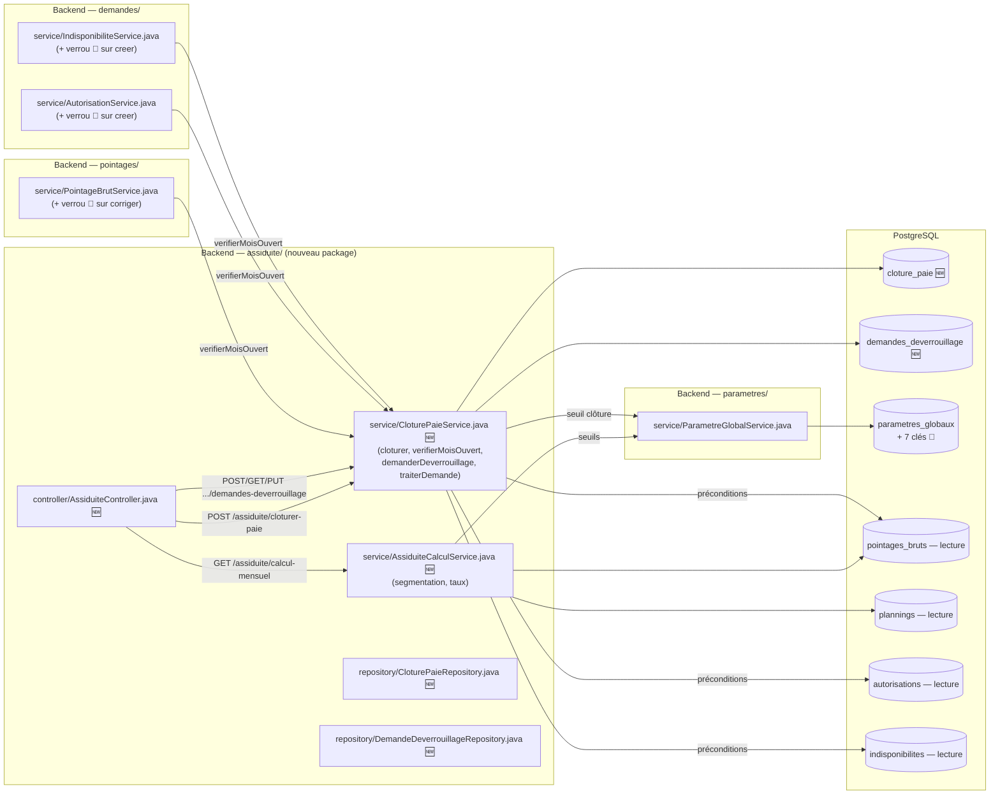

# Lot 6 — Assiduité & Paie *(Module 3 du CDF)*

**Statut** : backend implémenté, validé et committé. **Frontend non démarré** (hors périmètre de cette session — à traiter dans un lot de suivi, cf. règle de synchronisation multi-repo `CLAUDE.md`).
**Dépendances** : Lot 2 (pointages, `pointages_bruts`), Lot 3 (planning, contrôle repos légal), Lot 4 (jours fériés), Lot 5 (autorisations/indisponibilités, `parametres_globaux`).

## Objectif

Moteur de calcul mensuel qui traduit les présences (Modules 1/2/6/8 déjà livrés) en variables de paie exportables (segmentation heures normales/nuit/majorées, taux de présence, taux de prime par paliers d'incidents, pénalité), clôture de paie irréversible avec préconditions bloquantes, verrouillage en lecture seule du mois clôturé, et workflow formel de déverrouillage exceptionnel avec motif légal.

## Étapes de réalisation

1. **Chaînage Git** — `feature/lot-6-assiduite-paie` créée à partir de `feature/lot-5-conges-autorisations`.
2. **Design first (règle n°1 du DoD)** — lecture de `cahier-fonctionnel.md` (Module 3) et `cahier-technique.md` (§4.7). Gap réel trouvé, même nature que `jours_feries` au Lot 4 : `GET /assiduite/calcul-mensuel`/`POST /assiduite/cloturer-paie` étaient marqués "✅ INCHANGÉ" (repris du CDC-T v1) alors qu'**aucune table de verrouillage mensuel ni de demande de déverrouillage n'a jamais existé dans le schéma corrigé**, et qu'aucune valeur chiffrée n'est donnée nulle part pour les seuils du moteur (fenêtre heures de nuit, seuil de majoration, tranches de prime). Proposition d'architecture complète soumise à l'utilisateur avant tout code, avec deux décisions actées avant le "go" : clôture **globale par mois** (pas par département), et seuils du moteur posés comme valeurs par défaut dans `parametres_globaux` (même principe que le Lot 5) plutôt que figées en dur — validé tel quel, sans ajustement.
3. **Absence de champ salaire constatée** — `employes` n'a aucune colonne monétaire et `ARCHITECTURE.md` confirme qu'aucun logiciel de paie externe n'est intégré (`matricule_paie` = simple clé de correspondance pour export ultérieur). Le moteur ne produit donc que des **variables de paie** (heures, taux, incidents) — pas un montant.
4. **Migration V6** — deux nouvelles tables (`cloture_paie`, `demandes_deverrouillage`) + seed de 7 nouveaux paramètres dans `parametres_globaux` (`HEURE_DEBUT_NUIT`, `HEURE_FIN_NUIT`, `SEUIL_HEURES_MAJOREES_JOUR`, `SEUIL_PRIME_100`/`50`/`33`, `SEUIL_ANOMALIES_CLOTURE`).
5. **Nouveau package `com.sirh.assiduite`** — entités/repositories, `AssiduiteCalculService` (moteur, lecture seule, aucune dépendance vers `demandes`/`planning` au niveau service — uniquement leurs repositories) et `CloturePaieService` (clôture + workflow déverrouillage, expose `verifierMoisOuvert()` aux autres modules).
6. **Moteur de calcul** — pour chaque employé du mois : appariement des `pointages_bruts` (même exclusion `IGNORE_DOUBLON` que le Lot 3/`PlanningService`) en sessions Entrée/Sortie ; `heuresNormales + heuresMajorees = total travaillé` (mutuellement exclusifs, l'excès au-delà de `SEUIL_HEURES_MAJOREES_JOUR` par jour part en majorées) ; `heuresNuit` est une **étiquette indépendante** qui peut chevaucher l'une ou l'autre (calcul du recouvrement avec la fenêtre `HEURE_DEBUT_NUIT`/`HEURE_FIN_NUIT`, gérant le passage à minuit) — choix délibéré pour éviter l'ambiguïté d'ordre de soustraction entre deux bornes qui se chevauchent. `incidents` = nombre de `pointages_bruts.statut = ANOMALIE_NON_JUSTIFIEE` sur le mois (réutilise directement la détection déjà posée au Lot 2, pas de nouvelle notion de "retard") → `tauxPrime` par paliers. `tauxPresence`/`penaliteHeures` croisent les jours théoriques du planning (mêmes exclusions `REPOS`/`CONGE`/`ABSENCE` que `PlanningService.calculerDelta`) avec les jours réellement travaillés.
7. **Pas de table de snapshot des résultats** — `GET /assiduite/calcul-mensuel` recalcule à la volée à chaque appel ; une fois le mois `CLOTURE`, les données sources (pointages, autorisations, indisponibilités) deviennent en écriture bloquée au niveau applicatif, donc le recalcul reste stable sans duplication à synchroniser.
8. **Verrouillage transversal** — `CloturePaieService.verifierMoisOuvert(date)` injecté dans `PointageBrutService.corriger()` (vérifie l'ancienne **et** la nouvelle date, une correction pouvant déplacer un pointage d'un mois à l'autre), `AutorisationService.creer()` et `IndisponibiliteService.creer()` (vérifie chaque borne pour une indisponibilité à cheval sur deux mois) — appliqué **avant** toute autre validation métier, y compris le workflow d'urgence RH qui n'a pas de délai à faire respecter. Ajout de méthodes de repository dédiées (`countByTimestampPointageBetweenAndStatut`, `findByStatutAndDateAutorisationBetween`, `findByStatutAndDateDebutLessThanEqualAndDateFinGreaterThanEqual`) plutôt que de réutiliser des méthodes existantes scopées par employé.
9. **Clôture de paie** — `CloturePaieService.cloturer()` calcule le taux d'anomalies justifiées du mois (`JUSTIFIE / (JUSTIFIE + ANOMALIE_NON_JUSTIFIEE)`, 100% si aucune anomalie) et vérifie l'absence de toute autorisation/indisponibilité `EN_ATTENTE_RH` chevauchant le mois ; 409 avec message explicite si l'une des deux préconditions échoue, 409 si déjà `CLOTURE`. Auditée (`@Audited`, cf. `ARCHITECTURE.md` §9).
10. **Workflow de déverrouillage** — `POST /assiduite/demandes-deverrouillage` (400 si le mois n'est pas `CLOTURE`), `PUT .../{id}` RH (409 si la demande n'est pas `EN_ATTENTE`) : `APPROUVEE` repasse `cloture_paie.statut = OUVERT` — le RH doit ensuite reclôturer explicitement, pas de re-clôture automatique après régularisation.
11. **Validation backend** — Testcontainers toujours indisponible sur cette machine (limitation documentée depuis le Lot 0). Tests unitaires Mockito pour le moteur de calcul (aucune dépendance HTTP/DB). Tests d'intégration écrits et compilés pour le workflow complet (clôture, préconditions, verrouillage, déverrouillage) — non exécutables localement, donc **revérifiés manuellement de bout en bout via `docker compose up --build` + `curl`** (détail §Procédure de validation), y compris le cas non couvrable par un test isolé (bascule réelle OUVERT→CLOTURE→OUVERT via l'API sur la base de dev).

## Choix techniques & Dépendances

| Choix | Raison |
|---|---|
| Clôture **globale par mois**, pas par département | Décision explicite de l'utilisateur, cohérente avec le CDF ("le RH... clôture des périodes", droit global sur tous les départements) — évite de scoper par département le contrôle "aucune demande EN_ATTENTE", qui traverserait sinon plusieurs équipes. |
| Aucune table de snapshot des résultats de calcul | `GET /assiduite/calcul-mensuel` recalcule à la volée ; le verrouillage porte sur les données sources, pas sur un résultat dupliqué à garder synchronisé — plus simple, cohérent avec l'absence de besoin de figer un historique de calcul distinct du calcul lui-même. |
| Seuils du moteur dans `parametres_globaux` (pas de nouvelle table de configuration) | Aucune valeur n'est donnée dans le CDF/CDC-T ; même principe que `TAUX_INCREMENTATION_CONGES_MENSUEL` (Lot 5) — valeurs par défaut modifiables sans redéploiement, décision validée explicitement par l'utilisateur avant implémentation. |
| Pas de champ/calcul monétaire | Aucune colonne salaire sur `employes`, aucun logiciel de paie intégré (`ARCHITECTURE.md` §1) — le moteur produit des variables pour export externe, pas un net à payer ; éviter d'inventer un montant sans base dans le schéma. |
| `heuresNuit` étiquette indépendante (peut chevaucher normales/majorées) | `heuresNormales + heuresMajorees = total` reste une égalité simple et vérifiable ; classer la nuit comme un troisième seau exclusif aurait exigé un ordre arbitraire de priorité (nuit d'abord ou majoration d'abord) sans base dans le CDF pour trancher. |
| `incidents` = `pointages_bruts.statut = ANOMALIE_NON_JUSTIFIEE` du mois | Réutilise la détection d'anomalie déjà posée au Lot 2 (nombre impair de pointages) plutôt que d'inventer une nouvelle notion de "retard" sans définition dans le CDF — cohérent avec la philosophie "pas de règle dupliquée entre modules". |
| `verifierMoisOuvert()` appelé avant toute autre validation métier dans les 3 services d'écriture | Le verrou mensuel est une contrainte transversale de plus haut niveau que les règles métier locales (délai 72h, quota, solde) — un mois clôturé bloque même le workflow d'urgence RH, qui n'a pas de délai à contourner par ailleurs. |
| Pas de re-clôture automatique après approbation d'un déverrouillage | Laisse au RH le contrôle explicite du moment de re-clôture après régularisation, plutôt qu'une clôture silencieuse qui pourrait figer une correction incomplète. |

## Fichiers impactés & Cartographie API

### Endpoints exposés (Lot 6)

| Méthode | Endpoint | Rôles | Contrôleur |
|---|---|---|---|
| GET | `/assiduite/calcul-mensuel?mois=YYYY-MM&departementId=` | RH, SUPERUSER, MANAGER (son département) | `AssiduiteController` |
| POST | `/assiduite/cloturer-paie` | RH, SUPERUSER | `AssiduiteController` |
| POST | `/assiduite/demandes-deverrouillage` | MANAGER, RH, SUPERUSER | `AssiduiteController` |
| GET | `/assiduite/demandes-deverrouillage?statut=` | RH, SUPERUSER | `AssiduiteController` |
| PUT | `/assiduite/demandes-deverrouillage/{id}` | RH, SUPERUSER | `AssiduiteController` |

## Procédure de validation

- **Compilation** : `mvn compile`/`mvn test-compile`, verts.
- **Tests unitaires** (`AssiduiteCalculServiceTest`, Mockito, 7 cas) — verts en local (`mvn test`, offline, pas de Docker requis) : segmentation normales/majorées sur une journée de 10h30, heures de nuit sur une session chevauchant minuit (21h-06h), exclusion des pointages `IGNORE_DOUBLON` de l'appariement, prime à 100%/33% selon le nombre d'incidents, taux de présence en ratio jours théoriques/travaillés avec pénalité en heures de déficit, filtrage par département (`findByDepartement_Id` vs `findAll`).
- **Tests d'intégration** (`AssiduiteControllerIT`, 8 cas) : écrits et compilés — clôture réussie/refusée (déjà clôturé, taux d'anomalies insuffisant, demande `EN_ATTENTE_RH` sur le mois), verrou sur `PUT /pointages/{id}/corriger` et `POST /autorisations` (y compris workflow d'urgence RH) sur un mois clôturé, workflow de déverrouillage de bout en bout (demande refusée sur mois ouvert, création, blocage avant approbation, écriture débloquée après approbation, retraitement d'une demande déjà traitée refusé), réponse de `GET /assiduite/calcul-mensuel` — **non exécutables sur cette machine** (Testcontainers/npipe Docker Desktop, limitation documentée depuis le Lot 0).
- **Validation réelle backend** (`docker compose up --build` + `curl`), rejouée sur la base de dev réelle (Postgres 16 + Redis) :
  - Migration V6 appliquée avec succès au démarrage (`Flyway ... Successfully applied 1 migration ... now at version v6`), 7 nouveaux paramètres confirmés via `GET /parametres-globaux`.
  - `GET /assiduite/calcul-mensuel?mois=2026-07` : réponse `200` avec un `CalculMensuelEmployeDto` par employé existant (taux de présence/prime à 100%, aucun incident, cohérent avec l'absence de pointage sur le mois testé).
  - `POST /assiduite/cloturer-paie {mois:"2026-06"}` (aucune anomalie en base) → `200`, `statut:"CLOTURE"`, `tauxAnomaliesJustifiees:100`. Rejouer la même requête → `409 "Le mois 2026-06 est clôturé..."`.
  - `POST /autorisations` (workflow d'urgence RH, sans délai à respecter) daté dans le mois clôturé → `409` avec le même message de verrou, confirmant que le workflow d'urgence ne contourne pas la clôture.
  - `POST /assiduite/demandes-deverrouillage {mois:"2026-07"}` (mois **non** clôturé) → `400 "Ce mois n'est pas clôturé..."`. Sur le mois clôturé (`2026-06`) → `201`, `statut:"EN_ATTENTE"`.
  - Écriture `POST /autorisations` sur le mois clôturé tentée une seconde fois (demande de déverrouillage encore `EN_ATTENTE`) → toujours `409` (le verrou reste actif tant que non approuvé).
  - `PUT /assiduite/demandes-deverrouillage/{id} {statut:"APPROUVEE"}` → `200`. `POST /autorisations` rejouée sur le même mois → `201` (mois effectivement réouvert).
  - Toutes les données de test créées pendant cette vérification (autorisation, demande de déverrouillage, clôture du mois `2026-06`) ont été laissées en base de dev (comportement irréversible/traçable par conception — cohérent avec la nature de ces objets, contrairement aux fixtures des lots précédents qui étaient nettoyées).
- **Frontend** : non traité ce lot — à planifier séparément (écran de synthèse mensuelle par département, bouton `[Clôturer la Paie]`, bandeau "mois clôturé", formulaire de demande de déverrouillage, cf. `BACKLOG.md`).
