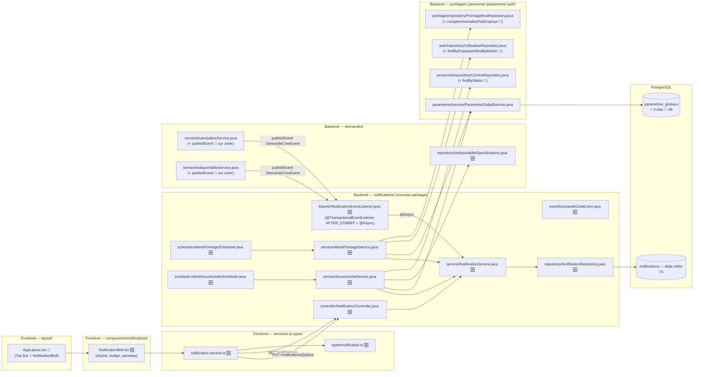

# Lot 8 — Notifications *(Module 11 du CDF)*

**Statut** : implémenté, validé et committé (backend + frontend).
**Dépendances** : [Lot 1 — Personnel & Départements](LOT_1_PERSONNEL.md) (référence `employes.id`, `departements.manager_id`), [Lot 5 — Congés & Autorisations](LOT_5_CONGES_AUTORISATIONS.md) (déclencheurs sur les demandes `autorisations`/`indisponibilites`), [Lot 6 — Assiduité & Paie](LOT_6_ASSIDUITE_PAIE.md) (`parametres_globaux`, convention seuils dynamiques).
**Suite** : Lot 9 — Renouvellement de contrats (proposition d'architecture validée avec l'utilisateur, implémentation à venir — voir `BACKLOG.md`).

**Commits** (`sirh-project-backend`) :
- `c11c404` `feat(notifications): add V8 migration with dynamic Module 11 thresholds`
- `0ae7086` `feat(notifications): CRUD, event-driven and scheduled alerts (Module 11)`
- `ca4898a` `docs(notifications): document Lot 8 gaps and finalize report`

**Commits** (`sirh-project-frontend`) :
- `accbaa9` `feat(notifications): add NotificationBell component to Top Bar`
- `f31b1a1` `docs(notifications): document Lot 8 gaps and finalize report`

## Objectif

Système de notifications applicatives (cloche + panneau déroulant Top Bar) avec trois déclencheurs : événementiel sur la création d'une demande Manager (`DEMANDE_A_VALIDER`, Lot 5), et deux tâches planifiées hebdomadaire/mensuelle (`ALERTE_POINTAGE` sur les oublis de badgeage, `ALERTE_SOUS_ACTIVITE` avec exclusion des salariés en suspension légale de contrat).

## Étapes de réalisation

1. **Chaînage Git** — la pile de branches n'étant pas mergée sur `main`, `feature/lot-8-notifications` a dû être recréée depuis `feature/lot-7-outillages` (backend et frontend) après avoir d'abord committé le travail Lot 7 encore non commité sur ces deux branches.
2. **Analyse des dépendances** — lecture de `Contrat`/`ContratStatut` (Lot 1), `Indisponibilite`/`AutorisationService`/`IndisponibiliteService` (Lot 5), `AssiduiteCalculService`/`ParametreGlobalService` (Lot 6). Constat clé : `indisponibilites.type_indisponibilite` est un `VARCHAR` libre **sans énumération applicative** (déjà noté en commentaire dans `Autorisation.java`) — aucune notion de "suspension légale de contrat" n'existe en base, alors que le CDF cite deux motifs concrets (congé maternité, arrêt maladie longue durée) pour le faux positif de l'alerte de sous-activité.
3. **Gap confirmé sur `notifications.entite_id`** — `BIGINT` (cahier-technique.md §3.18), alors que l'entité concernée par `ALERTE_POINTAGE`/`ALERTE_SOUS_ACTIVITE` est un employé (`id` `UUID`, règle transverse du projet). Résolu sans changement de schéma : `entite_type`/`entite_id` ne sont peuplés que pour `DEMANDE_A_VALIDER` (référence `autorisations`/`indisponibilites`, `id` `Long`) ; l'identité de l'employé reste dans le texte du `message` pour les deux alertes CRON.
4. **Migration V8** — en écrivant le script, découverte que la table `notifications` **existe déjà** intégralement dans `V1__init_schema.sql` (schéma consolidé initial, §18) — `CREATE TABLE notifications` aurait échoué en `42P07 relation already exists` sur toute base au-delà de V1 (bug trouvé en exécutant les tests d'intégration, cf. point 9). `V8__lot8_notifications.sql` ne contient donc que le seed de trois nouveaux paramètres `parametres_globaux` : `SEUIL_OUBLIS_BADGEAGE_HEBDO` (`3`), `SEUIL_JOURS_TRAVAILLES_SOUS_ACTIVITE` (`5`), `TYPES_SUSPENSION_LEGALE` (CSV `MALADIE,MATERNITE,PATERNITE,ACCIDENT_TRAVAIL`) — même principe que les seuils des Lots 5-7, jamais en dur.
5. **Nouveau package `com.sirh.notifications`** — entité/repository/DTO/service/contrôleur pour le CRUD minimal (`GET`/`PUT .../lue`, scope strict au destinataire authentifié via `SirhUserDetails.getUserId()`), plus `event/DemandeCreeEvent`, `listener/NotificationEventListener`, deux services de calcul dédiés (`AlertePointageService`, `SousActiviteService`) et deux `@Scheduled` orchestrateurs minces.
6. **Architecture événementielle (Lot 5 → Lot 8)** — `AutorisationService.creer()`/`IndisponibiliteService.creer()` injectent `ApplicationEventPublisher` et publient `DemandeCreeEvent` uniquement pour le workflow Manager (`EN_ATTENTE_RH`), jamais pour le workflow d'urgence RH (déjà `VALIDE`, rien à valider). `NotificationEventListener` consomme via `@TransactionalEventListener(phase = AFTER_COMMIT)` + `@Async("notificationExecutor")` : une demande qui rollback (ex. mois clôturé) ne génère jamais de notification fantôme, et la création de la demande côté Manager n'attend jamais l'écriture des notifications RH/SUPERUSER.
7. **Pool dédié `notificationExecutor`** — `AsyncConfig` gagne un second bean `Executor` nommé (mêmes réglages modestes que `pointagesImportExecutor`, thread prefix `notification-`) : avec deux beans `Executor` en présence, `@Async` sans qualifiant explicite devient ambigu pour Spring, donc qualifié partout — et le trafic notifications ne fait plus la queue derrière un import de pointages volumineux.
8. **Alerte hebdomadaire (`AlertePointageService`)** — une requête JPQL agrégée (`GROUP BY employeId`) sur `pointages_bruts.statut = ANOMALIE_NON_JUSTIFIEE` de la semaine ISO en cours, comparée à `SEUIL_OUBLIS_BADGEAGE_HEBDO` en **`>=`** (pas égalité stricte — "cumule 3" interprété comme atteindre le seuil, cohérent avec `SEUIL_ANOMALIES_CLOTURE`/`SEUIL_PRIME_*` ailleurs dans le projet, sinon un employé à 4 oublis échapperait à l'alerte). Résolution du destinataire : `employe.departement.managerId` → `UtilisateurRepository.findByEmployeId` (nouvelle méthode) ; employé sans département/manager résolvable → notification silencieusement ignorée avec un `WARN` (pas d'exception, l'absence de manager n'est pas une erreur système).
9. **Alerte mensuelle (`SousActiviteService`) + Specifications** — candidats = `ContratRepository.findByStatut(EN_COURS)` (nouvelle méthode), exclusion des suspensions légales via `IndisponibiliteSpecifications.suspensionLegaleActiveSur()` (nouvelle classe, `Specification<Indisponibilite>` : `statut = VALIDE`, `typeIndisponibilite IN (...)`, chevauchement avec la fenêtre de 30 jours glissants) plutôt qu'une requête native, pour rester composable avec le reste du module `demandes`. Jours travaillés = dates distinctes avec au moins un `pointages_bruts` non `IGNORE_DOUBLON` sur la fenêtre — notion volontairement plus simple que `AssiduiteCalculService.joursTravailles` (Lot 6), qui croise en plus le planning théorique : le Module 11 ne demande qu'un comptage brut de présence, pas un taux de présence pondéré.
10. **`@Scheduled` orchestrateurs minces** — `AlertePointageScheduler` (`0 0 20 * * SUN`, dimanche 20h) délègue directement. `AlerteSousActiviteScheduler` gère le "dernier jour du mois" (pas d'équivalent Quartz `L` en cron Spring à 6 champs) : `0 0 23 28-31 * *` + un unique garde `if (jour == dernierJourDuMois)` avant l'appel — seule logique tolérée dans la méthode planifiée, le calcul reste entièrement dans le service dédié.
11. **Bug trouvé en exécutant les tests d'intégration** (Testcontainers fonctionnel sur cette machine depuis le correctif `testcontainers.version` du Lot 7 — contrairement à la limitation documentée aux Lots 0-6) : `mvn verify` échouait systématiquement sur `Migration V8 ... relation "notifications" already exists`, qui a mené à la découverte du point 4. Un `mvn verify` scopé à `NotificationControllerIT` (`-Dit.test=NotificationControllerIT`) a ensuite confirmé les 4 cas verts. Deux tentatives de suite **complète** (`mvn verify`, tous lots/~15 classes IT confondus) ont en revanche échoué sur une instabilité Hikari/Testcontainers sans rapport avec le code Lot 8 (connexions refusées en cours de run, y compris sur un relance isolée sans process concurrent) — limitation d'environnement documentée en mémoire (`sirh_lot0_status.md`), pas un défaut du code : la validation de non-régression s'appuie donc sur `mvn test` complet (tous les tests unitaires, tous lots, vert) plutôt que sur une suite `verify` complète qui n'a jamais pu terminer sur cette machine.
12. **Design first frontend** — exploration de `AppLayout.tsx` (Top Bar existante), `components/ui/dialog.tsx` (convention "shadcn sans Radix", aucune dépendance Radix dans `package.json`) et du pattern TanStack Query déjà en place (`MesDemandesEquipePage`, `ImportPointagesPage.refetchInterval`). Décision : panneau déroulant ancré (pas de portal plein écran comme `Dialog`), polling 30s (même principe que le polling des jobs asynchrones), aucune nouvelle dépendance.
13. **Régénération des types** — backend démarré sur un port alternatif (`8081`, pour ne pas entrer en conflit avec un process de développement déjà actif sur `8080`), `npm run generate:api-types` (variante `openapi-typescript http://localhost:8081/v3/api-docs`) : `NotificationDto` (enum `type` fermé `ALERTE_POINTAGE`/`ALERTE_SOUS_ACTIVITE`/`DEMANDE_A_VALIDER`) apparaît dans `src/types/api.d.ts`.
14. **`NotificationBell`** (`src/components/notifications/NotificationBell.tsx`) — bouton cloche + badge de compteur non-lues (`9+` au-delà), panneau déroulant listant les notifications (type, message, date, pastille non-lue), clic sur une notification non lue déclenche `PUT .../lue` puis invalide la query. Fermeture au clic extérieur/Échap, même esprit que `Dialog` mais composant ancré autonome, sans portal.
15. **Vérification réseau de bout en bout** — pas d'outil d'automatisation navigateur disponible dans cette session (même limitation que documentée au Lot 6 pour `claude-in-chrome`). Vérifié à la place via `curl` à travers le proxy Vite réel (`http://localhost:5175/api/...`, chemin exact emprunté par le navigateur), avec une notification insérée directement en base de dev : `GET /notifications` (login `admin`) renvoie la ligne attendue, `PUT /notifications/{id}/lue` bascule `lue: true` — donnée de test nettoyée ensuite. **Absence de vérification visuelle réelle du rendu/interactions à signaler explicitement.**

## Choix techniques & Dépendances

| Choix | Raison |
|---|---|
| `V8` ne crée aucune table, seulement des `parametres_globaux` | `notifications` existe déjà dans `V1__init_schema.sql` (schéma consolidé initial) — recréer la table aurait fait échouer la migration sur toute base au-delà de V1, bug réel trouvé via les tests d'intégration. |
| `entite_type`/`entite_id` peuplés uniquement pour `DEMANDE_A_VALIDER` | `entite_id` est `BIGINT`, incompatible avec l'`id` `UUID` d'un employé (règle transverse du projet) — plutôt que de forcer un mismatch de type sur une colonne partagée, l'identité de l'employé reste dans le texte du message pour les deux alertes CRON. |
| `TYPES_SUSPENSION_LEGALE` en `parametres_globaux` (CSV) plutôt qu'un enum Java figé | `indisponibilites.type_indisponibilite` n'a pas d'énumération applicative contraignante (constat déjà documenté dans le code du Lot 5) — même principe que tous les seuils dynamiques du projet, RH peut ajuster la liste sans redéploiement. |
| Seuils `SEUIL_OUBLIS_BADGEAGE_HEBDO`/`SEUIL_JOURS_TRAVAILLES_SOUS_ACTIVITE` en base malgré des valeurs déjà chiffrées au CDF | Règle actée dès le Lot 5 : une valeur métier ajustable reste dynamique même si le CDF donne un premier chiffre, pour éviter tout redéploiement sur un simple changement de politique RH. |
| `@TransactionalEventListener(AFTER_COMMIT)` + `@Async` dédié | Découplage explicitement demandé (Lot 5 ignore tout de Lot 8) ; `AFTER_COMMIT` évite une notification sur une demande qui rollback (ex. mois clôturé) ; `@Async` sur un pool dédié évite de faire attendre la requête HTTP du Manager et de saturer le pool d'import de pointages. |
| `IndisponibiliteSpecifications` (nouvelle classe, `Specification<Indisponibilite>`) | Demandé explicitement pour rester modulaire plutôt qu'une requête SQL native complexe — composable avec le reste du module `demandes`, réutilisable si un futur lot a besoin du même filtre. |
| "Jours travaillés" = comptage brut de pointages, pas le `joursTravailles` pondéré par planning de `AssiduiteCalculService` | Le Module 11 ne demande qu'un signal de présence (0-5 jours sur 30), pas un taux de présence contractuel — réutiliser le calcul pondéré du Lot 6 aurait ajouté une dépendance au planning théorique non demandée par le CDF pour cette alerte. |
| `>=` sur le seuil hebdomadaire (pas égalité stricte) | Cohérence avec tous les autres seuils du projet (`SEUIL_ANOMALIES_CLOTURE`, `SEUIL_PRIME_*`) — un employé au-delà du seuil ne doit jamais échapper à l'alerte. |
| Cron `28-31` + garde applicatif pour "dernier jour du mois" | Spring `@Scheduled` (cron 6 champs) n'a pas d'équivalent au `L` de Quartz — solution la plus simple sans dépendance supplémentaire, le garde reste de la pure orchestration (pas de logique métier dans la méthode planifiée). |
| `NotificationBell` sans nouvelle dépendance (pas de Radix popover) | Convention déjà actée au projet ("shadcn sans Radix", cf. `components/ui/dialog.tsx`) — un composant ancré autonome tient en une centaine de lignes, pas de justification à une nouvelle dépendance pour un menu déroulant. |
| Polling 30s plutôt qu'un canal push (WebSocket/SSE) | Aucune infrastructure de push déjà en place (`ARCHITECTURE.md` §7 : pas de file de jobs, Redis borné au cache dashboard/JWT) ; même principe de polling déjà utilisé pour les jobs asynchrones (`ImportPointagesPage`), pas de nouvelle brique d'infrastructure pour ce lot. |

## Fichiers impactés & Cartographie API

### Endpoints exposés (Lot 8)

| Méthode | Endpoint | Rôles | Contrôleur |
|---|---|---|---|
| GET | `/notifications` | Tout rôle authentifié (scope = ses propres notifications) | `NotificationController` |
| PUT | `/notifications/{id}/lue` | Tout rôle authentifié (403 hors propriétaire) | `NotificationController` |

Aucun `POST` : les notifications sont créées exclusivement par les déclencheurs serveur (événement `DemandeCreeEvent`, tâches `@Scheduled`), jamais par un appel client.

## Procédure de validation

- **Compilation** : `mvn compile`/`mvn test-compile`, verts.
- **Tests unitaires** (Mockito, aucune dépendance HTTP/DB) :
  - `NotificationServiceTest` (3 cas) — marquage lu par le propriétaire, refus `AccessDeniedException` pour un autre destinataire, `NotificationNotFoundException` sur un id inexistant.
  - `AlertePointageServiceTest` (3 cas) — seuil atteint notifie le manager du département, sous le seuil aucune notification, département sans manager résolvable ignoré silencieusement (pas d'exception).
  - `SousActiviteServiceTest` (3 cas) — contrat actif sans suspension légale et sous le seuil notifie RH/SUPERUSER, employé en suspension légale (`MALADIE`) exclu, jours travaillés au-dessus du seuil non notifié.
- **Tests d'intégration** (`NotificationControllerIT`, Testcontainers — fonctionnel sur cette machine depuis le correctif `testcontainers.version` du Lot 7) : 4 cas, tous verts —
  - `GET /notifications` scope strict au destinataire authentifié.
  - `PUT /notifications/{id}/lue` : propriétaire → `200`/`lue:true` ; autre destinataire → `403`.
  - Bout en bout de l'architecture événementielle : création d'une autorisation par un Manager (`EN_ATTENTE_RH`) → poll court (jusqu'à 3s) sur `GET /notifications` du RH → notification `DEMANDE_A_VALIDER` avec `entiteType = "AUTORISATION"` présente, confirmant `ApplicationEventPublisher` → `@TransactionalEventListener(AFTER_COMMIT)` → `@Async` de bout en bout.
- **Non-régression** : `mvn test` complet (tous lots, unitaires uniquement) vert après l'ajout du second bean `Executor` (qualification explicite requise) et des méthodes `publishEvent` dans `AutorisationService`/`IndisponibiliteService`. Une suite `mvn verify` complète (tous lots, ~15 classes IT) n'a pas pu être menée à terme sur cette machine (instabilité Testcontainers/Hikari sans rapport avec le code, cf. point 11) — à rejouer en CI.
- **Régénération des types frontend** : `openapi-typescript` contre un backend Lot 8 démarré sur le port `8081` (pour ne pas interférer avec un process déjà actif sur `8080`) — `NotificationDto` confirmé dans `src/types/api.d.ts`.
- **Compilation frontend** : `tsc --noEmit` vert après l'ajout de `NotificationBell.tsx`.
- **Tests frontend** (`vitest run`) : 3 fichiers/9 cas préexistants toujours verts, aucune régression.
- **Réseau frontend** (pas de navigateur automatisé disponible cette session) : backend Lot 8 (port `8081`) + `vite dev` (port `5175`, proxy `VITE_BACKEND_URL`) réels, notification insérée directement en base de dev (`docker exec sirh-postgres psql`) pour le compte `admin` : `GET /api/notifications` via le proxy Vite renvoie la ligne attendue, `PUT /api/notifications/{id}/lue` bascule `lue: true` — donnée de test supprimée ensuite. **La vérification visuelle réelle (rendu de la cloche, badge, panneau, clic) n'a pas été effectuée faute d'outil d'automatisation navigateur disponible dans cette session — à refaire manuellement avant merge.**
