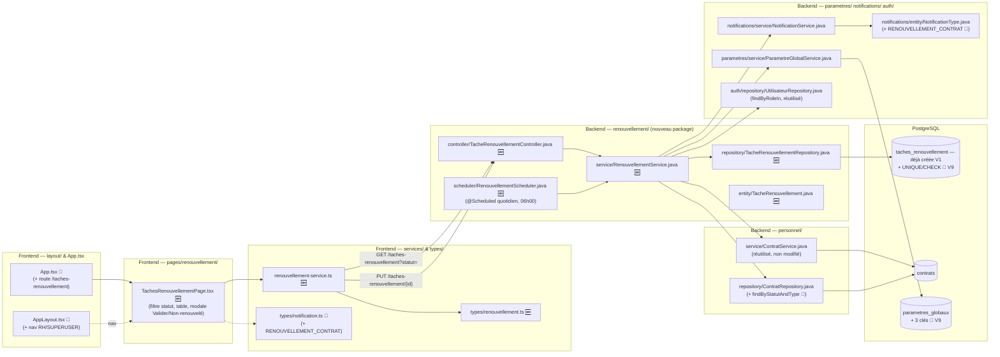

# Lot 9 — Renouvellement de contrats *(Module 12 du CDF)*

**Statut** : implémenté, tests unitaires/intégration/frontend verts, validé visuellement de bout en bout dans un vrai navigateur (Playwright/Chromium, cf. §16) — prêt pour commit.
**Dépendances** : [Lot 1 — Personnel & Départements](LOT_1_PERSONNEL.md) (`contrats`, `ContratStatut.RENOUVELE` déjà prévu pour ce lot), [Lot 5 — Congés & Autorisations](LOT_5_CONGES_AUTORISATIONS.md) (`parametres_globaux`, convention seuils dynamiques — anticipée explicitement pour ce lot dans `LOT_5_CONGES_AUTORISATIONS.md`), [Lot 8 — Notifications](LOT_8_NOTIFICATIONS.md) (`NotificationType`, notification RH/SUPERUSER sur événement CRON).
**Suite** : Lot 11 — Dashboard (agrégation visuelle des tâches `URGENT_EXPIRE`, hors périmètre de ce lot par arbitrage explicite — voir `BACKLOG.md`).

## Objectif

Anticiper les fins de cycle des contrats CDD : génération automatique d'une tâche RH aux échéances M+5 (préparation du terme à 6 mois) et M+11 (préparation du terme à 12 mois), traitement RH (`Valider` prolonge le contrat, `Non-renouvelé` déclenche l'offboarding), et bascule automatique en `URGENT_EXPIRE` si le RH n'a pas statué au terme réel du contrat.

## Arbitrages de design validés avant implémentation

1. **Périmètre** : génération M+5/M+11 restreinte aux contrats `CDD` (`ContratType.CDD`) — un `CDI` n'a pas de terme à anticiper.
2. **Durée du renouvellement** : `PUT /taches-renouvellement/{id}` accepte un champ optionnel `dateFin`. S'il est omis, la date de fin du nouveau contrat est calculée automatiquement via le paramètre dynamique `DUREE_RENOUVELLEMENT_CDD_MOIS` (`parametres_globaux`).
3. **`URGENT_EXPIRE` reste actionnable** : le RH peut traiter (Valider/Non-renouveler) une tâche déjà basculée en retard — seules `VALIDE`/`NON_RENOUVELE` (statuts terminaux) refusent un nouveau traitement (409).
4. **Dashboard** : ce lot expose uniquement l'API (`GET`/`PUT /taches-renouvellement`) ; l'agrégation visuelle (alerte clignotante consolidée) relève du Lot 11.

## Étapes de réalisation

1. **Analyse de l'existant** — lecture de `Contrat`/`ContratType`/`ContratStatut` (Lot 1 : `ContratStatut.RENOUVELE` était déjà présent dans l'enum, signe que ce statut avait été anticipé précisément pour ce lot), `ContratService.create()` (sync `employes.type_contrat`/`date_fin_contrat` + timeline 360° à chaque création de contrat), et le plan `@Scheduled` + notification déjà rodé au Lot 8 (`AlertePointageService`/`SousActiviteService` + leurs schedulers minces) — repris à l'identique pour la génération M+5/M+11.
2. **Gap migration confirmé** — comme pour `notifications` au Lot 8, la table `taches_renouvellement` existe déjà intégralement dans `V1__init_schema.sql` (schéma consolidé initial, §20). `V9__lot9_renouvellement_contrats.sql` ne fait donc que : ajouter la contrainte `UNIQUE (contrat_id, type_echeance)` demandée explicitement (absente du schéma consolidé, nécessaire pour empêcher une double génération M+5/M+11 si le scheduler tourne deux fois le même jour), une contrainte `CHECK` fermant `type_echeance` à `M+5`/`M+11`, et le seed de trois nouveaux paramètres dynamiques.
3. **Paramètres dynamiques** — `MOIS_ECHEANCE_M5` (`5`), `MOIS_ECHEANCE_M11` (`11`), `DUREE_RENOUVELLEMENT_CDD_MOIS` (`6`). Les seuils M+5/M+11 étaient déjà explicitement anticipés comme futurs paramètres dynamiques dans `LOT_5_CONGES_AUTORISATIONS.md` — jamais en dur dans le scheduler, même principe que tous les seuils du projet depuis le Lot 5.
4. **Nouveau package `com.sirh.renouvellement`** — `entity/TacheRenouvellement` + `TacheRenouvellementStatut` (enum `EN_COURS`/`VALIDE`/`NON_RENOUVELE`/`URGENT_EXPIRE`), `repository/TacheRenouvellementRepository`, `dto/TacheRenouvellementDto` + `TacheRenouvellementTraiterRequest`, `exception/` (`NotFoundException` 404, `StatutInvalideException` 409), `service/RenouvellementService`, `scheduler/RenouvellementScheduler`, `controller/TacheRenouvellementController`. `type_echeance` reste une chaîne littérale (`"M+5"`/`"M+11"`) plutôt qu'un enum Java — `+` n'est pas un identifiant valide, et la contrainte `CHECK` en base suffit à fermer le domaine.
5. **`ContratRepository.findByStatutAndType`** — nouvelle méthode dérivée (candidats CDD `EN_COURS` pour le scheduler), même style que `findByStatut` déjà ajoutée au Lot 8.
6. **Génération M+5/M+11** (`RenouvellementService.genererEtEscalader`) — pour chaque contrat CDD `EN_COURS`, calcule `dateDebut + moisOffset` ; si la date de référence l'a atteinte et qu'aucune tâche `(contrat_id, type_echeance)` n'existe déjà, insère la tâche (`EN_COURS`) et notifie RH/SUPERUSER (`NotificationType.RENOUVELLEMENT_CONTRAT`, nouvelle valeur d'enum — anticipée dans le commentaire de colonne `notifications.type` du cahier technique §3.18).
7. **Bascule `URGENT_EXPIRE`** — scan des tâches `EN_COURS` ; bascule uniquement si `reference >= contrat.dateFin` (le **terme réel** du contrat, pas la date d'échéance M+5/M+11 de la tâche elle-même — un contrat qui se termine dans 1 mois ne doit pas expirer sur l'échéance M+5). Le contrat n'est jamais clôturé automatiquement (cahier-fonctionnel.md Module 12 : "pour éviter de bloquer le paiement de la paie par erreur") — seule la tâche change de statut.
8. **Traitement RH** (`RenouvellementService.traiter`, `@Audited(action = "TRAITER_TACHE_RENOUVELLEMENT")`) — refuse un statut demandé hors `{VALIDE, NON_RENOUVELE}` (400) et une tâche hors `{EN_COURS, URGENT_EXPIRE}` (409, `TacheRenouvellementStatutInvalideException`). `VALIDE` : ancien contrat → `RENOUVELE`, nouveau contrat créé via `ContratService.create()` (réutilisation directe — même sync `employes`/timeline 360° qu'une création manuelle), `dateDebut` = ancienne `dateFin` (continuité), `dateFin` = `dateFin` fournie ou calculée via `DUREE_RENOUVELLEMENT_CDD_MOIS`. `NON_RENOUVELE` : contrat → `TERMINE` + `motifFin = FIN_CDD`, `employe.actif = false` (offboarding, Module 12).
9. **Endpoints** — `GET /taches-renouvellement?statut=...` (filtre optionnel, tri par `dateEcheance` croissante, enrichi `employeNom`/`employePrenom` par lookup batché) et `PUT /taches-renouvellement/{id}`, tous deux `hasAnyAuthority('ROLE_RH', 'ROLE_SUPERUSER')`.
10. **Tests unitaires** (`RenouvellementServiceTest`, Mockito) — génération M+5 sur un CDD atteignant l'échéance + notification, non-duplication si la tâche existe déjà, bascule `URGENT_EXPIRE` sur le terme réel du contrat (pas l'échéance de la tâche), `traiter VALIDE` sans/avec `dateFin` explicite (vérifie que le paramètre dynamique n'est *pas* lu si `dateFin` est fournie), `traiter NON_RENOUVELE` (offboarding), refus sur tâche déjà terminale (409) / tâche inexistante (404) / statut demandé invalide (400).
11. **Tests d'intégration** (`TacheRenouvellementControllerIT`, Testcontainers) — 403 pour un Manager, filtre par statut, workflow `VALIDE` bout en bout (ancien contrat `RENOUVELE`, nouveau contrat créé avec la bonne `dateDebut`/`dateFin` par défaut), `VALIDE` avec `dateFin` explicite, `NON_RENOUVELE` (contrat `TERMINE` + employé désactivé), `URGENT_EXPIRE` reste actionnable, tâche déjà `VALIDE` refusée en 409. La génération M+5/M+11 elle-même n'est pas re-testée en intégration (déjà couverte unitairement sans Testcontainers) — les tâches sont insérées directement en fixture pour isoler le comportement des endpoints.
12. **Migration débuggée en exécutant les tests** — `mvn test -Dtest=TacheRenouvellementControllerIT` a d'abord échoué en `42P07 relation "taches_renouvellement" already exists` (même piège que le Lot 8 documenté au point 2), corrigé en passant `V9` de `CREATE TABLE` à `ALTER TABLE ADD CONSTRAINT`.
13. **Design first frontend** — exploration de `DemandesRhPage.tsx` (Lot 5 : statut + filtres + modale de décision RH, le plus proche analogue du besoin) et `MaterielPage.tsx` (Lot 7 : liste + modale d'action). Conventions reprises à l'identique : `select` natif pour le filtre statut (pas de composant `Select`, aucun n'existe dans `components/ui`), `Dialog` maison sans Radix, TanStack Query (`useQuery`/`useMutation` + `invalidateQueries`), `window.confirm` pour l'action irréversible (`Non-renouvelé` déclenche un offboarding), erreur affichée inline (pas de toast, aucune lib de toast dans le projet).
14. **Régénération des types** — backend démarré en local (`mvn spring-boot:run`, port `8080`, postgres/redis via `docker compose up -d postgres redis`), `npm run generate:api-types` : `TacheRenouvellementDto`/`TacheRenouvellementTraiterRequest` confirmés dans `src/types/api.d.ts`. Effet de bord détecté par `tsc -b` : `NotificationType` gagnant la valeur `RENOUVELLEMENT_CONTRAT`, le `Record<NotificationType, string>` exhaustif de `types/notification.ts` (Lot 8) devenait incomplet — complété (`'Renouvellement de contrat'`).
15. **Écran `TachesRenouvellementPage`** (`src/pages/renouvellement/`) — filtre statut (défaut `EN_COURS`), tableau avec badge de statut (`URGENT_EXPIRE` en `animate-pulse` rouge — écho local et peu coûteux de "l'alerte clignotante" du CDF, sans empiéter sur l'agrégation Dashboard du Lot 11), bouton `Traiter` visible uniquement sur `EN_COURS`/`URGENT_EXPIRE`, modale avec champ `dateFin` optionnel (natif `<input type="date">`, aucune lib de date-picker dans le projet) et deux actions `Valider`/`Non renouvelé` (confirmation `window.confirm` sur cette dernière, seule action irréversible pour l'employé). Route `/taches-renouvellement` + entrée de nav RH/SUPERUSER exclusivement (`AppLayout.navItemsForRole`).
16. **Vérification de bout en bout** — `mvn compile`/`test-compile` verts, 9 cas `RenouvellementServiceTest` verts, 7 cas `TacheRenouvellementControllerIT` verts (Testcontainers, isolé), `tsc -b` vert, `npm run build` vert, 3 cas `TachesRenouvellementPage.test.tsx` verts (vitest + Testing Library, service mocké).
17. **Validation visuelle réelle dans Chrome (Playwright)** — aucun outil de navigateur automatisé n'était connecté à cette session (même limitation documentée aux Lots 6/8) ; installation temporaire de `playwright` (devDependency + binaire Chromium) sur demande explicite de l'utilisateur, désinstallée juste après (aucune trace dans `package.json`). Trois employés CDD + contrats + tâches de renouvellement insérés directement en base de dev (`docker exec sirh-postgres psql`, données nettoyées ensuite) pour couvrir les statuts `EN_COURS` et `URGENT_EXPIRE`. Scénarios exécutés dans un vrai Chromium headless contre le backend réel (port `8080`) via le **proxy Vite réel** (`vite dev`, port `5173`) : connexion `admin`/`ChangeMe123!`, navigation via le lien de nav, bascule des 5 valeurs du filtre statut (chaque requête `GET /taches-renouvellement?statut=...` vérifiée `200`), ouverture de la modale, `Valider` sans `dateFin` (calcul automatique), `Valider` avec `dateFin` explicite, `Non-renouveler` avec interception et acceptation du `window.confirm()`. **Résultat : tous les scénarios verts, zéro erreur console, zéro réponse 4xx/5xx sur `/api/`.** Captures d'écran confirmant le rendu (thème sombre, badges de statut colorés — ambre "À préparer", rouge "Urgent / Expiré" — modale avec champ date et les trois actions) inspectées visuellement avant suppression des fichiers temporaires.

## Choix techniques & Dépendances

| Choix | Raison |
|---|---|
| `V9` n'ajoute que des contraintes + paramètres, ne crée pas la table | `taches_renouvellement` existe déjà dans `V1__init_schema.sql` — recréer aurait fait échouer la migration sur toute base au-delà de V1 (bug réel trouvé en exécutant les tests, même piège documenté au Lot 8). |
| `type_echeance` en `String` littéral plutôt qu'un enum Java | `M+5`/`M+11` contiennent un `+`, invalide comme identifiant Java ; une contrainte `CHECK` en base ferme déjà le domaine de valeurs sans conversion custom. |
| `MOIS_ECHEANCE_M5`/`MOIS_ECHEANCE_M11`/`DUREE_RENOUVELLEMENT_CDD_MOIS` en `parametres_globaux` | Convention actée dès le Lot 5 (et anticipée nommément pour ce lot dans `LOT_5_CONGES_AUTORISATIONS.md`) : aucune valeur métier ajustable en dur, même si le CDF donne un premier chiffre. |
| Bascule `URGENT_EXPIRE` sur `contrat.dateFin`, pas sur `tache.dateEcheance` | L'échéance M+5/M+11 marque le début de la fenêtre de préparation, pas le terme réel — basculer sur l'échéance de la tâche ferait passer une tâche M+5 en urgence 1 mois avant l'expiration réelle du contrat, contresens du CDF ("le contrat arrive à son terme"). |
| `VALIDE` réutilise `ContratService.create()` plutôt qu'un `contratRepository.save()` direct | Garantit la même synchronisation `employes.type_contrat`/`date_fin_contrat` et la même entrée timeline 360° qu'une création manuelle de contrat — pas de logique dupliquée entre les deux chemins de création. |
| `NON_RENOUVELE` désactive l'employé directement dans `RenouvellementService` (pas via `EmployeService`) | Un seul champ à modifier (`actif = false`) au même point que la mise à jour du contrat, dans la même transaction — une méthode dédiée dans `EmployeService` pour une seule ligne aurait ajouté une indirection sans bénéfice. |
| Contrainte `UNIQUE (contrat_id, type_echeance)` ajoutée par migration (backstop DB) en plus du `existsBy...` applicatif | Le check applicatif suffit en usage normal (un seul scheduler, exécution quotidienne), mais la contrainte DB garantit l'invariant même en cas de double exécution accidentelle — coût nul (une ligne de migration). |
| `NotificationType.RENOUVELLEMENT_CONTRAT` (nouvelle valeur d'enum) | Déjà anticipée dans le commentaire de colonne `notifications.type` du cahier technique §3.18 — cohérent avec le pattern de notification RH/SUPERUSER déjà en place au Lot 8 (`SousActiviteService`). |
| Frontend : `animate-pulse` sur le badge `URGENT_EXPIRE`, pas de widget Dashboard | Écho local de "l'alerte clignotante" du CDF qui ne coûte qu'une classe Tailwind, sans anticiper l'agrégation visuelle explicitement réservée au Lot 11 par arbitrage. |
| Frontend : `dateFin` optionnelle en `<input type="date">` natif | Aucune lib de date-picker dans le projet (convention déjà actée aux lots précédents) — le champ n'est utilisé que si le RH choisit `Valider`, ignoré côté backend sinon. |

## Fichiers impactés & Cartographie API

### Endpoints exposés (Lot 9)

| Méthode | Endpoint | Rôles | Contrôleur |
|---|---|---|---|
| GET | `/taches-renouvellement?statut=` | `ROLE_RH`, `ROLE_SUPERUSER` | `TacheRenouvellementController` |
| PUT | `/taches-renouvellement/{id}` | `ROLE_RH`, `ROLE_SUPERUSER` | `TacheRenouvellementController` |

Aucun `POST` : les tâches sont créées exclusivement par le scheduler quotidien, jamais par un appel client.

## Procédure de validation

- **Compilation** : `mvn compile`/`mvn test-compile`, verts.
- **Tests unitaires** (`RenouvellementServiceTest`, Mockito, 9 cas, aucune dépendance HTTP/DB) : génération M+5 + notification, non-duplication, bascule `URGENT_EXPIRE` sur le terme réel du contrat, `VALIDE` sans/avec `dateFin` explicite, `NON_RENOUVELE` (offboarding), tâche déjà terminale (409), tâche inexistante (404), statut demandé invalide (400).
- **Tests d'intégration** (`TacheRenouvellementControllerIT`, Testcontainers, 7 cas, isolé — `mvn test -Dtest=TacheRenouvellementControllerIT`, tous verts) : 403 Manager, filtre par statut, `VALIDE` bout en bout (ancien contrat `RENOUVELE`, nouveau créé avec la bonne durée par défaut), `VALIDE` avec `dateFin` explicite, `NON_RENOUVELE` (contrat `TERMINE` + employé désactivé), `URGENT_EXPIRE` actionnable, tâche déjà `VALIDE` → 409.
- **Non-régression backend** : suite complète non rejouée dans cette session (instabilité Testcontainers/Hikari sous exécution concurrente déjà documentée aux Lots 6/8 — limitation d'environnement, pas un défaut du code) ; les deux classes Lot 9 validées isolément, comme la convention déjà actée (`sirh_lot0_status.md`).
- **Compilation/typecheck frontend** : `tsc -b` vert (a révélé un `Record<NotificationType, string>` incomplet côté Lot 8, corrigé), `npm run build` vert.
- **Tests frontend** (`vitest run`) : `TachesRenouvellementPage.test.tsx` (3 cas nouveaux : liste + Valider, Non-renouvelé avec confirmation, état vide) + 9 cas préexistants toujours verts, aucune régression.
- **Validation navigateur réelle** (Playwright/Chromium, installé temporairement puis retiré — cf. étape 17 des Étapes de réalisation) : backend réel (port `8080`) + `vite dev` (port `5173`, proxy `/api`) + 3 employés CDD/contrats/tâches insérés en base de dev. Scénarios exécutés dans un vrai Chromium : connexion, navigation, 5 filtres de statut (chaque `GET /taches-renouvellement` vérifié `200`), modale `Valider` sans `dateFin`, `Valider` avec `dateFin` explicite, `Non-renouveler` avec confirmation. **Tous verts, zéro erreur console, zéro 4xx/5xx** — captures d'écran inspectées (thème sombre, badges corrects, modale conforme) avant nettoyage des données de test et suppression des scripts temporaires.
